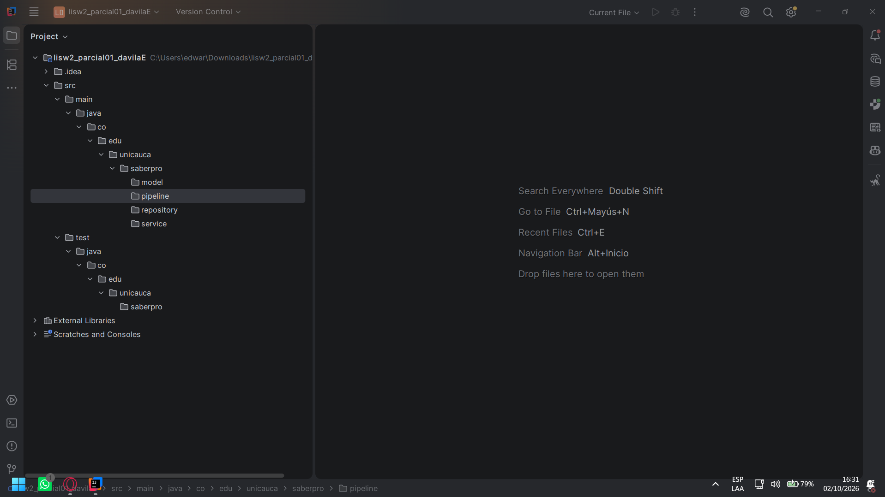
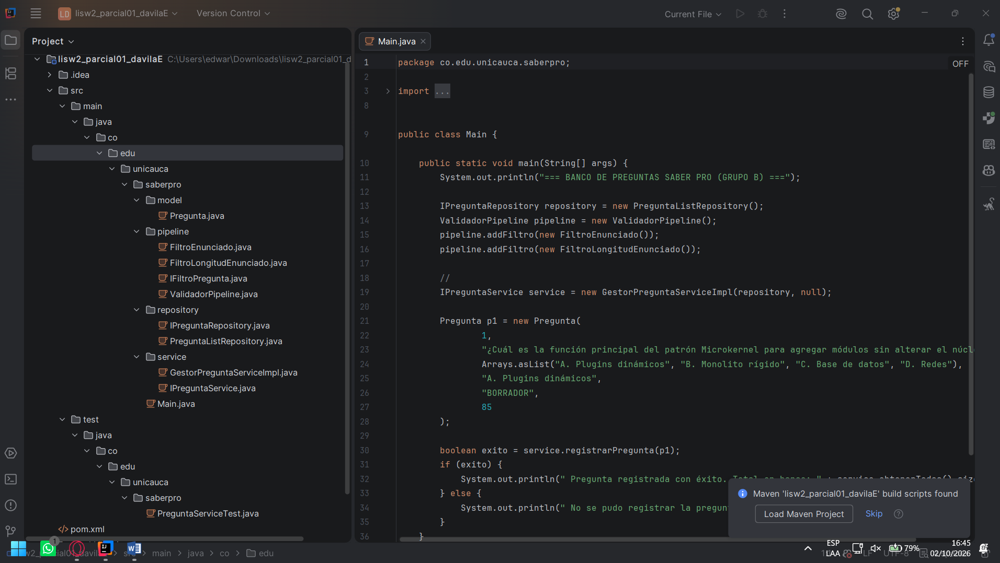
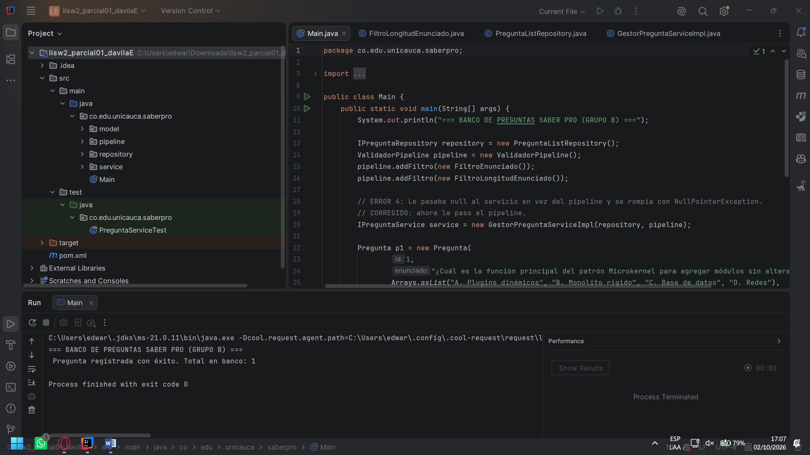
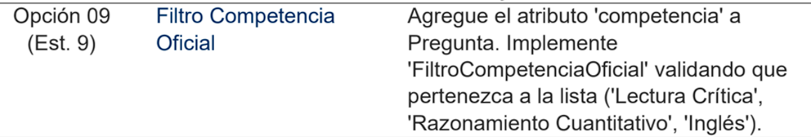
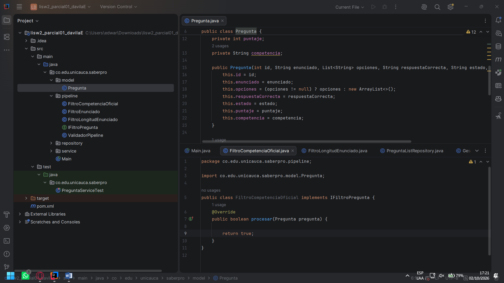
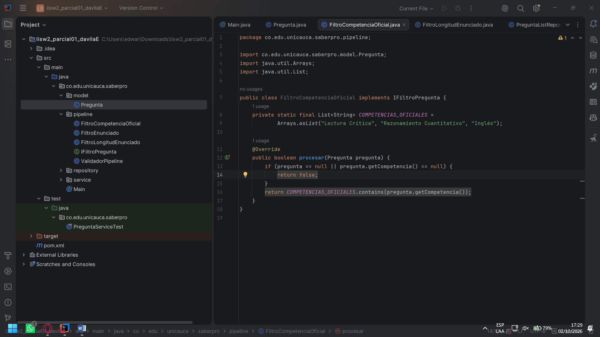
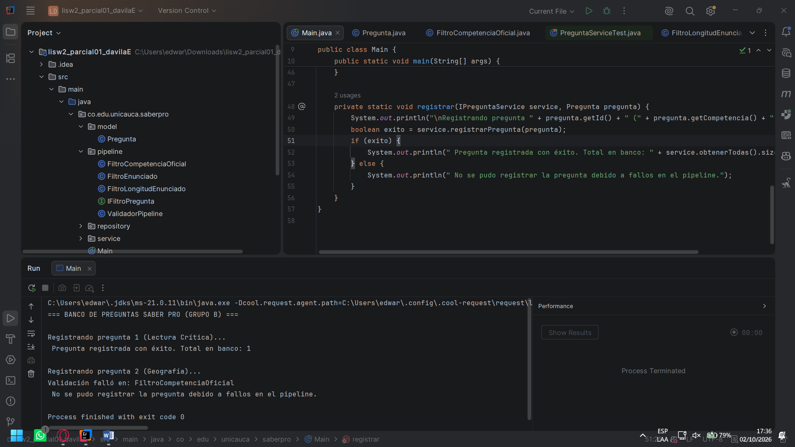
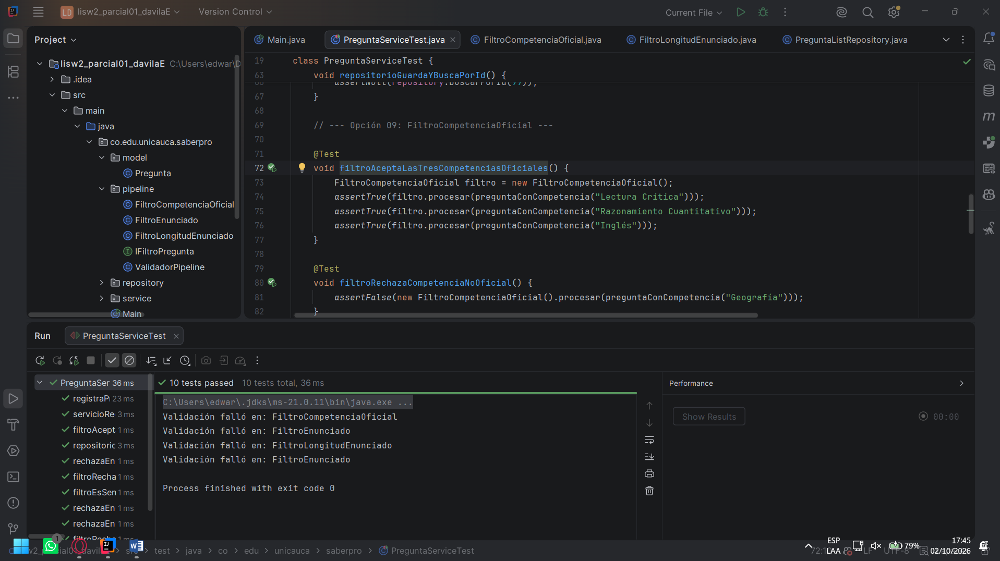

# Parcial 1: capturas del proceso

Capturas del desarrollo del parcial, con una nota de lo que se hizo en cada paso.

Cap 1: creacion del encarpetado B)

Cap 2: copiado de los codigos dados en la guia y creado de archivos pom y test (ambos vacios aun) :)

Cap 3: ya compila :D

Cap 4: se selecciono la opcion 9 para el punto 2 y se dejo el esqueleto listo para desarrollar el filtro nuevo :'p

Cap 5: lista la logica del filtro ;)

Cap 6: Compila :'D

Cap 7: las pruebas unitarias completas por fin :')(psdt: me demore un toque al comienzo con el punto 1 porque hice las unitarias de ese antes de empezar con el 2 jeje)

