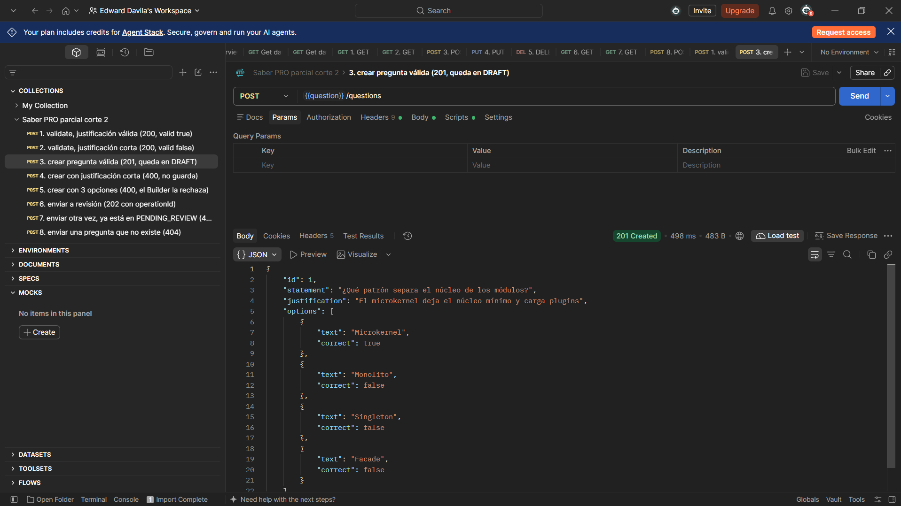
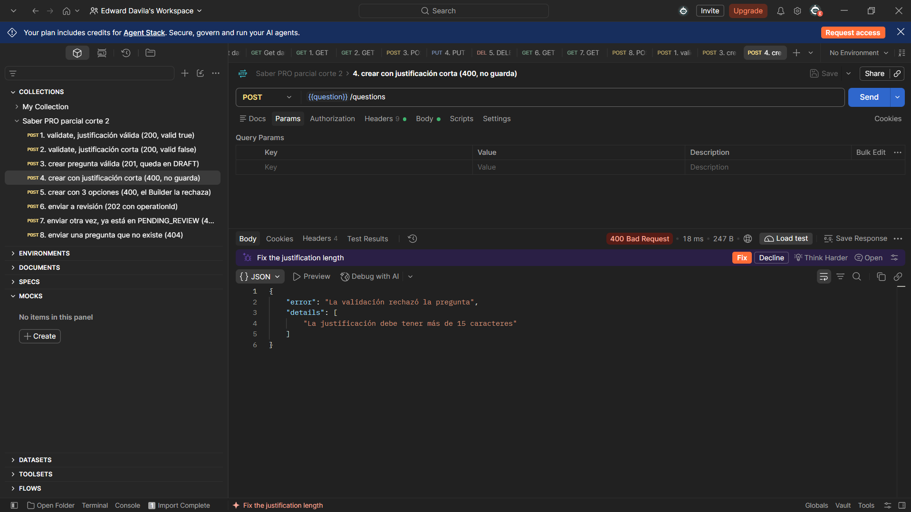
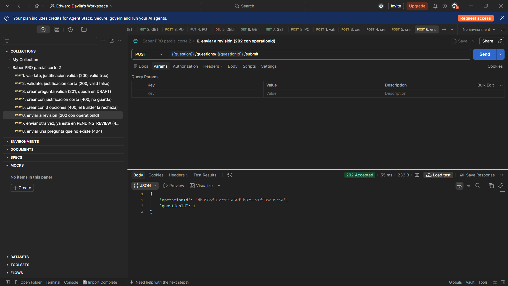
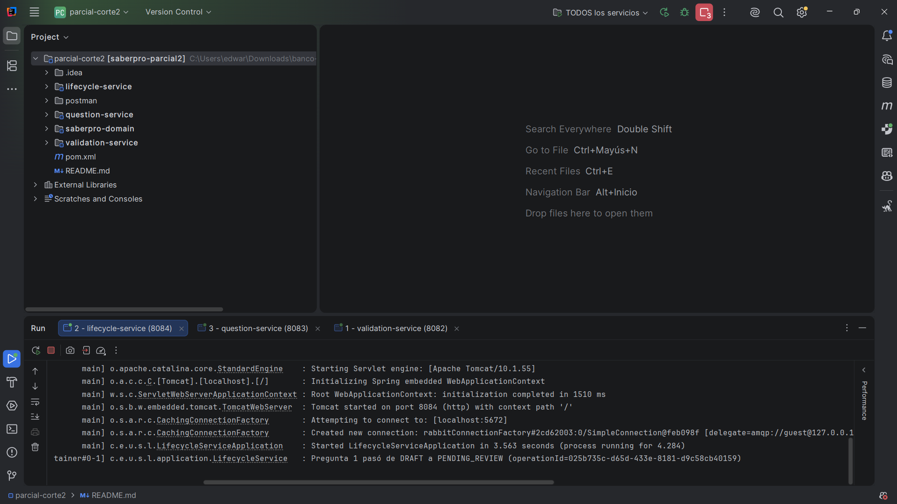
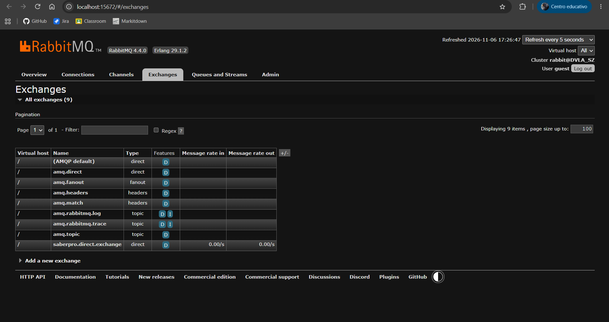
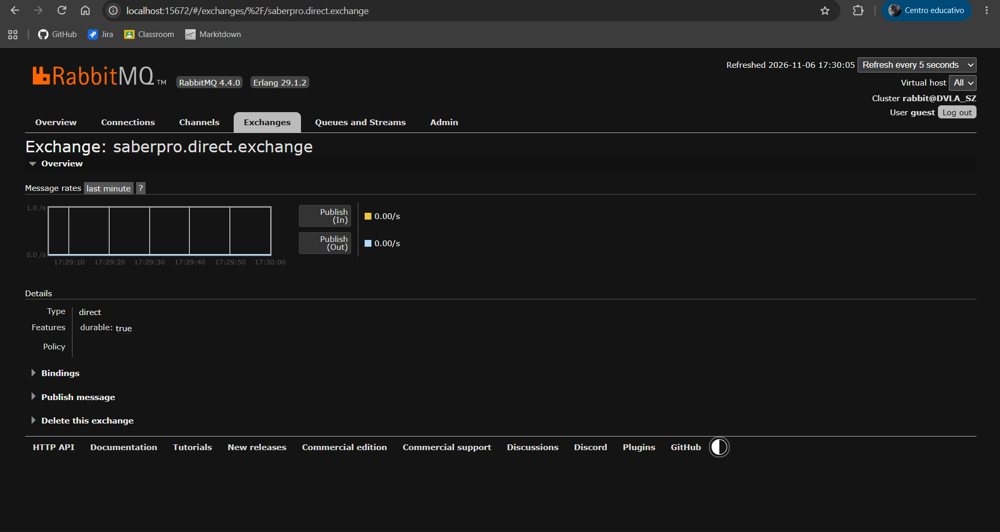
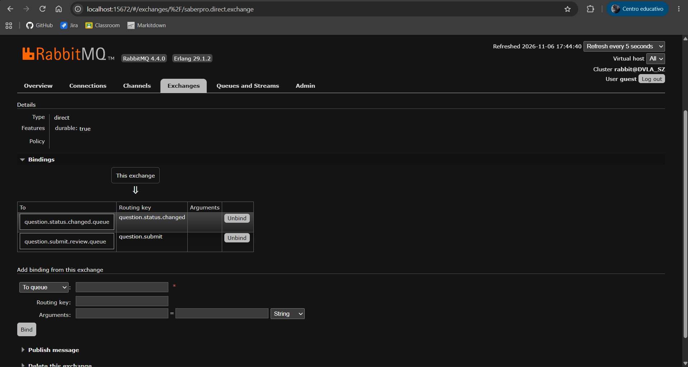
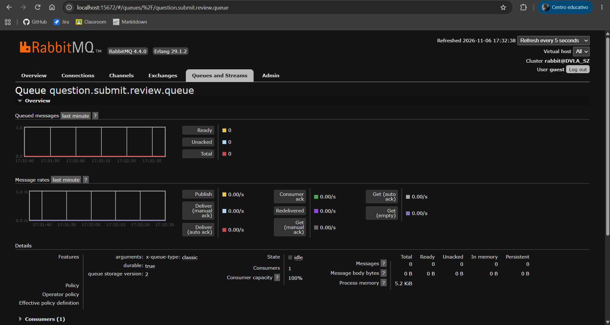
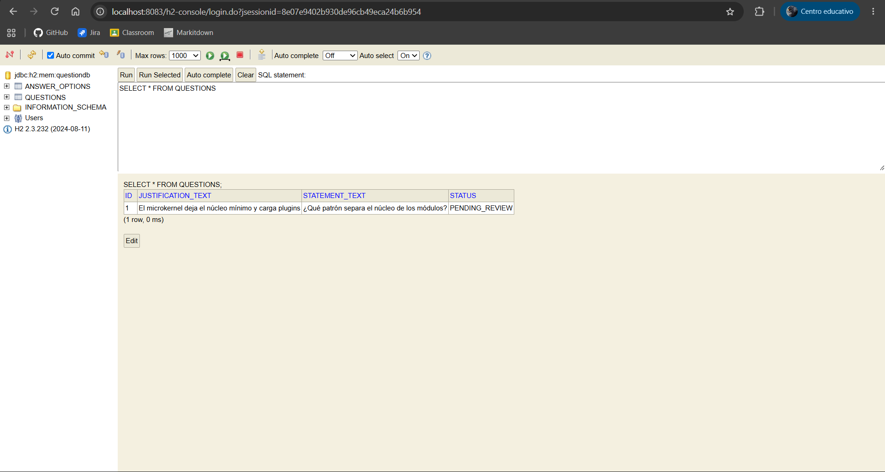

# Parcial 2: capturas del proceso

Capturas de la prueba del parcial, con una nota de lo que se ve en cada una. Todo se probó con Postman, la consola de RabbitMQ y la consola de H2,
con los tres servicios corriendo desde IntelliJ.

Cap 1: crear una pregunta válida. Lleva 4 opciones con una sola correcta y una justificación de más de 15 caracteres. `question-service` consulta
a `validation-service` por REST, guarda la pregunta y responde 201 Created con el estado `DRAFT`.

Cap 2: crear una pregunta con la justificación corta. `validation-service` la rechaza y `question-service` responde 400 Bad Request con el mensaje
"La justificación debe tener más de 15 caracteres". No se guarda nada.

Cap 3: crear una pregunta con solo 3 opciones. Pasa la validación de la justificación, pero el Builder no la deja armar y responde 400 con el mensaje
"La pregunta debe tener exactamente 4 opciones y tiene 3".

Cap 4: enviar la pregunta a revisión con `POST /questions/1/submit`. La respuesta es 202 Accepted y trae un `operationId`. `question-service` no
espera a que termine la transición: publica el comando y responde.

Cap 5: la pestaña de `lifecycle-service` en IntelliJ. Recibió el comando por `@RabbitListener` y dejó la línea "Pregunta 1 pasó de DRAFT a
PENDING_REVIEW", con el mismo `operationId` que devolvió Postman.

Cap 6: el exchange `saberpro.direct.exchange` en la consola de RabbitMQ. Primero la lista de exchanges, luego su detalle (tipo `direct` y
durable) y por último sus bindings: `question.submit.review.queue` con la routing key `question.submit`, y `question.status.changed.queue` con
`question.status.changed`.

Cap 7: la cola `question.submit.review.queue`. Tiene un consumidor, que es `lifecycle-service`, y no deja mensajes listos porque los recibe al
instante.

Cap 8: la consola de H2 con `SELECT * FROM QUESTIONS`. La pregunta 1 quedó con el estado `PENDING_REVIEW`: `lifecycle-service` hizo la transición
y avisó de vuelta a `question-service`, que la guardó.

