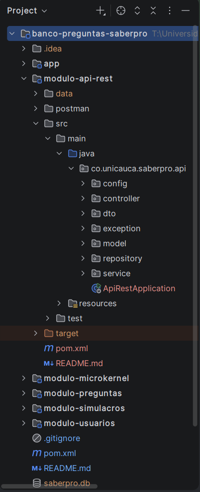
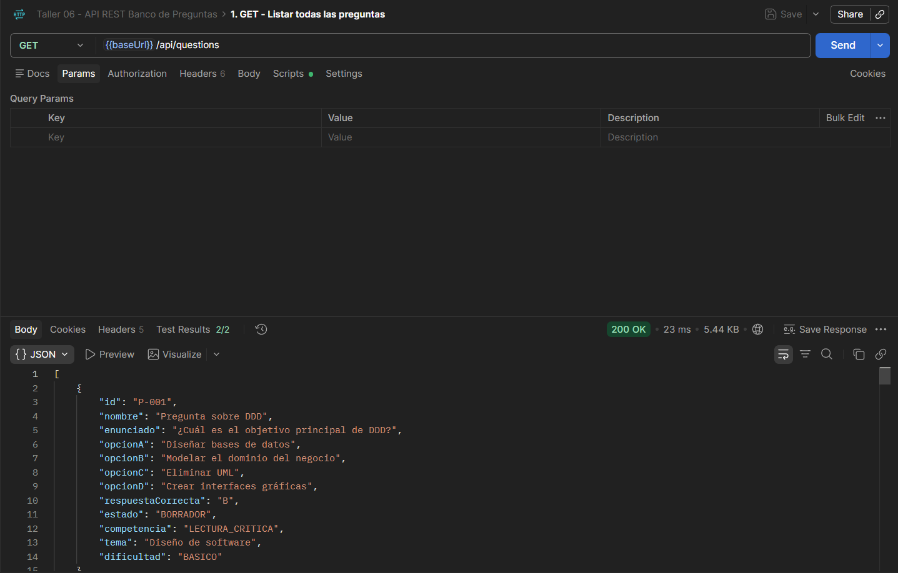
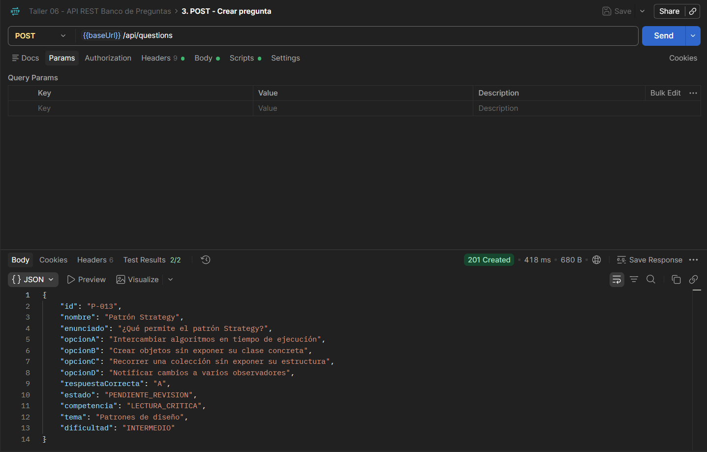
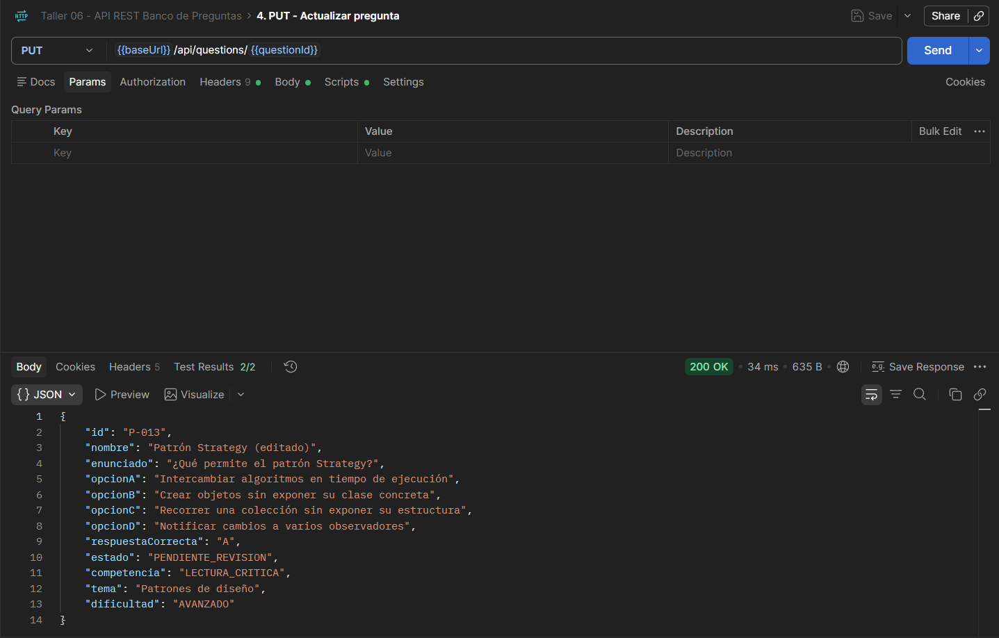
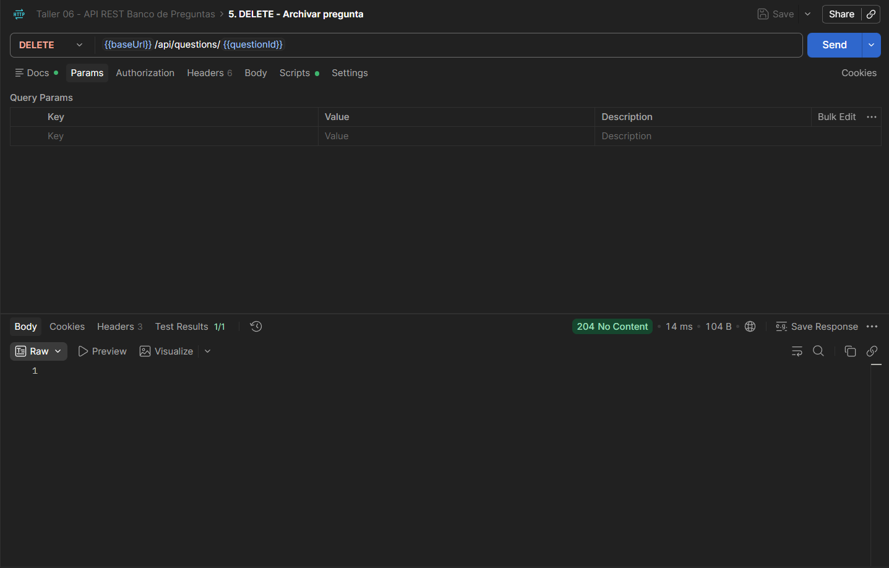
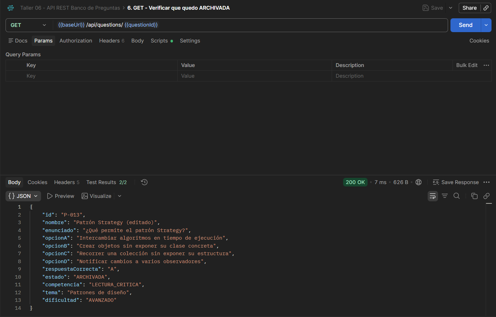
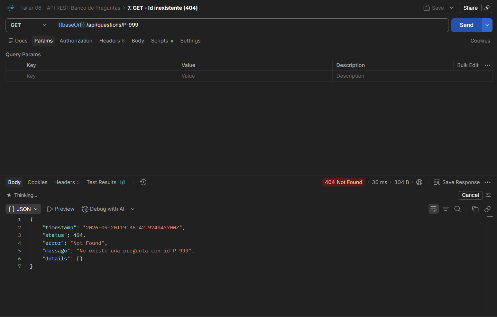
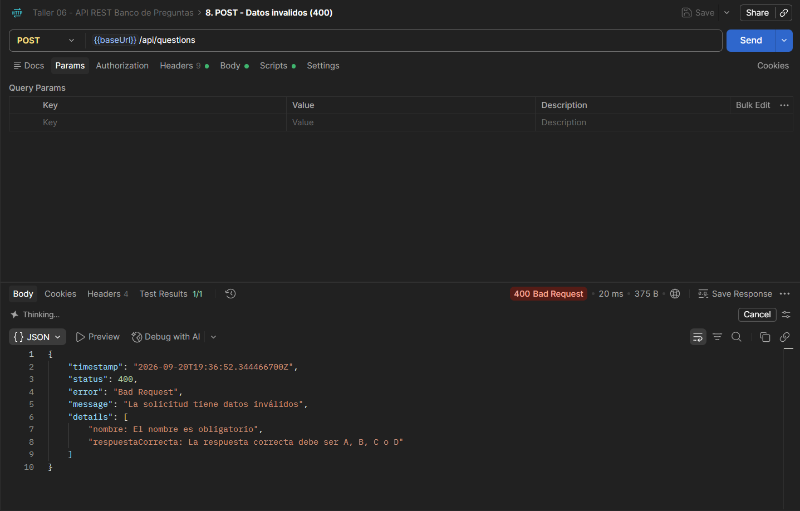

# Informe del Taller 6: API REST con Spring Boot

## 1. Objetivo

Construir la API REST de un microservicio con Spring Boot que implemente el CRUD de una entidad de negocio, con arquitectura en capas y acceso a datos con JPA, y comprobar el funcionamiento de los verbos HTTP GET, POST, PUT y DELETE.

## 2. Qué se construyó

Un microservicio REST sobre la entidad Question (pregunta) del proyecto de curso "Banco de Preguntas Saber Pro". No se usó una entidad de ejemplo aparte: la API reutiliza el dominio real del proyecto (modulo-preguntas), de modo que una pregunta creada por la API pasa por las mismas validaciones que una creada desde la aplicación de escritorio.

- Framework: Spring Boot 3.5.16, Java 17+ (compilado y probado con JDK 21).
- Persistencia: Spring Data JPA (Hibernate) sobre H2 en archivo. Cambiar a Postgres o MariaDB solo requiere modificar application.properties.
- Arquitectura: en capas controller, service, repository, model, con el acceso a datos detrás del puerto QuestionRepository del dominio.
- Módulo Maven: modulo-api-rest, dentro del monolito modular del proyecto. La aplicación de escritorio no depende de él.

## 3. Estructura del proyecto

```
modulo-api-rest/
├── pom.xml
├── postman/
│   └── Taller06-API-REST.postman_collection.json
└── src/
    ├── main/
    │   ├── java/co/unicauca/saberpro/api/
    │   │   ├── ApiRestApplication.java
    │   │   ├── controller/   QuestionController.java
    │   │   ├── service/      IQuestionApiService.java, QuestionApiServiceImpl.java
    │   │   ├── repository/   QuestionJpaRepository.java, QuestionJpaAdapter.java
    │   │   ├── model/        QuestionEntity.java, QuestionMapper.java
    │   │   ├── dto/          QuestionRequest.java, QuestionResponse.java
    │   │   ├── exception/    GlobalExceptionHandler.java, ApiError.java
    │   │   └── config/       QuestionServiceConfig.java, SampleDataSeeder.java
    │   └── resources/        application.properties
    └── test/                 (43 pruebas: controller, service, repository, model, integration)
```



Figura 1. Estructura del proyecto en el IDE (módulo modulo-api-rest).

Responsabilidad de cada capa:

| **Capa** | **Clases** | **Qué hace** |
|---|---|---|
| controller | QuestionController | Mapea rutas y verbos HTTP (@RestController, /api/questions) |
| service | IQuestionApiService, QuestionApiServiceImpl | Convierte el JSON al dominio y delega en QuestionService |
| repository | QuestionJpaRepository, QuestionJpaAdapter | Spring Data JPA y adaptador que implementa QuestionRepository |
| model | QuestionEntity, QuestionMapper | Entidad JPA y conversiones entre entidad, dominio y respuesta |
| dto | QuestionRequest, QuestionResponse | Cuerpos JSON (con validaciones de entrada) |
| exception | GlobalExceptionHandler | Traduce errores a respuestas HTTP uniformes |

## 4. Endpoints

Base: http://localhost:8080/api/questions

| **Verbo** | **Ruta** | **Descripción** | **Respuesta** |
|---|---|---|---|
| GET | /api/questions | Lista todas las preguntas | 200 |
| GET | /api/questions/{id} | Consulta una pregunta | 200 / 404 |
| POST | /api/questions | Crea una pregunta | 201 + Location / 400 |
| PUT | /api/questions/{id} | Actualiza el contenido | 200 / 400 / 404 |
| DELETE | /api/questions/{id} | Archiva la pregunta | 204 / 404 |

## 5. Cómo ejecutarlo

```
mvn -pl modulo-api-rest -am package
cd modulo-api-rest
java -jar target/banco-preguntas-api.jar        # http://localhost:8080
```

Al arrancar se cargan 12 preguntas de ejemplo (identificadores P-001 a P-012) para que el primer GET ya devuelva datos.

## 6. Pruebas de funcionamiento con Postman

Se importó la colección postman/Taller06-API-REST.postman_collection.json (8 peticiones, cada una con pruebas que validan el código HTTP) y se ejecutaron en orden sobre una base de datos recién sembrada.

### 6.1 GET: listar preguntas

GET http://localhost:8080/api/questions: 200 OK, arreglo con las 12 preguntas (P-001 ... P-012); las 2 pruebas de Postman pasan.



Figura 2. GET /api/questions: 200 OK con las 12 preguntas.

### 6.2 POST: crear una pregunta

POST http://localhost:8080/api/questions con cuerpo JSON:

```
{
  "nombre": "Patrón Strategy",
  "enunciado": "¿Qué permite el patrón Strategy?",
  "opcionA": "Intercambiar algoritmos en tiempo de ejecución",
  "opcionB": "Crear objetos sin exponer su clase concreta",
  "opcionC": "Recorrer una colección sin exponer su estructura",
  "opcionD": "Notificar cambios a varios observadores",
  "respuestaCorrecta": "A",
  "competencia": "LECTURA_CRITICA",
  "tema": "Patrones de diseño",
  "dificultad": "INTERMEDIO"
}
```

Resultado: 201 Created, con cabecera Location hacia /api/questions/P-013, "id": "P-013" y "estado": "PENDIENTE_REVISION".



Figura 3. POST /api/questions: 201 Created, pregunta P-013.

### 6.3 PUT: actualizar la pregunta creada

PUT http://localhost:8080/api/questions/P-013 con el mismo cuerpo, cambiando "nombre" a "Patrón Strategy (editado)" y "dificultad" a AVANZADO. Resultado: 200 OK con los datos actualizados; el estado sigue siendo PENDIENTE_REVISION (PUT solo cambia el contenido, no el estado).



Figura 4. PUT /api/questions/P-013: 200 OK con los datos actualizados.

### 6.4 DELETE: archivar la pregunta

DELETE http://localhost:8080/api/questions/P-013: 204 No Content. La pregunta no se borra: pasa al estado ARCHIVADA, porque el requisito RNF-16 del proyecto prohíbe eliminar físicamente una pregunta.



Figura 5. DELETE /api/questions/P-013: 204 No Content.

Se comprueba con un GET posterior a /P-013, que responde 200 con "estado": "ARCHIVADA":



Figura 6. GET /api/questions/P-013 después del DELETE: estado ARCHIVADA.

### 6.5 Casos de error

Un id inexistente responde 404 Not Found, y un cuerpo con datos inválidos responde 400 Bad Request con el detalle de cada campo:



Figura 7. GET /api/questions/P-999: 404 Not Found.



Figura 8. POST con nombre vacío y respuesta "Z": 400 Bad Request con el detalle por campo.

### 6.6 Persistencia

Al detener y volver a iniciar el servicio, las 13 preguntas siguen ahí (P-013 archivada) y la siguiente pregunta creada recibe el id P-014: los datos están en la base de datos H2 (archivo data/banco-preguntas-api.mv.db) y no en memoria.

## 7. Pruebas automatizadas

43 pruebas (JUnit 5, Mockito y Spring Boot Test), todas exitosas:

| **Clase** | **Pruebas** | **Qué cubre** |
|---|---|---|
| QuestionMapperTest | 3 | Conversión dominio ↔ entidad ↔ respuesta |
| QuestionJpaAdapterTest | 10 | Adaptador JPA contra H2: crear, leer, actualizar, orden y generación de ids |
| QuestionApiServiceImplTest | 8 | Traducción de JSON a dominio y DELETE = archivar |
| QuestionControllerTest | 13 | Códigos HTTP, Location, validación y errores (MockMvc) |
| QuestionApiIntegrationTest | 7 | Flujo completo: API, dominio, JPA, H2 |
| SampleDataSeederTest | 2 | Carga inicial de 12 preguntas e idempotencia |

Con el resto del proyecto, mvn clean package ejecuta 150 pruebas (107 del monolito y las 43 nuevas) sin fallos.

## 8. Cumplimiento de lo solicitado

El taller tiene dos documentos (enunciado y guía paso a paso) con algunas diferencias; la implementación cumple ambos:

| **Requisito** | **Enunciado** | **Guía paso a paso** | **Cómo se cumplió** |
|---|---|---|---|
| API REST con Spring Boot | Sí | Sí | Spring Boot 3.5.16, proyecto Maven |
| CRUD de una entidad de negocio | Sí | Sí (Product) | Entidad Question real del proyecto |
| Arquitectura en capas | Sí | model / repository / service / controller | Mismos paquetes, más dto, exception y config |
| Acceso a datos con JPA | Sí | (en memoria) | JPA/Hibernate sobre H2; el dominio no depende de JPA |
| Servicio con interfaz e implementación |, | IProductService + ProductServiceImpl | IQuestionApiService + QuestionApiServiceImpl |
| Verbos GET/POST/PUT/DELETE en /api/... | Sí | /api/products | /api/questions |
| Informe PDF: estructura, Postman (4 verbos) y enlace al repositorio | Sí | Sí | Secciones 3, 6 y portada |
| Trabajo en pareja | Sí (máx. 2) | (individual) | Pareja, según lo indicado por el docente |

Sobre la estructura: el árbol de carpetas que muestra la guía corresponde al del Taller 5 (microkernel); se tomó como referencia la estructura de capas de su código (model, repository, service, controller).

## 9. Decisiones de diseño

- Entidad JPA separada del dominio. Question no tiene anotaciones de persistencia; QuestionEntity (solo en este módulo) las lleva y un adaptador convierte entre ambas. Así el dominio queda libre de JPA y Spring (separación entre lógica de negocio y persistencia, RNF-12).
- DELETE archiva. Cumple RNF-16 (ninguna pregunta se elimina físicamente).
- El servidor decide el id y el estado. El cliente no envía id ni estado.
- Errores uniformes. Un GlobalExceptionHandler devuelve siempre el mismo formato (timestamp, status, error, message, details) con 400, 404 o 500.
- Límites conocidos: sin autenticación (corresponde al Corte 3) y sin paginación ni filtros en el listado.

## 10. Repositorio

https://github.com/DVLASZ/banco-preguntas-saberpro, módulo modulo-api-rest (código, pruebas, README y colección de Postman).

