# Taller Patrones de Diseño

**Taller 8**

Taller N°8 presentado en el curso de Laboratorio de Ingeniería de Software 2

**Estudiantes:** Edward Esteban Dávila Salazar y Laura Isabel Sánchez Fernández

**Programa:** Ingeniería de Sistemas

**Profesor:** Paola Andrea Bedoya Toro

**Universidad del Cauca**, Facultad de Ingeniería Electrónica y Telecomunicaciones, Departamento de Sistemas

Popayán, octubre de 2026

## Lista de tablas

| N.º | Nombre |
|---|---|
| Tabla 1 | Patrones aplicados en el taller |
| Tabla 2 | Lo que se reutilizó del proyecto de curso y lo que se desarrolló nuevo |
| Tabla 3 | Reglas que comprueba el método `build()` del Builder |
| Tabla 4 | Campos de las cadenas que entrega el servicio externo |
| Tabla 5 | Operaciones de la fachada y subsistemas que oculta |
| Tabla 6 | Estados del ciclo de vida de una pregunta |
| Tabla 7 | Evaluadores de respuestas |
| Tabla 8 | Decoradores de preguntas |
| Tabla 9 | Pruebas unitarias por clase de prueba |
| Tabla 10 | Enlaces del trabajo |

## Lista de figuras

| N.º | Nombre |
|---|---|
| Figura 1 | Estructura de paquetes del proyecto |
| Figura 2 | Diagrama de clases del modelo del dominio |
| Figura 3 | Diagrama de clases del patrón Builder |
| Figura 4 | Código del método `build()` de `QuestionBuilder` |
| Figura 5 | Código del método `buildMultipleChoice` de `QuestionDirector` |
| Figura 6 | Diagrama de clases del patrón Adapter |
| Figura 7 | Código del método `convert` de `ExternalQuestionAdapter` |
| Figura 8 | Diagrama de clases del patrón Facade |
| Figura 9 | Diagrama de secuencia de la importación de preguntas externas |
| Figura 10 | Código de las operaciones `createQuestion` e `importExternalQuestions` de la fachada |
| Figura 11 | Diagrama de estados del ciclo de vida de una pregunta |
| Figura 12 | Diagrama de clases del patrón State |
| Figura 13 | Código de la interfaz `IQuestionState` |
| Figura 14 | Código de los estados `DraftState` y `ReviewState` |
| Figura 15 | Diagrama de clases del patrón Template Method |
| Figura 16 | Código de la clase `QuestionEvaluator` y su método plantilla |
| Figura 17 | Código de la clase `MultipleChoiceEvaluator` |
| Figura 18 | Diagrama de clases del patrón Decorator |
| Figura 19 | Código de la clase `HighDifficultyQuestion` |
| Figura 20 | Ejemplo de composición de decoradores |
| Figura 21 | Salida de `ApplicationMain` en la consola |
| Figura 22 | Resultado de las pruebas unitarias en IntelliJ IDEA |

## 1. Introducción

El banco de preguntas Saber Pro, nuestro proyecto de curso, tiene que crecer en varias direcciones a la vez: aceptar
distintos tipos de pregunta, controlar el ciclo de vida de cada una (desde que se redacta hasta que se aprueba),
evaluar las respuestas de los estudiantes y recibir preguntas que vienen de otras plataformas. Si cada una de esas
necesidades se resuelve con condicionales y código copiado, el sistema se vuelve rígido y frágil muy rápido.

Este taller aplica seis patrones del catálogo GoF para evitarlo: **Builder**, **Adapter** y **Facade** (Parte 1,
trabajada en clase) y **State**, **Template Method** y **Decorator** (Parte 2, trabajo autónomo). Todo se prueba con
JUnit 5. El trabajo continúa lo que veníamos haciendo en el Parcial 1, que la docente cuenta como Taller 7; por eso el
proyecto se llama `lisw2_taller07_08_grupo2`.

### 1.1 Objetivo general

Aplicar patrones de diseño creacionales, estructurales y de comportamiento sobre un modelo de pregunta del banco Saber
Pro, y comprobar con pruebas automatizadas que funcionan como se espera.

### 1.2 Objetivos específicos

- Construir preguntas completas y válidas paso a paso con el patrón Builder.
- Importar preguntas de un servicio externo con el patrón Adapter y ofrecer un acceso simple al banco con el patrón
  Facade.
- Modelar el ciclo de vida de la pregunta con el patrón State, sin usar condicionales.
- Evaluar respuestas de distintos tipos de pregunta con un algoritmo común mediante el patrón Template Method.
- Añadir características a una pregunta en tiempo de ejecución con el patrón Decorator.
- Certificar el comportamiento con pruebas unitarias en JUnit 5.

### 1.3 Patrones aplicados

**Tabla 1.** Patrones aplicados en el taller.

| Patrón | Tipo | Parte | Paquete | Qué resuelve |
|---|---|---|---|---|
| Builder | Creacional | 1 (clase) | `builder` | Armar una pregunta con muchas partes sin dejarla incompleta |
| Adapter | Estructural | 1 (clase) | `adapter` | Usar preguntas que llegan en un formato ajeno |
| Facade | Estructural | 1 (clase) | `facade` | Ofrecer a la interfaz un acceso simple al banco |
| State | Comportamiento | 2 (autónoma) | `state` | Controlar el ciclo de vida sin `if/else` |
| Template Method | Comportamiento | 2 (autónoma) | `templatemethod` | Reutilizar el algoritmo de evaluación entre tipos de pregunta |
| Decorator | Estructural | 2 (autónoma) | `decorator` | Añadir características a una pregunta sin crear subclases |

## 2. Punto de partida: qué reutilizamos y qué hicimos

El taller no parte de cero: el proyecto de curso ya tiene un módulo de preguntas con varias ideas que aquí se
retoman. Sin embargo, no copiamos código; la guía pide un proyecto independiente, con su propio modelo y una estructura
de paquetes definida, así que reescribimos lo reutilizado de forma más simple y con la forma de cada patrón.
La **Tabla 2** resume qué viene de dónde.

**Tabla 2.** Lo que se reutilizó del proyecto de curso y lo que se desarrolló nuevo.

| Elemento | De dónde viene | Qué hicimos en el taller |
|---|---|---|
| Estructura de una pregunta (contexto, enunciado, 4 opciones, justificación y clasificación) | Clases `Question` y `ContenidoPregunta` del módulo de preguntas del monolito | Un modelo inmutable más pequeño: `Question`, `Context`, `Option` y `Classification` |
| Builder | `Question.Builder`, clase interna del monolito | Se rediseñó como patrón completo: interfaz `IQuestionBuilder`, builder concreto que valida todo junto y `QuestionDirector` |
| Competencias y dificultades | `Competencia` y `Dificultad` del monolito | Enumeraciones `Competence` y `Difficulty` con las mismas categorías |
| Reglas de calidad de la pregunta | Reglas del paquete `validation` (`PreguntaDirectaUnicaRule`, `CuatroOpcionesRule`, `RespuestaCorrectaUnicaRule`) | `QuestionValidator` conserva dos reglas (una sola pregunta en el enunciado y opciones no repetidas); las de 4 opciones y 1 correcta pasaron al Builder |
| Ciclo de vida | `EstadoPregunta`, un enumerado con un `switch` para las transiciones | Se reemplazó por el patrón State: una clase por estado y ningún condicional; implementamos los cuatro estados que pide la guía |
| Adapter, Facade, Template Method y Decorator | No existían en el proyecto | Desarrollo nuevo |
| Servicio externo, repositorio en memoria y servicio de aplicación | No existían con esta forma | Desarrollo nuevo, pensado para ser lo más simple posible |

El código original se puede consultar en el módulo de preguntas del monolito (ver **Tabla 10**).

## 3. Estructura del proyecto y modelo

El proyecto es un Maven independiente (Java 17) con la estructura de paquetes que pide la guía. Además de los
paquetes de cada patrón, hay un paquete `domain` con el modelo y los subsistemas (repositorio, servicio y validador)
que la fachada se encarga de ocultar. La **Figura 1** muestra el árbol completo.

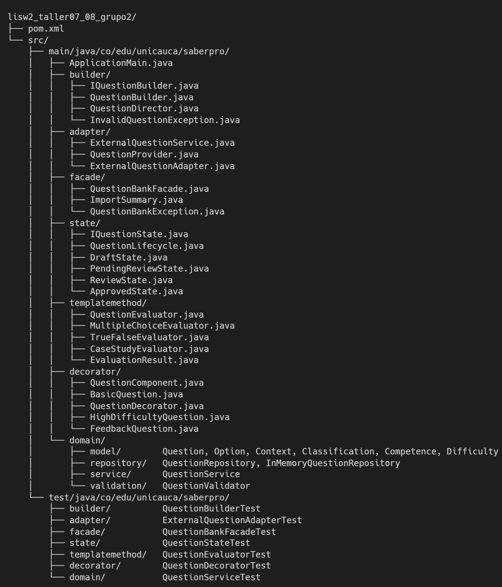

**Figura 1.** Estructura de paquetes del proyecto.

`Competence` agrupa las cinco competencias de Saber Pro (lectura crítica, razonamiento cuantitativo, competencias ciudadanas, comunicación escrita e inglés) y `Difficulty` los tres niveles de dificultad (básico, intermedio y avanzado), como en el banco del proyecto de curso.

El modelo es pequeño a propósito. Una `Question` es inmutable: se crea una sola vez, con sus partes obligatorias, y
no cambia. Por eso tiene sentido construirla con un Builder.

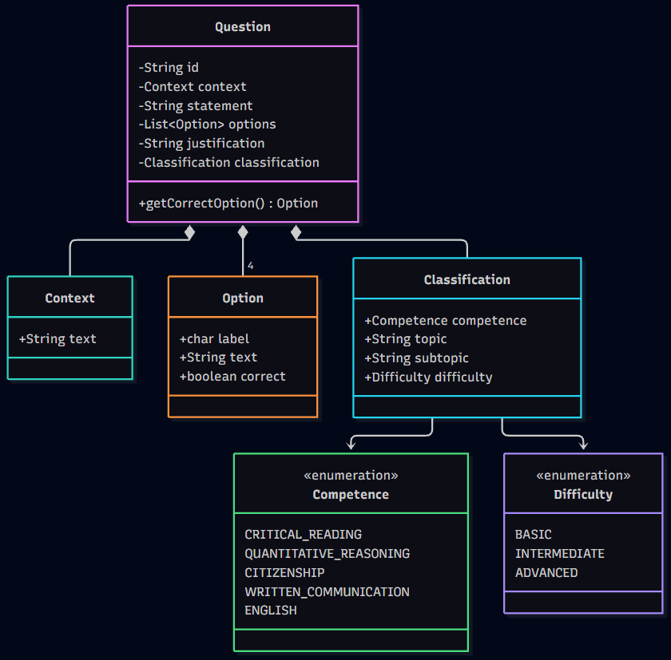

**Figura 2.** Diagrama de clases del modelo del dominio.

## 4. Parte 1: núcleo de creación y acceso al banco

### 4.1 Builder (creacional)

**Problema.** Una pregunta tiene contexto, enunciado, cuatro opciones, justificación y clasificación. Un constructor con
tantos parámetros es difícil de leer y permite crear preguntas incompletas o con las opciones mal marcadas.

**Solución.** `IQuestionBuilder` define los pasos y `QuestionBuilder` los va acumulando; los pasos se pueden dar en
cualquier orden y cada uno devuelve el mismo builder, así que se encadenan. Al llamar a `build()` se revisa todo junto
(**Tabla 3**) y, si algo falla, se lanza una `InvalidQuestionException` con la **lista completa** de problemas, no solo
el primero. Después de construir, el builder queda vacío para reutilizarlo. `QuestionDirector` conoce el orden estándar
de los pasos y arma preguntas completas con cualquier builder.

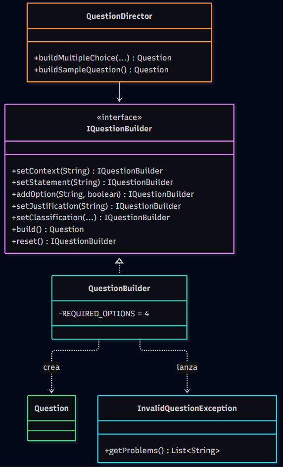

**Figura 3.** Diagrama de clases del patrón Builder.

**Tabla 3.** Reglas que comprueba el método `build()` del Builder.

| Regla | Mensaje cuando falla |
|---|---|
| Debe haber contexto | falta el contexto |
| Debe haber enunciado | falta el enunciado |
| Exactamente 4 opciones | debe tener exactamente 4 opciones y tiene N |
| Ninguna opción vacía | ninguna opción puede estar vacía |
| Exactamente 1 respuesta correcta | debe tener exactamente 1 respuesta correcta y tiene N |
| Debe haber justificación | falta la justificación |
| Clasificación completa | falta la clasificación (competencia, tema, subtema y dificultad) |

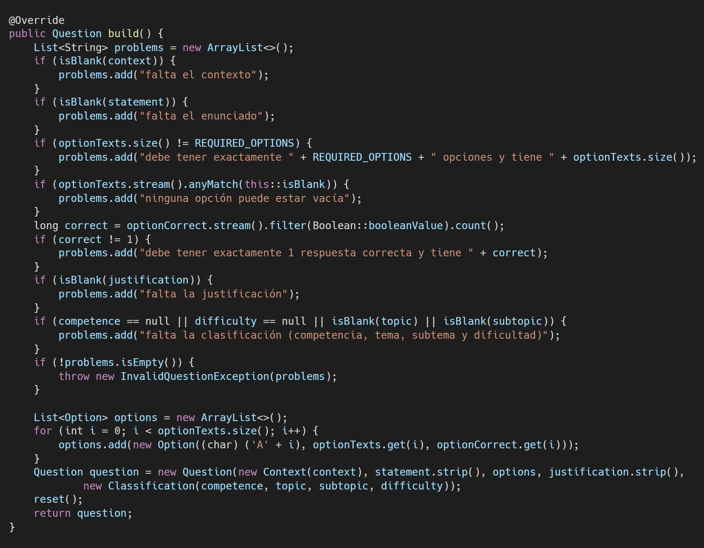

**Figura 4.** Código del método `build()` de `QuestionBuilder`.

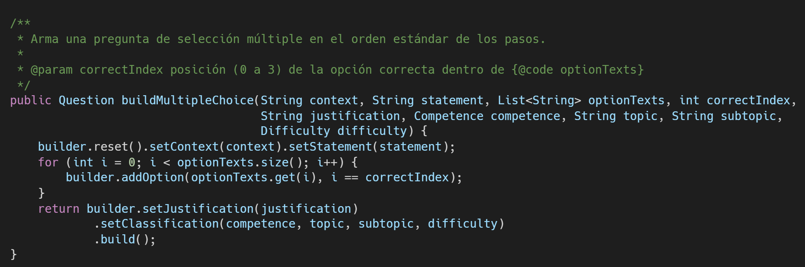

**Figura 5.** Código del método `buildMultipleChoice` de `QuestionDirector`.

**Pruebas.** `QuestionBuilderTest` (18 pruebas) cubre la construcción completa, las letras A a D, la opción correcta, los
pasos en cualquier orden, el rechazo de 3 y de 5 opciones, de 0 y de 2 respuestas correctas, las partes faltantes, la
lista completa de problemas, el reinicio tras construir, la inmutabilidad de las opciones y el comportamiento del
director.

### 4.2 Adapter (estructural)

**Problema.** Otra plataforma entrega sus preguntas como cadenas de texto con un formato propio, que el banco no
entiende y que no podemos cambiar.

**Solución.** El banco solo conoce la interfaz `QuestionProvider`. `ExternalQuestionAdapter` la implementa envolviendo
a `ExternalQuestionService`, que simula la otra plataforma. El adaptador convierte cada cadena usando el
`QuestionBuilder`, de modo que las reglas del banco también se aplican a lo que llega de afuera. Lo que no se puede
convertir se descarta, queda registrado con su motivo en `getRejected()` y no detiene la importación de las demás.

Decidimos simular el servicio con cadenas crudas de nueve campos separados por `|` (**Tabla 4**), sin dependencias
externas. El servicio de ejemplo trae tres preguntas: dos correctas y una con solo tres opciones, para mostrar cómo se
descarta.

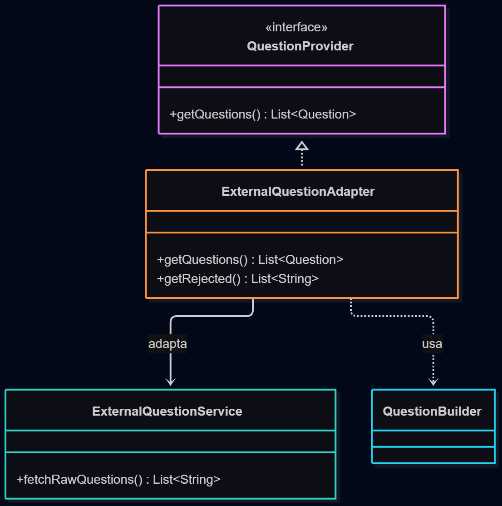

**Figura 6.** Diagrama de clases del patrón Adapter.

**Tabla 4.** Campos de las cadenas que entrega el servicio externo.

| N.º | Campo | Formato |
|---|---|---|
| 1 | Contexto | Texto |
| 2 | Enunciado | Texto |
| 3 | Opciones | Cuatro textos separados por `;` |
| 4 | Letra de la respuesta correcta | `A` a `D` |
| 5 | Justificación | Texto |
| 6 | Competencia | Nombre de la enumeración, por ejemplo `CRITICAL_READING` |
| 7 | Tema | Texto |
| 8 | Subtema | Texto |
| 9 | Dificultad | Nombre de la enumeración, por ejemplo `BASIC` |

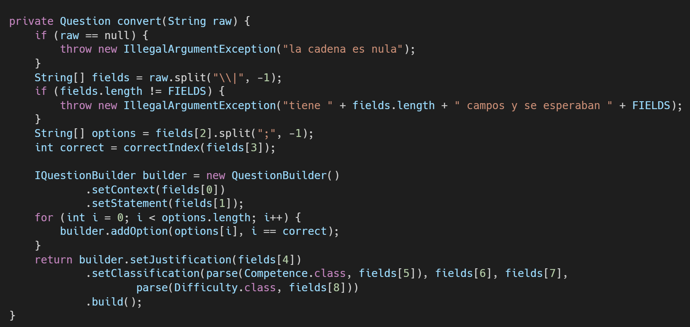

**Figura 7.** Código del método `convert` de `ExternalQuestionAdapter`.

**Pruebas.** `ExternalQuestionAdapterTest` (13 pruebas) cubre la conversión de todos los campos, la tolerancia a
mayúsculas, el servicio de ejemplo (2 importadas y 1 descartada), los campos incorrectos, la letra inválida o fuera de
rango, la competencia o la dificultad desconocida, la opción vacía, la continuidad tras un error, el reinicio de los
descartes y el servicio vacío.

### 4.3 Facade (estructural)

**Problema.** Para crear o importar una pregunta, la interfaz tendría que conocer el Builder, el Director, el
validador, el repositorio, el servicio y el Adapter, y llamarlos en el orden correcto. Cualquier cambio interno la
rompería.

**Solución.** `QuestionBankFacade` es el único punto de contacto con el banco y ofrece cuatro operaciones (**Tabla 5**).
Arma sus subsistemas por dentro con el constructor por defecto y permite inyectarlos con un segundo constructor, que
usamos en las pruebas. Todos los errores salen como `QuestionBankException`, de modo que quien la use no necesita
conocer las excepciones internas, y la importación devuelve un `ImportSummary` con las preguntas registradas y el motivo
de cada descarte. En la Parte 1, `ApplicationMain` solo habla con la fachada.

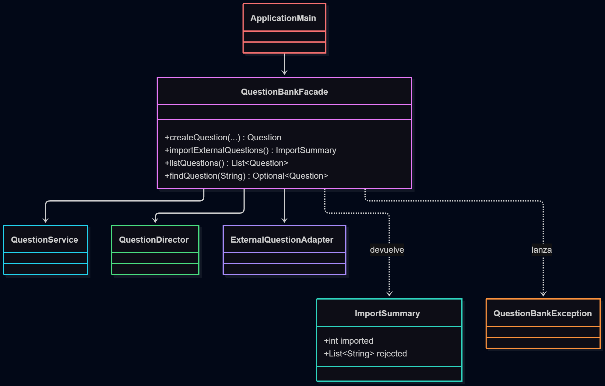

**Figura 8.** Diagrama de clases del patrón Facade.

**Tabla 5.** Operaciones de la fachada y subsistemas que oculta.

| Operación | Qué hace | Subsistemas que usa |
|---|---|---|
| `createQuestion(...)` | Arma la pregunta y la registra validándola | Director, Builder, validador, repositorio |
| `importExternalQuestions()` | Importa del servicio externo y devuelve un resumen | Adapter, Builder, validador, repositorio |
| `listQuestions()` | Lista las preguntas del banco | Servicio, repositorio |
| `findQuestion(id)` | Busca una pregunta por su identificador | Servicio, repositorio |

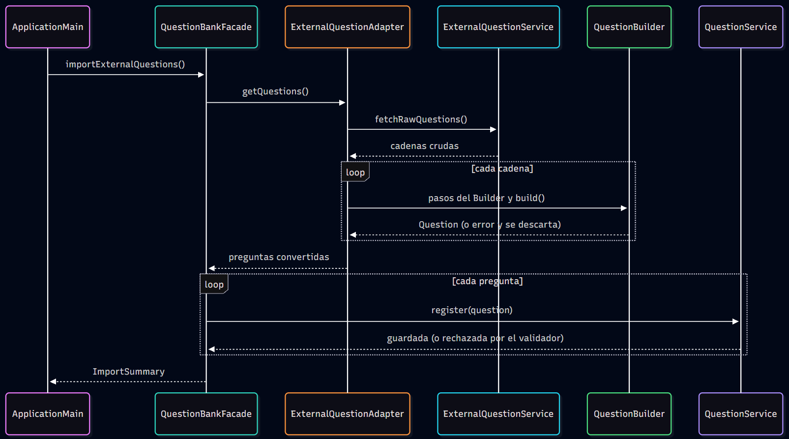

**Figura 9.** Diagrama de secuencia de la importación de preguntas externas.

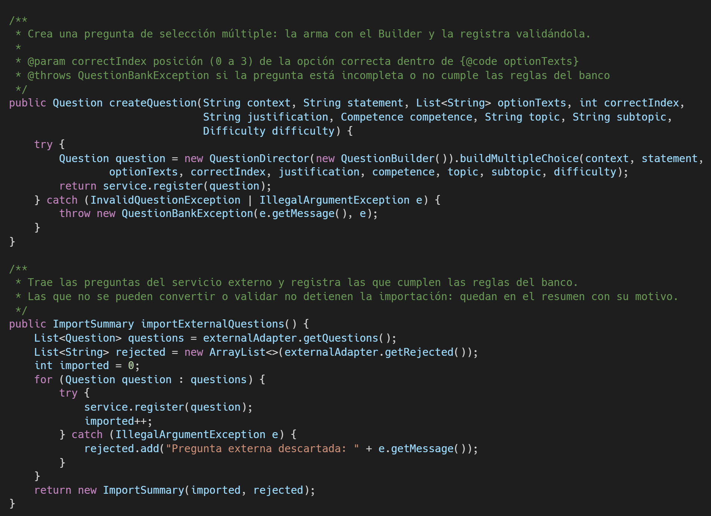

**Figura 10.** Código de las operaciones `createQuestion` e `importExternalQuestions` de la fachada.

**Pruebas.** `QuestionBankFacadeTest` (10 pruebas) cubre crear y consultar, el rechazo por opciones incorrectas y por
enunciado sin signo de interrogación, el banco vacío, la importación del servicio de ejemplo, la suma de lo importado a
lo creado a mano, el descarte por el validador, el servicio vacío, el identificador inexistente y la inmutabilidad del
resumen.

## 5. Parte 2: ciclo de vida, evaluación y decoración

### 5.1 State (comportamiento)

**Problema.** Una pregunta pasa por un ciclo de vida (Borrador, Pendiente de revisión, En revisión y Aprobada) y en
cada estado solo unas operaciones son válidas: el autor edita solo en Borrador, un revisor aprueba solo en revisión,
etc. Resolverlo con `if/else` o `switch` sobre un campo de estado repite las mismas condiciones en cada operación y
obliga a tocar todas al agregar un estado. Es justo lo que hacía el enumerado `EstadoPregunta` del proyecto original.

**Solución.** `QuestionLifecycle`, el contexto, guarda la pregunta y su estado actual, y delega cada operación al
estado. `IQuestionState` declara las operaciones (`edit`, `submitForReview`, `startReview`, `approve` y
`requestChanges`) como **prohibidas por defecto**: lanzan una `IllegalStateException`. Cada estado concreto
sobrescribe solo las que permite y decide a qué estado pasa (**Tabla 6** y **Figura 11**). Así no hay ningún
condicional sobre el estado. La guía describe cuatro estados aunque su árbol de archivos omite `PendingReviewState`;
implementamos los cuatro, como confirmó la docente.

**Tabla 6.** Estados del ciclo de vida de una pregunta.

| Estado | Qué permite | Pasa a | ¿Publicable? |
|---|---|---|---|
| `DraftState` (Borrador) | Editar y enviar a revisión | Pendiente de revisión | No |
| `PendingReviewState` (Pendiente de revisión) | Iniciar la revisión; el autor queda bloqueado | En revisión | No |
| `ReviewState` (En revisión) | Aprobar o solicitar correcciones | Aprobada, o Borrador | No |
| `ApprovedState` (Aprobada) | Nada; es un estado final | (ninguno) | Sí |

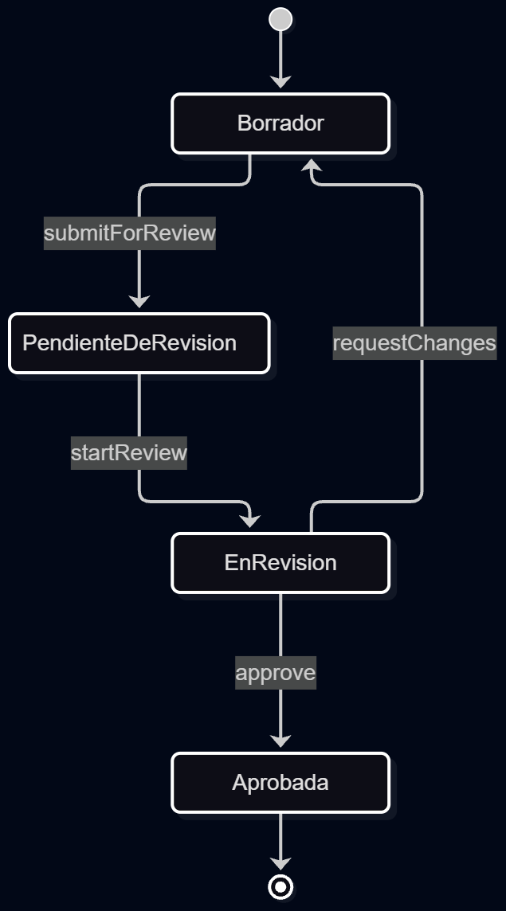

**Figura 11.** Diagrama de estados del ciclo de vida de una pregunta.

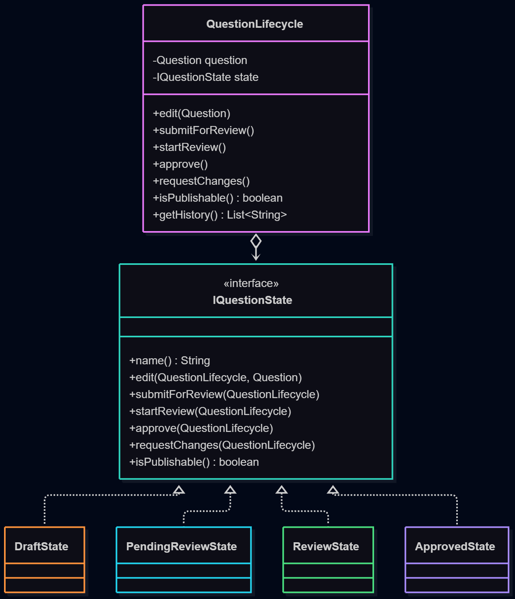

**Figura 12.** Diagrama de clases del patrón State.

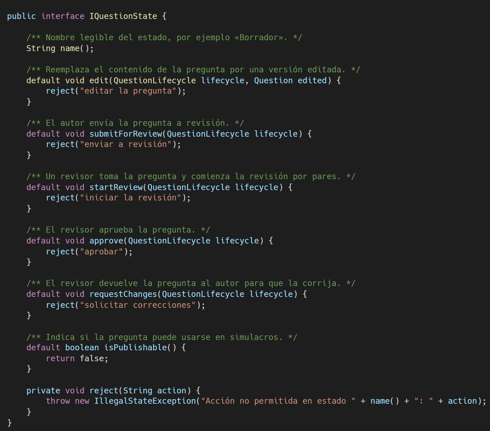

**Figura 13.** Código de la interfaz `IQuestionState`.

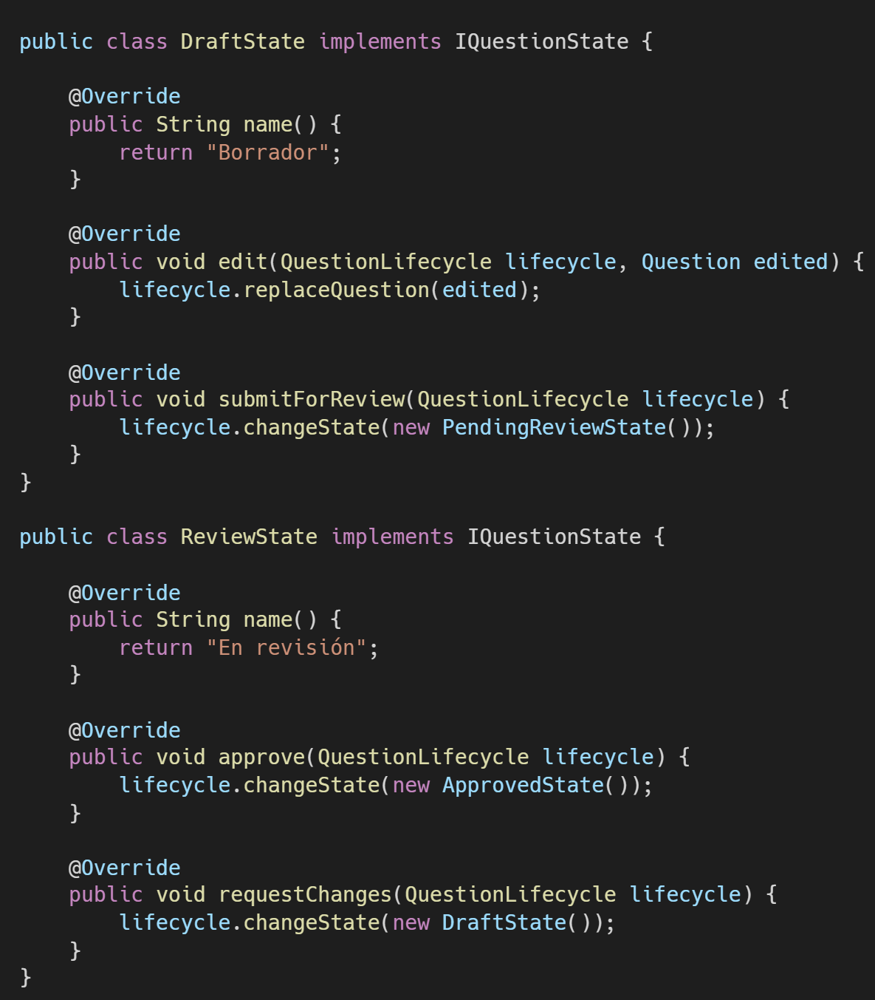

**Figura 14.** Código de los estados `DraftState` y `ReviewState`.

**Pruebas.** `QuestionStateTest` (14 pruebas) cubre el estado inicial, la edición en Borrador, las operaciones
prohibidas en cada estado con su mensaje, las transiciones válidas, la devolución por correcciones y el reenvío, el
estado final, el historial de estados y que una operación rechazada no cambia nada.

### 5.2 Template Method (comportamiento)

**Problema.** Evaluar una respuesta sigue siempre los mismos cuatro pasos (recibir la respuesta, validar el formato,
calcular el puntaje y generar la retroalimentación), pero el formato y el cálculo cambian según el tipo de pregunta.
Copiar el algoritmo en cada tipo duplica código y permite que el orden de los pasos se desordene.

**Solución.** `QuestionEvaluator` define `evaluate(String)` como método plantilla `final`: llama en orden a
`receiveAnswer` (con una implementación por defecto), `validateFormat`, `calculateScore` y `generateFeedback` (los tres
últimos abstractos). Si el formato es inválido, la plantilla se detiene y devuelve un `EvaluationResult` inválido sin
calcular el puntaje. El puntaje va de 0.0 a 1.0. Las tres subclases se describen en la **Tabla 7**.

Las preguntas de verdadero/falso y de caso de estudio no pasan por el Builder, que construye preguntas de selección
múltiple (4 opciones y 1 correcta). Por eso sus evaluadores reciben sus propios datos (la respuesta esperada y su
explicación, o la rúbrica). Consultamos esta decisión con la docente y la aprobó.

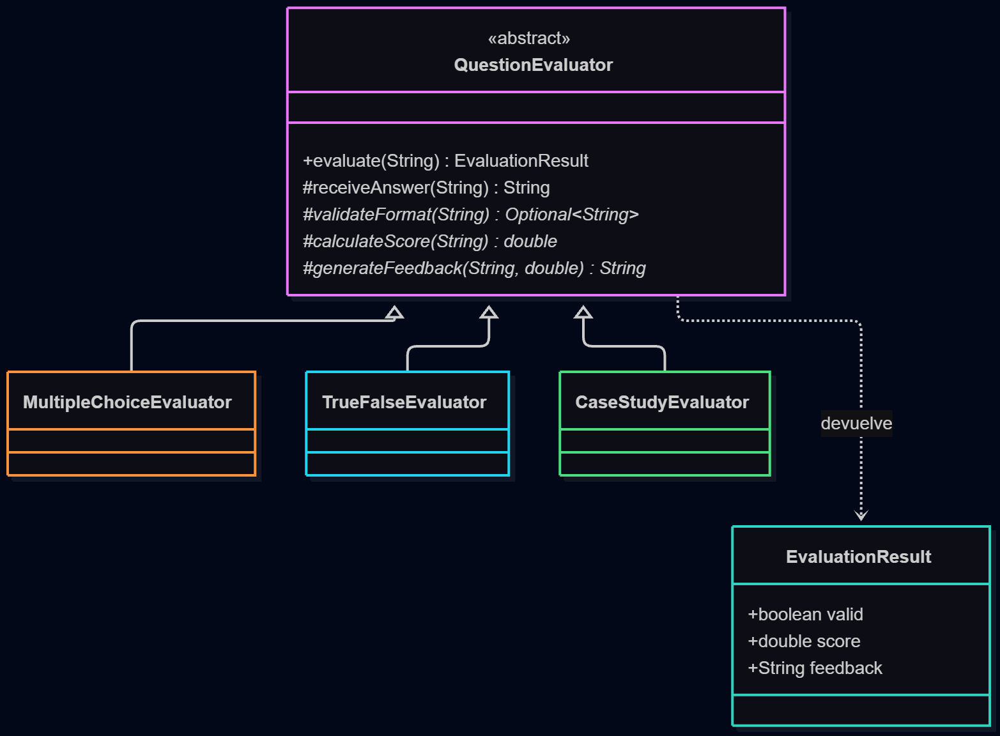

**Figura 15.** Diagrama de clases del patrón Template Method.

**Tabla 7.** Evaluadores de respuestas.

| Evaluador | Respuesta esperada | Formato inválido cuando | Puntaje |
|---|---|---|---|
| `MultipleChoiceEvaluator` | Letra de una opción (A a D), sin importar mayúsculas | No es una letra de las opciones | 1.0 si es la correcta, 0.0 si no |
| `TrueFalseEvaluator` | V/F, verdadero/falso o true/false | No es ninguna de esas palabras | 1.0 si coincide con lo esperado, 0.0 si no |
| `CaseStudyEvaluator` | Texto libre de 30 caracteres o más | Es más corto que el mínimo | Fracción de los criterios de la rúbrica que el texto menciona |

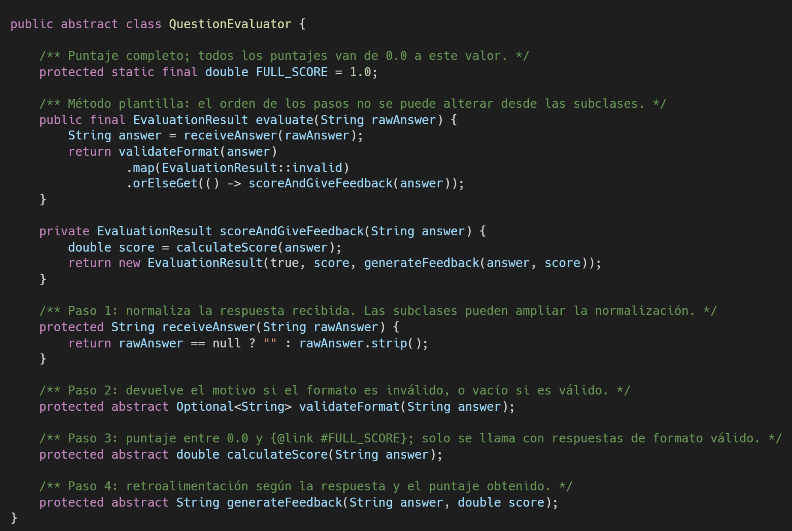

**Figura 16.** Código de la clase `QuestionEvaluator` y su método plantilla.

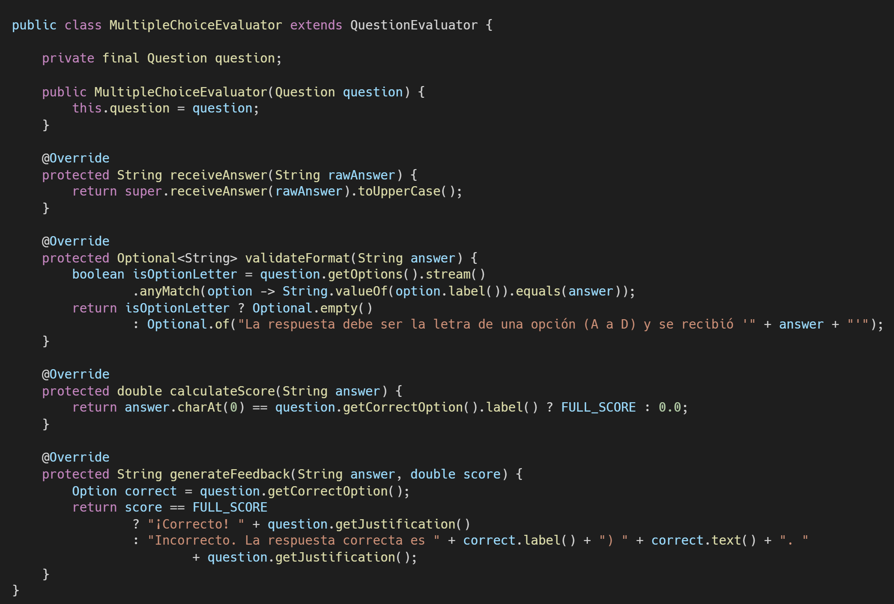

**Figura 17.** Código de la clase `MultipleChoiceEvaluator`.

**Pruebas.** `QuestionEvaluatorTest` (19 pruebas) comprueba el orden de los pasos con un evaluador espía, el corte por
formato inválido y la respuesta nula; y, para cada subclase, el caso correcto, el incorrecto, la normalización de la
respuesta y el formato inválido, además de la fracción de criterios y la rúbrica vacía en el caso de estudio.

### 5.3 Decorator (estructural)

**Problema.** Hay características opcionales que se combinan a voluntad: que una pregunta sea de alta dificultad y valga
más, o que traiga una explicación técnica detallada. Crear una subclase por cada combinación haría explotar el número
de clases, y modificar `Question` mezclaría responsabilidades.

**Solución.** `QuestionComponent` es la interfaz común (`getQuestion`, `getMaxScore`, `describe` y `getExplanation`).
`BasicQuestion` envuelve una `Question` sin cambiarla y le asigna el puntaje base de 1.0. `QuestionDecorator` envuelve
otro componente y le delega todo; los decoradores concretos (**Tabla 8**) sobrescriben solo lo que modifican y se
pueden apilar en cualquier orden (**Figura 20**).

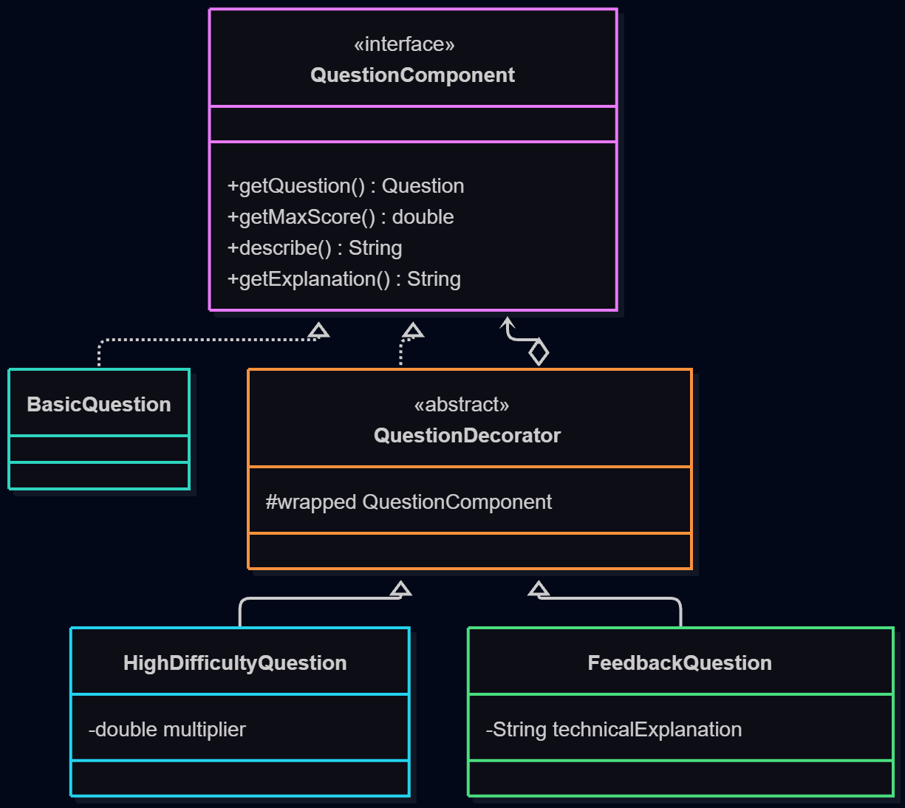

**Figura 18.** Diagrama de clases del patrón Decorator.

**Tabla 8.** Decoradores de preguntas.

| Decorador | Qué añade | Efecto |
|---|---|---|
| `HighDifficultyQuestion` | Marca de alta dificultad y multiplicador (1.5 por defecto) | Multiplica el puntaje máximo; el multiplicador debe ser mayor que 0 |
| `FeedbackQuestion` | Explicación técnica detallada | Añade la explicación a la justificación original; no puede estar vacía |

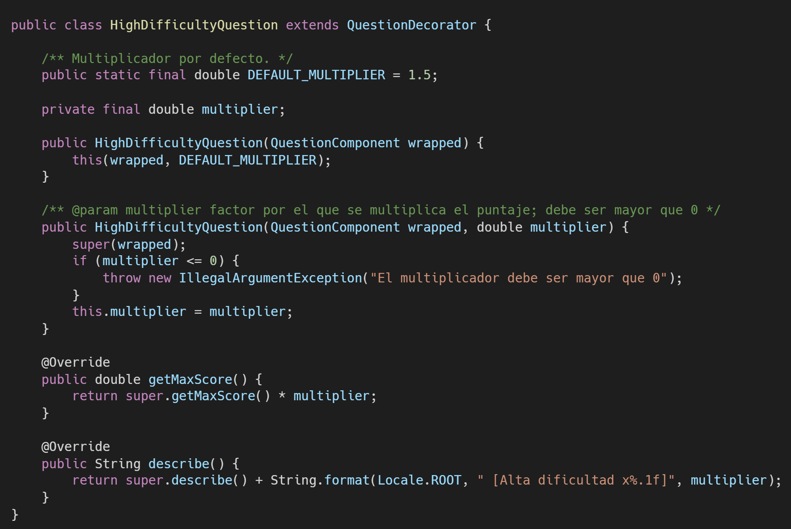

**Figura 19.** Código de la clase `HighDifficultyQuestion`.

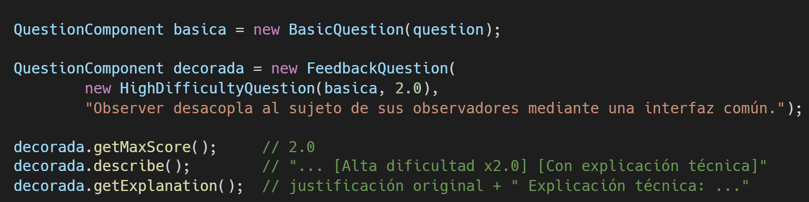

**Figura 20.** Ejemplo de composición de decoradores.

**Pruebas.** `QuestionDecoratorTest` (14 pruebas) cubre la pregunta básica, el multiplicador por defecto, el propio y el
inválido, la explicación técnica y su validación, los decoradores sin componente, el apilado en cualquier orden, los
multiplicadores apilados y que decorar no modifica la pregunta original.

## 6. Ejecución y pruebas

**Ejecución.** Se necesita Java 17 o superior y Maven. Desde la carpeta `lisw2_taller07_08_grupo2`:

```bash
mvn test       # ejecuta las pruebas
mvn compile
java -Dfile.encoding=UTF-8 -cp target/classes co.edu.unicauca.saberpro.ApplicationMain
```

`ApplicationMain` es la demostración: crea una pregunta y rechaza una inválida a través de la fachada, importa del
servicio externo (2 registradas y 1 descartada con su motivo), recorre el ciclo de vida de una pregunta, evalúa
respuestas de los tres tipos y muestra una pregunta decorada. Su salida se ve en la **Figura 21**.

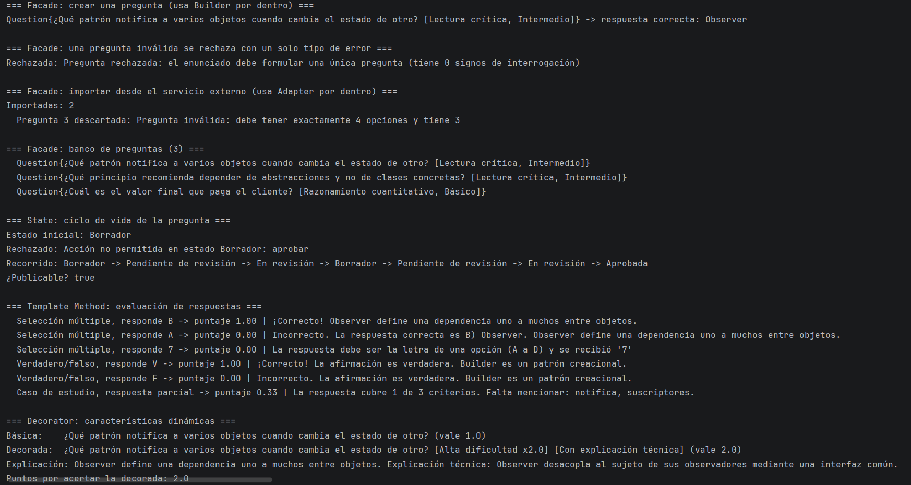

**Figura 21.** Salida de `ApplicationMain` en la consola.

**Pruebas.** El proyecto tiene 98 pruebas unitarias en JUnit 5, una clase de prueba por patrón más la de los
subsistemas del banco, y todas pasan (**Tabla 9** y **Figura 22**).

**Tabla 9.** Pruebas unitarias por clase de prueba.

| Clase de prueba | Pruebas | Qué cubre |
|---|---|---|
| `QuestionBuilderTest` | 18 | Builder y Director |
| `ExternalQuestionAdapterTest` | 13 | Adapter |
| `QuestionServiceTest` | 10 | Validador, repositorio y servicio |
| `QuestionBankFacadeTest` | 10 | Facade |
| `QuestionStateTest` | 14 | State |
| `QuestionEvaluatorTest` | 19 | Template Method |
| `QuestionDecoratorTest` | 14 | Decorator |
| **Total** | **98** | |

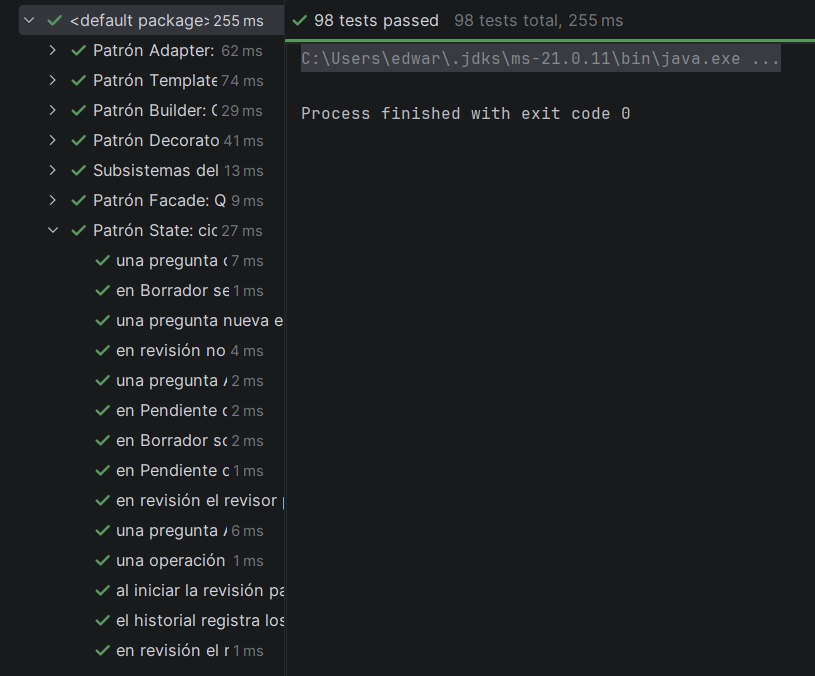

**Figura 22.** Resultado de las pruebas unitarias en IntelliJ IDEA.

## 7. Decisiones de diseño

- **Verdadero/falso y caso de estudio:** el Builder solo construye preguntas de selección múltiple; sus evaluadores
  reciben sus propios datos. Decisión consultada con la docente.
- **Estados:** se implementan los cuatro del enunciado, incluido `PendingReviewState`. Decisión confirmada con la
  docente.
- **Servicio externo:** simulado con cadenas de texto, sin dependencias. Decisión confirmada con la docente.
- **Fachada básica:** crear, importar, listar y buscar preguntas, con un solo tipo de error.
- **Numeración:** la docente cuenta el Parcial 1 como Taller 7, así que este taller se mantiene como Taller 8 y el
  proyecto conserva el nombre `lisw2_taller07_08_grupo2`.
- **Pruebas en todas las clases:** cada patrón tiene su clase de prueba, con los casos válidos, los inválidos y los
  límites.

## 8. Conclusiones

- El **Builder** concentró las reglas de construcción en un solo lugar, y el Adapter y la Fachada lo reutilizan, de
  modo que ninguna pregunta inválida llega al banco por ningún camino.
- El **Adapter** nos permitió incorporar preguntas de una plataforma externa sin modificar el banco ni el servicio
  ajeno.
- La **Facade** redujo lo que la interfaz necesita conocer a cuatro operaciones y un solo tipo de error.
- El **State** eliminó los condicionales sobre el estado: agregar un estado es agregar una clase, sin tocar las demás.
- El **Template Method** evitó duplicar el algoritmo de evaluación: cada tipo de pregunta solo aporta lo que cambia.
- El **Decorator** permitió combinar características (dificultad, explicación) sin crear una subclase por combinación.
- Las 98 pruebas JUnit 5 cubren todas las clases del proyecto, incluidos los casos inválidos y los límites.
- **Limitaciones:** el banco guarda todo en memoria, el servicio externo es simulado y el ciclo de vida todavía no está
  conectado a la fachada ni al repositorio. Son extensiones naturales que no requieren cambiar los patrones.

## 9. Enlaces

**Tabla 10.** Enlaces del trabajo.

| Recurso | Enlace |
|---|---|
| Repositorio del laboratorio | https://github.com/DVLASZ/ingenieria-software-2 |
| Carpeta del Taller 8 | https://github.com/DVLASZ/ingenieria-software-2/tree/main/talleres/Taller-08-PatronesDiseno |
| Proyecto Maven `lisw2_taller07_08_grupo2` | https://github.com/DVLASZ/ingenieria-software-2/tree/main/talleres/Taller-08-PatronesDiseno/lisw2_taller07_08_grupo2 |
| Repositorio del proyecto de curso (banco de preguntas Saber Pro) | https://github.com/DVLASZ/banco-preguntas-saberpro |
| Módulo de preguntas del monolito (origen de lo reutilizado) | https://github.com/DVLASZ/banco-preguntas-saberpro/tree/main/monolito/modulos/modulo-preguntas |

