# Comunicación síncrona y asíncrona de microservicios

## 1. Introducción

El banco de preguntas Saber Pro, nuestro proyecto de curso, pasa de un monolito a una arquitectura de microservicios.
Dividir el sistema en servicios independientes trae ventajas (cada contexto evoluciona y escala por separado), pero
obliga a decidir cómo se comunican. Una llamada REST es simple y da respuesta inmediata, pero acopla a quien llama con
la disponibilidad de quien responde. Un mensaje en RabbitMQ desacopla a los servicios en el tiempo, pero la respuesta
deja de ser inmediata y hay que diseñar con cuidado qué pasa cuando algo falla.

Este taller implementa ambos mecanismos sobre el ciclo de vida de una pregunta: autenticación, creación y validación
(REST), envío a revisión, transición de estado y asignación de revisores (REST y mensajería), y notificaciones (solo
mensajería). El resultado son nueve microservicios Spring Boot que se comunican entre sí, una colección de Postman
con los casos de éxito y de error, y las evidencias de ejecución que se presentan en este informe.

### 1.1 Objetivo general

Diseñar, implementar y probar mecanismos de comunicación síncrona (REST) y asíncrona (RabbitMQ) entre microservicios
con Spring Boot y Postman, aplicados al banco de preguntas Saber Pro, para comprender sus implicaciones en el
acoplamiento, la interoperabilidad, la resiliencia y la escalabilidad.

### 1.2 Objetivos específicos

- Definir los contextos delimitados del sistema y asignar a cada microservicio una responsabilidad única.
- Implementar la comunicación síncrona con Spring Web: endpoints REST y llamadas entre servicios.
- Implementar la comunicación asíncrona con Spring AMQP: publicar con `RabbitTemplate` y consumir con
  `@RabbitListener`.
- Garantizar que `lifecycle-service` sea el único responsable de modificar el estado de una pregunta.
- Manejar los fallos sin informar falsamente de éxito: transiciones inválidas, validaciones que fallan y RabbitMQ
  caído.
- Probar todos los flujos, normales y fallidos, con una colección de Postman y pruebas automáticas.

### 1.3 Alcance

El taller pide seis microservicios (usuarios, preguntas, validación, ciclo de vida, revisión y notificaciones) y el
escenario de creación, validación y envío a revisión. El grupo entrega **nueve**: a los seis les suma `history-service`,
`simulation-service` y `tracking-service`, que corresponden a los contextos de trazabilidad, simulacros y seguimiento
académico que el docente definió para el proyecto. El taller es la versión reducida del proyecto: usa los mismos
estados, las mismas reglas de revisión y el mismo mecanismo de rechazo, pero sin Keycloak, Eureka, API Gateway,
Outbox ni cola de mensajes fallidos, que pertenecen al proyecto.

El token de acceso es simple: el login lo devuelve y `question-service` exige el encabezado `Authorization` sin
validarlo, como se acordó con la profesora (los tokens JWT se implementan en el tercer corte).

### 1.4 Organización del documento

El capítulo 2 resume los conceptos necesarios. El capítulo 3 presenta el diseño: contextos, estados, mensajes y
estructura. El capítulo 4 explica la implementación con fragmentos de código. El capítulo 5 muestra cómo se validan
los estados, los errores y la resiliencia. El capítulo 6 reúne las pruebas y las evidencias de ejecución, y el capítulo
7 relaciona el trabajo con la rúbrica. El capítulo 8 cierra con las conclusiones y el capítulo 9 con los enlaces.

## 2. Marco conceptual

### 2.1 Microservicios y contextos delimitados

Un microservicio es un programa pequeño, con su propio código, su propia base de datos y su propio ciclo de
despliegue, que resuelve una parte acotada del negocio. Esa parte se llama **contexto delimitado** (*bounded
context*): un área del dominio con su propio vocabulario y sus propias reglas. Delimitar bien los contextos evita que
un cambio en un servicio obligue a modificar a los demás.

En este taller cada servicio tiene su propia base de datos H2 en memoria y sus propios objetos de transferencia de
datos (DTO); no comparten código. La duplicación es intencional: protege la autonomía de los servicios.

### 2.2 Comunicación síncrona con REST

En la comunicación síncrona el cliente envía una petición HTTP y espera la respuesta. Es la forma natural de pedir un
dato o de ejecutar una acción cuyo resultado se necesita ya: autenticar a un usuario, validar una pregunta, consultar
un estado. Sus ventajas son la simplicidad y la respuesta inmediata; sus costos son el acoplamiento temporal (si el
servicio llamado está caído, la operación falla) y la latencia acumulada de las llamadas en cadena.

### 2.3 Comunicación asíncrona con RabbitMQ

En la comunicación asíncrona quien envía publica un mensaje y sigue con su trabajo; el destinatario lo procesa cuando
puede. RabbitMQ es el intermediario (*broker*) que guarda los mensajes hasta que alguien los consume.

#### 2.3.1 Exchanges, colas y bindings

El productor no escribe directamente en una cola: publica en un **exchange** con una **routing key**. El exchange
reparte el mensaje a las **colas** que tengan un **binding** compatible con esa clave. Un exchange de tipo *direct*
entrega a las colas cuya clave coincide exactamente; uno de tipo *topic* admite patrones, por lo que varias colas pueden
recibir el mismo mensaje. Los consumidores se suscriben a una cola y confirman (*ack*) cada mensaje que procesan.

#### 2.3.2 Comandos y eventos

Un **comando** le pide a un servicio concreto que haga algo (`SubmitQuestionForReview`) y tiene un único destinatario
responsable. Un **evento** cuenta algo que ya ocurrió (`ReviewerAssigned`) y puede interesar a varios servicios, o a
ninguno. En el taller los comandos viajan por un exchange *direct* y los eventos por uno *topic*.

#### 2.3.3 Entrega al menos una vez e idempotencia

RabbitMQ puede entregar un mensaje más de una vez (por ejemplo, si el consumidor cae antes de confirmarlo). Por eso los
consumidores deben ser **idempotentes**: procesar dos veces el mismo mensaje no debe producir dos efectos. En el
taller cada comando lleva un `operationId` y cada evento un `eventId`; los servicios los registran y descartan los
repetidos.

### 2.4 Consistencia y manejo de fallos

Con varios servicios no hay una transacción única que cubra todo. Hay que decidir qué hacer cuando un paso falla a la
mitad: revertir lo que ya se guardó (como en la asignación de revisores), o registrar el fallo para que el cliente lo
consulte (como en las operaciones asíncronas). La regla que guía el taller es no informar nunca de un éxito que no
ocurrió.

## 3. Diseño de la solución

### 3.1 Contextos delimitados

El enunciado sugiere seis servicios y deja libertad para ajustarlos o proponer otros. El grupo definió nueve contextos
(**Tabla 3.1**). Los tres últimos son los que el taller no incluye pero que el proyecto necesita: `history-service`
consume todos los eventos y guarda la línea de tiempo de cada pregunta (es el ejemplo de un servicio que solo
reacciona a mensajes), `simulation-service` mantiene su propio catálogo con las preguntas publicadas y
`tracking-service` calcula estadísticas con los resultados de los simulacros.

**Tabla 3.1.** Microservicios del taller y su contexto delimitado.

| Servicio | Puerto | Contexto delimitado | Origen |
|---|---|---|---|
| `user-service` | 8081 | Gestión de usuarios | Taller |
| `validation-service` | 8082 | Validación de preguntas | Taller |
| `question-service` | 8083 | Gestión de preguntas | Taller |
| `lifecycle-service` | 8084 | Ciclo de vida de preguntas | Taller |
| `review-service` | 8085 | Revisión por pares | Taller |
| `notification-service` | 8086 | Notificaciones | Taller |
| `history-service` | 8087 | Administración y trazabilidad | Propuesto |
| `simulation-service` | 8088 | Simulacros de evaluación | Propuesto |
| `tracking-service` | 8089 | Seguimiento académico | Propuesto |

La **Figura 3.1** muestra cómo se comunican: las líneas continuas son llamadas REST y las punteadas son mensajes de
RabbitMQ.

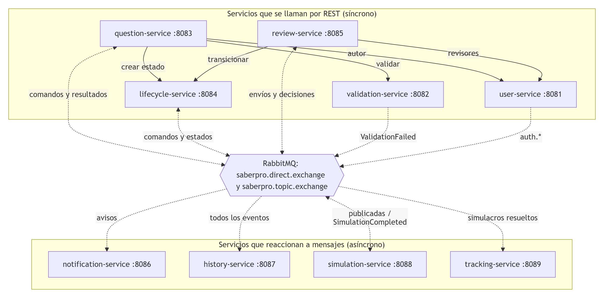

**Figura 3.1.** Diagrama de contextos delimitados y de la comunicación entre servicios.

### 3.2 Ciclo de vida de la pregunta

`lifecycle-service` es la autoridad sobre el estado: los demás servicios le piden transiciones o reaccionan a los
eventos que publica, pero ninguno actualiza el estado por su cuenta. Los estados y transiciones son los del proyecto
(**Figura 3.2**); la API devuelve el nombre del proyecto y su equivalente en el enunciado (**Tabla 3.2**).

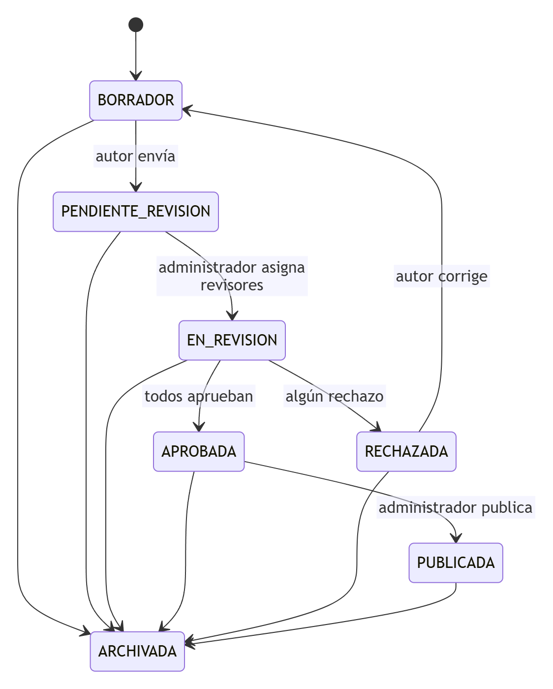

**Figura 3.2.** Diagrama de estados del ciclo de vida de una pregunta.

**Tabla 3.2.** Estados del proyecto y su nombre en el enunciado del taller.

| Estado del proyecto | Nombre en el enunciado |
|---|---|
| `BORRADOR` | DRAFT |
| `PENDIENTE_REVISION` | PENDING_REVIEW |
| `EN_REVISION` | IN_REVIEW |
| `APROBADA` | APPROVED |
| `RECHAZADA` | REJECTED |
| `PUBLICADA` | PUBLISHED |
| `ARCHIVADA` | ARCHIVED |

Las reglas de revisión son las del proyecto:

- El administrador asigna de 1 a 3 revisores; el autor nunca puede ser revisor y no se repite ninguno.
- La pregunta se aprueba solo si todos los revisores aprueban (unanimidad).
- Un solo rechazo cierra la ronda y la pregunta queda `RECHAZADA`; rechazar exige una observación.
- El autor corrige: la pregunta vuelve a `BORRADOR`, se valida otra vez y se reenvía, lo que abre una nueva ronda.
- Ninguna pregunta se borra: cualquier estado puede pasar a `ARCHIVADA`.

### 3.3 Mensajería

#### 3.3.1 Exchanges y colas

Se usan dos exchanges durables: `saberpro.direct.exchange` (*direct*) para los comandos y `saberpro.topic.exchange`
(*topic*) para los eventos, de modo que varios servicios puedan recibir el mismo evento. Todos los mensajes viajan en
JSON. La **Tabla 3.3** lista cada mensaje, quién lo publica, con qué routing key y qué colas lo reciben.

**Tabla 3.3.** Mensajes del sistema, colas y consumidores.

| Mensaje | Publica | Routing key | Cola | Consume |
|---|---|---|---|---|
| `SubmitQuestionForReview` (comando) | question | `question.submit` | `lifecycle.commands` | lifecycle |
| `PublishQuestion` (comando) | question | `question.publish` | `lifecycle.commands` | lifecycle |
| `ArchiveQuestion` (comando) | question | `question.archive` | `lifecycle.commands` | lifecycle |
| `OperationResult` | lifecycle | `question.operation-result` | `question.operation-result` | question |
| `question.state-changed` | lifecycle | `question.state-changed` | `question.state-changed`, `history.events` | question, history |
| `question.submitted` | lifecycle | `question.submitted` | `review.submitted-questions`, `history.events` | review, history |
| `question.published` | lifecycle | `question.published` | `simulation.published-questions`, `notification.events`, `history.events` | simulation, notification, history |
| `ValidationFailed` | validation | `validation.failed` | `notification.events`, `history.events` | notification, history |
| `ReviewerAssigned` | review | `reviewer.assigned` | `notification.reviewer-assigned`, `history.events` | notification, history |
| `EvaluationSubmitted` | review | `review.evaluation-submitted` | `notification.events`, `history.events` | notification, history |
| `ReviewCompleted` | review | `review.completed` | `notification.events`, `history.events` | notification, history |
| `auth.login-succeeded` y `auth.login-failed` | user | `auth.login-*` | `history.events` | history |
| `SimulationCompleted` | simulation | `simulation.completed` | `tracking.simulation-results`, `history.events` | tracking, history |

#### 3.3.2 Sobre común de los mensajes

Todos los mensajes llevan el mismo sobre (*envelope*) con cuatro campos: `eventId` (identificador único del mensaje),
`type` (nombre del comando o evento), `occurredAt` (fecha y hora) y `data` (el contenido). Los comandos incluyen en
`data` el `operationId` con el que el cliente consultará el resultado.

### 3.4 Estructura del proyecto

El proyecto es un monorepo con una carpeta por servicio (**Tabla 3.4**). Cada servicio es un proyecto Spring Boot
autónomo con el mismo esquema de paquetes, el de la guía del taller (**Tabla 3.5**).

**Tabla 3.4.** Contenido de la carpeta `lisw2_taller09_microservicios_g8`.

| Elemento | Contenido |
|---|---|
| `pom.xml` | Compila los nueve servicios con un solo comando |
| `docker-compose.yml` | RabbitMQ con la consola de administración |
| `scripts/` | Levantar y detener todo en local, con o sin Docker |
| `postman/` | Colección de pruebas y entorno local |
| `user-service/` a `tracking-service/` | Un proyecto Spring Boot por servicio |

**Tabla 3.5.** Paquetes de cada servicio.

| Paquete | Responsabilidad |
|---|---|
| `config` | `RabbitMQConfig`: exchanges, colas, bindings y conversor JSON |
| `controller` | `@RestController` con los endpoints REST |
| `dto` | Contratos de REST y de los mensajes |
| `messaging` | `*Publisher` (usa `RabbitTemplate`) y `*Listener` (usa `@RabbitListener`) |
| `model` | Entidades y enumeraciones |
| `repository` | Spring Data JPA sobre H2 en memoria |
| `service` | Reglas del contexto |

### 3.5 Configuración por servicio

Cada servicio tiene su puerto y sus variables de configuración en su `application.yml`, con valores por defecto
para ejecutar en local y sustituibles por variables de entorno (**Tabla 3.6**).

**Tabla 3.6.** Variables de configuración de cada servicio.

| Variable | Valor por defecto | Uso |
|---|---|---|
| `SERVER_PORT` | 8081 a 8089 según el servicio | Puerto HTTP |
| `RABBITMQ_HOST` y `RABBITMQ_PORT` | `localhost` y `5672` | Dirección de RabbitMQ |
| `RABBITMQ_USER` y `RABBITMQ_PASSWORD` | `guest` y `guest` | Credenciales de RabbitMQ |
| `DIRECT_EXCHANGE` y `TOPIC_EXCHANGE` | `saberpro.direct.exchange` y `saberpro.topic.exchange` | Nombres de los exchanges |
| `USER_SERVICE_URL`, `VALIDATION_SERVICE_URL` y `LIFECYCLE_SERVICE_URL` | `http://localhost:8081`, `8082` y `8084` | Servicios a los que se llama por REST |

### 3.6 Flujo del escenario

La **Figura 3.3** recorre el escenario completo del taller: el autor inicia sesión, crea una pregunta (REST), la envía a
revisión (comando asíncrono con respuesta 202), `lifecycle-service` procesa la transición, el administrador asigna un
revisor y el `ReviewerAssigned` llega a `notification-service` sin bloquear la asignación.

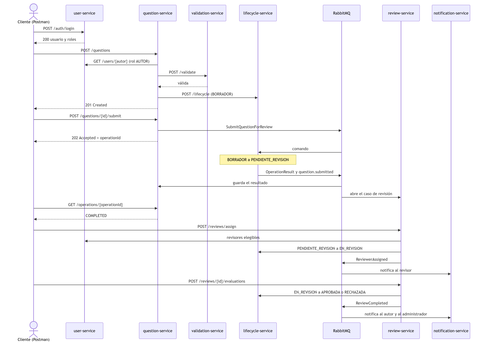

**Figura 3.3.** Diagrama de secuencia del escenario de creación, envío a revisión, asignación y notificación.

## 4. Implementación

Todos los servicios usan las piezas que pidió la profesora, escritas como en los ejemplos de teoría: Spring Web para
los endpoints REST, `RabbitTemplate.convertAndSend` para publicar, `@RabbitListener` para consumir, puertos distintos
y variables de configuración por servicio (**Tabla 4.1**).

**Tabla 4.1.** Piezas de Spring que usa cada servicio.

| Servicio | Spring Web | `RabbitTemplate` publica | `@RabbitListener` consume |
|---|---|---|---|
| `user-service` | `AuthController`, `UserController` | `auth.login-succeeded`, `auth.login-failed` | — |
| `validation-service` | `ValidationController` | `ValidationFailed` | — |
| `question-service` | `QuestionController`, `OperationController` | Comandos de envío, publicación y archivo | `OperationResult`, `question.state-changed` |
| `lifecycle-service` | `LifecycleController` | `OperationResult`, `question.state-changed`, `question.submitted`, `question.published` | Comandos |
| `review-service` | `ReviewController` | `ReviewerAssigned`, `EvaluationSubmitted`, `ReviewCompleted` | `question.submitted` |
| `notification-service` | `NotificationController` | — | `ReviewerAssigned` y demás avisos |
| `history-service` | `HistoryController` | — | Todos los eventos |
| `simulation-service` | `SimulationController` | `SimulationCompleted` | `question.published` |
| `tracking-service` | `TrackingController` | — | `SimulationCompleted` |

### 4.1 Comunicación síncrona

#### 4.1.1 Autenticación

El autor ingresa su usuario y su clave; el cliente envía `POST /auth/login` a `user-service`. Si las credenciales son
correctas responde 200 con los datos básicos del usuario, sus roles y un token simple; si no, responde 401 con
`authenticated: false`. En ambos casos publica un evento (`auth.login-succeeded` o `auth.login-failed`) que solo
consume `history-service` para la auditoría. Si RabbitMQ no está disponible, el evento se registra en el log y el
login sigue funcionando: la autenticación nunca depende de la mensajería.

#### 4.1.2 Creación y validación de preguntas

`POST /questions` exige el encabezado `Authorization`. `question-service` consulta a `user-service` para comprobar que
el usuario tiene el rol AUTOR, pide a `validation-service` que valide la pregunta y, si es válida, la guarda en
`BORRADOR`, crea su estado en `lifecycle-service` y responde 201. Si la validación falla responde 400 con la lista
de errores y la pregunta no se registra. Si crear el estado en `lifecycle-service` falla, la pregunta recién guardada
se elimina para no dejar un registro huérfano (**Figura 4.1**).

```java
public Question crear(PreguntaRequest req) {
    exigirAutor(req.autorId());          // REST a user-service: debe tener el rol AUTOR
    validar(req);                        // REST a validation-service: 400 si no es válida
    Question q = new Question();
    q.setAutorId(req.autorId());
    aplicar(q, req);
    q = preguntas.save(q);
    try {
        ciclo.crearEstado(q.getId(), q.getAutorId(), q.getTitulo(), q.getCompetencia());  // REST a lifecycle-service
    } catch (RuntimeException e) {
        preguntas.delete(q);             // no queda una pregunta sin estado
        throw e;
    }
    return q;
}
```

**Figura 4.1.** Método `crear` de `QuestionService`: creación síncrona con llamadas REST a tres servicios.

#### 4.1.3 Llamadas REST entre servicios

La **Tabla 4.2** resume las llamadas síncronas entre servicios. En todas, el servicio que llama traduce los fallos del
servicio llamado a errores HTTP propios (400, 403, 404, 409 o 503) en lugar de dejar pasar una excepción.

**Tabla 4.2.** Llamadas REST entre servicios.

| Origen | Destino | Para qué |
|---|---|---|
| `question-service` | `user-service` | Comprobar que el autor tiene el rol AUTOR |
| `question-service` | `validation-service` | Validar la estructura de la pregunta |
| `question-service` | `lifecycle-service` | Crear el estado `BORRADOR` y devolver una rechazada a `BORRADOR` |
| `review-service` | `user-service` | Comprobar el administrador y los revisores elegibles |
| `review-service` | `lifecycle-service` | Consultar el estado y pedir `EN_REVISION`, `APROBADA` o `RECHAZADA` |

### 4.2 Comunicación asíncrona

#### 4.2.1 Publicación del comando y respuesta 202

Cuando el docente pide enviar una pregunta a revisión, `question-service` registra una operación con un identificador
único y publica el comando `SubmitQuestionForReview` en el exchange *direct* (**Figura 4.2**). Responde
**202 Accepted** con el `operationId`: la respuesta confirma que la solicitud fue aceptada, pero no que la
transición haya terminado. Si no se puede publicar porque RabbitMQ no está disponible, la operación se marca `FAILED`
y la respuesta es 503: no se acepta una solicitud que no se pudo encolar.

```java
public void enviar(Comando comando, Long questionId, String operationId, String requestedBy, String motivo) {
    Map<String, Object> data = new HashMap<>();
    data.put("operationId", operationId);
    data.put("questionId", questionId);
    data.put("requestedBy", requestedBy);
    // ... también se agregan la fecha de la solicitud y el motivo
    rabbitTemplate.convertAndSend(directExchange, comando.routingKey(), EventEnvelope.of(comando.tipo(), data));
}

public Operation solicitar(Long questionId, Comando comando, String solicitadoPor, String motivo) {
    Operation operacion = operaciones.save(new Operation(UUID.randomUUID().toString(), questionId, comando.tipo()));
    try {
        comandos.enviar(comando, questionId, operacion.getOperationId(), solicitadoPor, motivo);
    } catch (AmqpException e) {
        operacion.registrarResultado(OperationStatus.FAILED, "No se pudo publicar el comando en RabbitMQ");
        operaciones.save(operacion);
        throw new ApiException(HttpStatus.SERVICE_UNAVAILABLE, "RabbitMQ no está disponible; la solicitud no se aceptó");
    }
    return operacion;
}
```

**Figura 4.2.** Publicación del comando con `RabbitTemplate` y manejo de RabbitMQ caído en `question-service`.

#### 4.2.2 Procesamiento en lifecycle-service y resultado consultable

`lifecycle-service` consume el comando con `@RabbitListener` (**Figura 4.3**), verifica que la transición
`BORRADOR → PENDIENTE_REVISION` sea válida y registra el nuevo estado. Siempre guarda el resultado de la operación
(`COMPLETED` o `FAILED` con el motivo) y lo publica como evento `OperationResult`; `question-service` lo recibe y lo
deja disponible en `GET /operations/{operationId}`, que es lo que el cliente consulta. Un comando repetido se
descarta porque su `operationId` ya tiene resultado.

```java
@RabbitListener(queues = RabbitMQConfig.QUEUE_LIFECYCLE_COMMANDS)
public void alRecibirUnComando(EventEnvelope comando) {
    servicio.procesarComando(comando);
}

public void procesarComando(EventEnvelope comando) {
    String operationId = comando.stringOf("operationId");
    if (operationId == null || resultados.existsById(operationId)) {
        return;                                   // idempotencia: un comando repetido no se procesa dos veces
    }
    // ... se obtienen la pregunta y el estado destino que pide el comando
    try {
        QuestionState estado = transicionar(questionId, destino, comando.stringOf("requestedBy"), ...);
        status = OperationStatus.COMPLETED;
        mensaje = "La pregunta pasó a " + estado.getEstado().etiqueta();
    } catch (ApiException e) {
        status = OperationStatus.FAILED;          // transición inválida: queda consultable, no se simula éxito
        mensaje = e.getMessage();
    }
    resultados.save(new OperationResult(operationId, questionId, comando.type(), status, mensaje));
    eventos.resultadoDeOperacion(operationId, questionId, comando.type(), status.name(), mensaje);
}
```

**Figura 4.3.** Consumo del comando y registro del resultado en `lifecycle-service`.

#### 4.2.3 Asignación de revisor y consistencia

El administrador pide `POST /reviews/assign`. `review-service` valida las reglas (1 a 3 revisores, sin repetidos, el
autor no puede revisar, el usuario debe ser administrador y los revisores deben ser elegibles) y consulta a
`lifecycle-service` que la pregunta esté en `PENDIENTE_REVISION`. Después guarda la asignación y pide por REST la
transición a `EN_REVISION`. Todo el método es transaccional: si `lifecycle-service` rechaza la transición, la excepción
revierte la asignación y no queda ninguna asignación sin su cambio de estado (**Figura 4.4**). Solo cuando la
transición tiene éxito se publica el evento.

```java
@Transactional
public CasoDeRevision asignar(Long questionId, List<Long> revisores, Long administrador) {
    // ... validaciones: de 1 a 3 revisores, sin repetidos, administrador, revisores elegibles ...
    String estado = ciclo.estadoDe(questionId);
    if (!"PENDIENTE_REVISION".equals(estado)) {
        throw new ApiException(HttpStatus.CONFLICT, "La pregunta no es elegible: está en " + estado
                + " y debe estar en PENDIENTE_REVISION");
    }
    caso.asignar(revisores, administrador);
    casos.saveAndFlush(caso);
    ciclo.transicionar(questionId, "EN_REVISION", String.valueOf(administrador), null);  // si falla, se revierte
    eventos.revisoresAsignados(caso, revisores);                                         // solo tras el éxito
    return caso;
}
```

**Figura 4.4.** Método `asignar` de `ReviewService`: la asignación se revierte si la transición falla.

#### 4.2.4 Evento ReviewerAssigned y notificación

Confirmada la asignación, `review-service` publica un evento `ReviewerAssigned` por cada revisor. `notification-service`
lo consume en la cola `notification.reviewer-assigned`, crea la notificación y simula el correo (se registra en el
log y queda consultable en `GET /notifications`). La publicación del evento no bloquea la asignación: si
`notification-service` está detenido, el mensaje espera en su cola y se procesa cuando el servicio vuelve
(sección 5.5).

#### 4.2.5 Servicios que solo reaccionan

`history-service` se une con la clave `#` al exchange de eventos, por lo que recibe todos los mensajes y guarda la línea
de tiempo de cada pregunta y la auditoría de inicios de sesión, de forma idempotente por `eventId`.
`simulation-service` recibe `question.published` y agrega la pregunta a su catálogo; cuando se resuelve un
simulacro publica `SimulationCompleted`, que `tracking-service` consume para calcular los promedios por usuario.

#### 4.2.6 Reintentos de los consumidores

Los consumidores reintentan un mensaje fallido hasta tres veces, con una espera inicial de un segundo que se duplica
en cada intento (`spring.rabbitmq.listener.simple.retry`). Si el mensaje sigue fallando se descarta
(`default-requeue-rejected: false`) para que no bloquee la cola. En el proyecto, esta política se completa con una cola
de mensajes fallidos y el patrón Outbox.

## 5. Validación de estados, errores y resiliencia

### 5.1 Matriz de casos de prueba

La **Tabla 5.1** reúne los diez casos del enunciado con el resultado que obtuvo el sistema en la ejecución de este
informe y la prueba que lo comprueba en la colección de Postman.

**Tabla 5.1.** Casos de prueba del enunciado y resultado obtenido.

| Caso | Resultado esperado | Resultado obtenido |
|---|---|---|
| Login con credenciales válidas | Autenticación exitosa | 200, `authenticated: true`, rol AUTOR |
| Login con credenciales incorrectas | Acceso rechazado | 401, «Credenciales incorrectas» |
| Crear una pregunta válida | Persistida en DRAFT | 201, estado `BORRADOR` (DRAFT) |
| Crear una pregunta inválida | Se informa el error y no se persiste | 400, «Deben ser exactamente cuatro opciones» |
| Enviar una pregunta a revisión | Transición a PENDING_REVIEW | 202 y luego `COMPLETED`; estado `PENDIENTE_REVISION` |
| Aprobar una pregunta en DRAFT | Transición rechazada | 409, «Transición no permitida: Borrador → Aprobada» |
| Asignar un revisor a una pregunta elegible | Asignación y notificación | 201; estado `EN_REVISION`; notificación `REVIEWER_ASSIGNED` |
| Rechazar una pregunta en IN_REVIEW | REJECTED con el motivo | 200; resultado `REJECTED`; observación registrada |
| Corregir una pregunta rechazada | Vuelve al proceso de revisión | 200; estado `BORRADOR`, versión 2 |
| Falla el procesamiento de una transición asíncrona | Resultado consultable, sin éxito falso | 202 y luego `FAILED` con el motivo |

### 5.2 Operaciones asíncronas

La **Figura 5.1** muestra la ejecución real del envío a revisión. La primera solicitud se acepta (202) y, al consultar la
operación, está `COMPLETED`; `lifecycle-service` confirma el estado `PENDIENTE_REVISION`. Un segundo envío de la misma
pregunta también recibe 202, porque la solicitud se acepta antes de saber si la transición será válida, pero su
resultado queda `FAILED` con el motivo: el cliente puede verificar que la transición no se completó.

```
POST /questions/7/submit                                    -> 202
  {"message": "Solicitud de envío a revisión aceptada para procesamiento",
   "operationId": "6c643e2b-0ff1-410c-a5a2-02c9f3a057c1", "status": "PROCESSING"}
GET  /operations/6c643e2b-0ff1-410c-a5a2-02c9f3a057c1       -> 200
  {"tipo": "SubmitQuestionForReview", "status": "COMPLETED",
   "mensaje": "La pregunta pasó a Pendiente de revisión"}
GET  /lifecycle/7                                           -> 200
  {"estado": "PENDIENTE_REVISION", "equivalente": "PENDING_REVIEW"}

POST /questions/7/submit (segundo envío)                    -> 202
  {"operationId": "2c89c944-b5d2-4d1d-9fa3-b34bdec958c0", "status": "PROCESSING"}
GET  /operations/2c89c944-b5d2-4d1d-9fa3-b34bdec958c0       -> 200
  {"tipo": "SubmitQuestionForReview", "status": "FAILED",
   "mensaje": "La pregunta 7 ya está en Pendiente de revisión"}
```

**Figura 5.1.** Envío a revisión: una operación `COMPLETED` y otra `FAILED`, consultadas después.

### 5.3 Asignación, rechazo y corrección

La **Figura 5.2** muestra el recorrido de una pregunta por la revisión. El intento de asignar al propio autor se
rechaza con 400. La asignación de un revisor elegible responde 201, `lifecycle-service` deja la pregunta en
`EN_REVISION` y `notification-service` genera el aviso al revisor. Rechazar sin observación responde 400; rechazar con
observación cierra la ronda (`REJECTED`) y deja la pregunta `RECHAZADA`. Al corregirla, el autor la devuelve a
`BORRADOR` con una nueva versión. Por último, intentar aprobar una pregunta en `BORRADOR` es rechazado por
`lifecycle-service` con 409.

```
POST /reviews/assign {"questionId": 11, "reviewerIds": [2], "assignedBy": 1}        -> 400
  {"message": "El autor no puede ser revisor de su propia pregunta"}
POST /reviews/assign {"questionId": 11, "reviewerIds": [4], "assignedBy": 1}        -> 201
  {"ronda": 1, "estado": "EN_CURSO", "asignaciones": [{"reviewerId": 4, "decision": null}]}
GET  /lifecycle/11                                                                  -> 200
  {"estado": "EN_REVISION", "equivalente": "IN_REVIEW", "changedBy": "1"}
GET  /notifications?destinatario=4&tipo=REVIEWER_ASSIGNED                           -> 200
  [{"tipo": "REVIEWER_ASSIGNED", "asunto": "Pregunta asignada para revisión", "estado": "ENVIADA"}]
POST /reviews/11/evaluations {"reviewerId": 4, "decision": "REJECT"}                -> 400
  {"message": "Rechazar exige una observación"}
POST /reviews/11/evaluations {"reviewerId": 4, "decision": "REJECT",
                              "observation": "El enunciado es ambiguo"}             -> 200
  {"estado": "CERRADA", "resultado": "REJECTED", "asignaciones": [{"observacion": "El enunciado es ambiguo"}]}
GET  /lifecycle/11                                                                  -> 200
  {"estado": "RECHAZADA", "equivalente": "REJECTED", "changedBy": "4"}
PUT  /questions/11 (corrección del autor)                                           -> 200
  {"estado": "BORRADOR", "equivalente": "DRAFT", "version": 2}
POST /lifecycle/12/transition {"to": "APROBADA"} (pregunta en BORRADOR)            -> 409
  {"message": "Transición no permitida: Borrador → Aprobada"}
```

**Figura 5.2.** Asignación de un revisor, notificación, rechazo, corrección y transición inválida.

### 5.4 Caída de RabbitMQ

Con RabbitMQ detenido, el login sigue respondiendo 200 porque no depende de la mensajería, y el envío a revisión
responde 503 con un mensaje claro en lugar de aceptar una solicitud que no se pudo encolar. Al reiniciar RabbitMQ, los
nueve consumidores se reconectan solos y el mismo envío se acepta y se completa (**Figura 5.3**).

```
(docker stop saberpro-rabbitmq)
POST /auth/login                    -> 200   {"authenticated": true, "message": "Autenticación exitosa"}
POST /questions/8/submit            -> 503   {"message": "RabbitMQ no está disponible; la solicitud no se aceptó"}
(docker start saberpro-rabbitmq; a los pocos segundos los consumidores se reconectan)
POST /questions/8/submit            -> 202   {"operationId": "90512f6a-5879-413c-8ee7-da38984b26fc", "status": "PROCESSING"}
GET  /operations/90512f6a-5879-413c-8ee7-da38984b26fc  -> 200   {"status": "COMPLETED"}
```

**Figura 5.3.** Comportamiento del sistema con RabbitMQ detenido y tras reiniciarlo.

### 5.5 Consumidores detenidos

Se detuvo `notification-service` y se ejecutó la colección completa. Las peticiones que no dependen de ese servicio
pasaron sin problema; los mensajes dirigidos a él quedaron esperando en sus colas (**Figura 6.9**): 10 mensajes en
`notification.events` y 4 en `notification.reviewer-assigned`. Al volver a levantarlo, los consumió y las colas
quedaron en cero (**Figura 6.10**). Así se comprueba el desacoplamiento temporal: el servicio de notificaciones puede
estar caído sin afectar la operación principal.

## 6. Pruebas y evidencias de ejecución

### 6.1 Pruebas automáticas

`mvn clean package` compila los nueve servicios y ejecuta 78 pruebas unitarias y de integración que no necesitan
RabbitMQ: los mensajes se verifican con un `RabbitTemplate` simulado y los listeners se invocan directamente
(**Tabla 6.1** y **Figura 6.1**).

**Tabla 6.1.** Pruebas automáticas por servicio.

| Servicio | Pruebas | Qué verifican |
|---|---|---|
| `user-service` | 5 | Login válido e incorrecto, eventos de inicio de sesión, revisores elegibles |
| `validation-service` | 7 | Cada regla de validación y la publicación de `ValidationFailed` |
| `question-service` | 14 | Crear (201, 400, 401, 403, 503), enviar (202), resultado asíncrono, edición y corrección |
| `lifecycle-service` | 17 | Los siete estados y sus transiciones, comandos `COMPLETED` y `FAILED`, idempotencia |
| `review-service` | 14 | De 1 a 3 revisores, elegibilidad, reversión si falla lifecycle, unanimidad, rechazo y rondas |
| `notification-service` | 7 | Cada tipo de aviso y la idempotencia |
| `history-service` | 4 | Línea de tiempo, idempotencia y auditoría |
| `simulation-service` | 6 | Catálogo, calificación y errores |
| `tracking-service` | 4 | Acumulación por usuario e idempotencia |
| **Total** | **78** | |

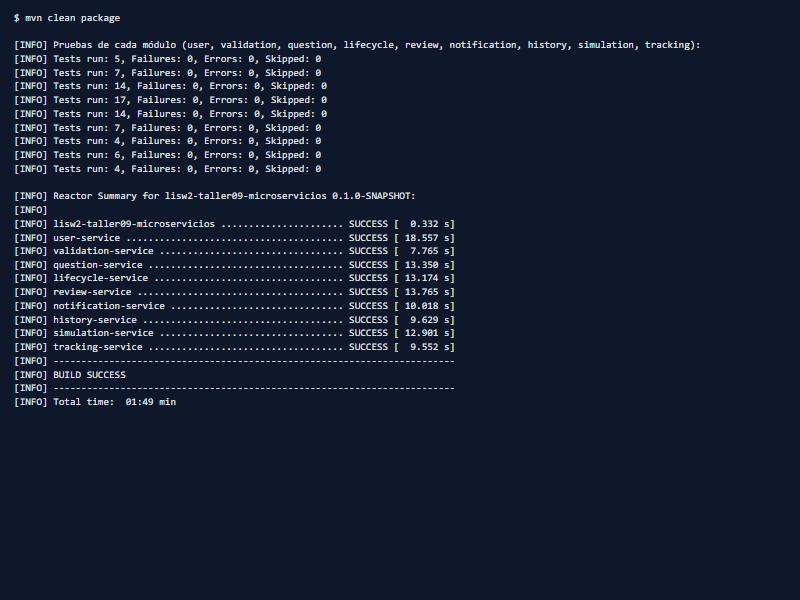

**Figura 6.1.** Resultado de `mvn clean package`: 78 pruebas en verde y los nueve módulos compilados.

### 6.2 Colección de Postman

La colección `SaberPro_Microservices.postman_collection.json` está organizada por microservicio, como pide el
enunciado, en doce carpetas (**Tabla 6.2**). Se ejecuta completa con el *Collection Runner* de Postman o por consola con
`newman`, y se puede repetir sin reiniciar nada. El resultado es de **67 peticiones y 146 verificaciones, todas en
verde** (**Figura 6.2**).

**Tabla 6.2.** Carpetas de la colección de Postman.

| Carpeta | Qué recorre |
|---|---|
| 01 · user-service | Logins válidos e incorrectos y revisores elegibles |
| 02 · validation-service | Una pregunta válida y una inválida |
| 03 · question-service | Crear (y casos de error), enviar a revisión y consultar el resultado |
| 04 · lifecycle-service | Estados y transición rechazada por las dos rutas |
| 05 · review-service | Errores de asignación, asignación, unanimidad y rechazo con observación |
| 06 · question-service | Resultado de la revisión, corrección, reenvío, publicación y archivo |
| 07 · lifecycle-service | Motivo del rechazo y estados finales |
| 08 · review-service | Segunda ronda de la pregunta corregida |
| 09 · notification-service | Avisos al revisor, al autor y al administrador |
| 10 · history-service | Línea de tiempo y auditoría |
| 11 · simulation-service | Catálogo de preguntas publicadas y simulacros |
| 12 · tracking-service | Estadísticas del usuario |

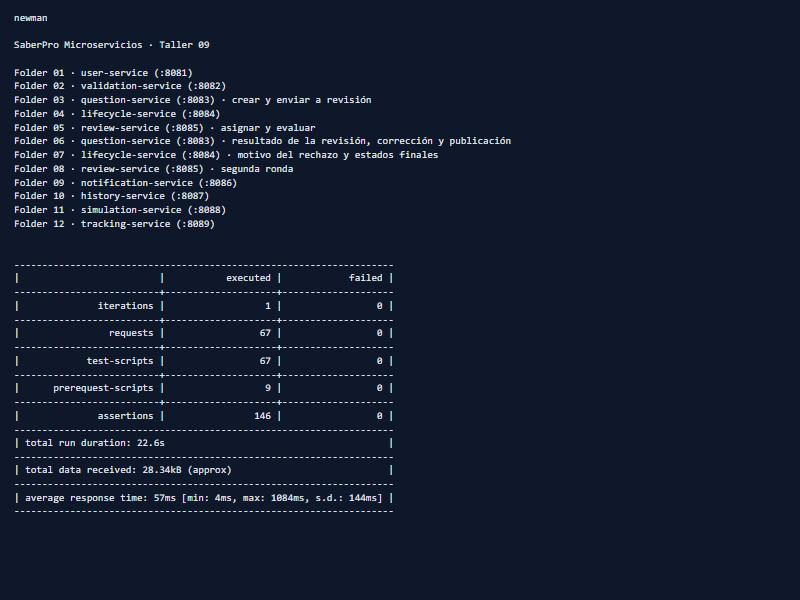

**Figura 6.2.** Resultado de la colección de Postman con `newman`: 67 peticiones y 146 verificaciones, sin fallos.

### 6.3 Evidencias del panel de RabbitMQ

Las capturas siguientes se tomaron en la consola de administración de RabbitMQ (`http://localhost:15672`) después de
ejecutar la colección (**Tabla 6.3**).

**Tabla 6.3.** Capturas del panel de RabbitMQ y lo que muestran.

| Figura | Pestaña | Qué muestra |
|---|---|---|
| 6.3 | *Overview* | Gráfica de mensajes y 9 conexiones, 15 canales, 9 colas y 9 consumidores |
| 6.4 | *Exchanges* | `saberpro.direct.exchange` (direct) y `saberpro.topic.exchange` (topic) |
| 6.5 | *Exchanges* → topic | Colas y routing keys enlazadas al exchange de eventos |
| 6.6 | *Queues* | Las nueve colas, con 0 mensajes pendientes |
| 6.7 | *Queues* → `lifecycle.commands` | Un consumidor conectado y capacidad del 100 % |
| 6.8 | *Connections* | Una conexión AMQP por servicio |
| 6.9 | *Queues* | Mensajes acumulados con `notification-service` detenido |
| 6.10 | *Queues* | Colas en cero tras volver a levantar el servicio |

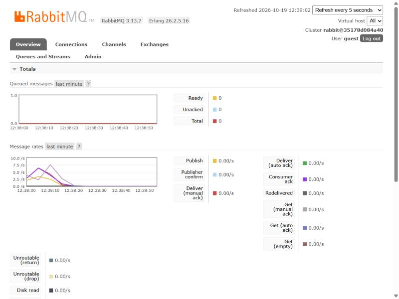

**Figura 6.3.** Resumen del panel de RabbitMQ: mensajes publicados y entregados, y los totales de conexiones y colas.

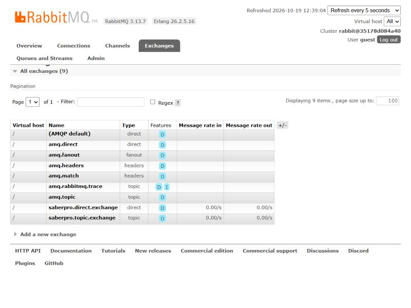

**Figura 6.4.** Exchanges de RabbitMQ: el *direct* de los comandos y el *topic* de los eventos.

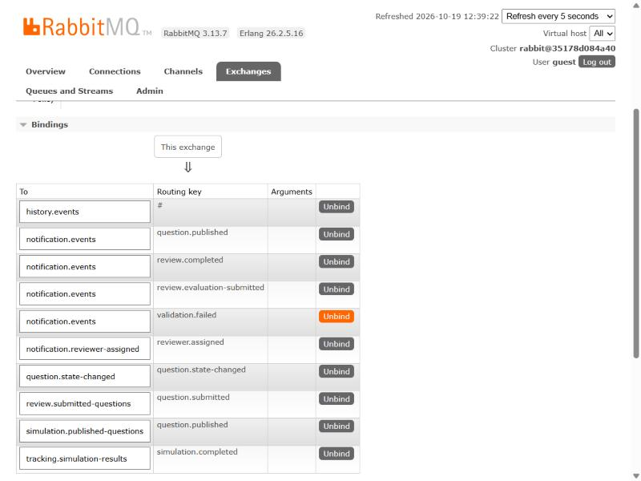

**Figura 6.5.** Bindings del exchange `saberpro.topic.exchange`: colas y routing keys.

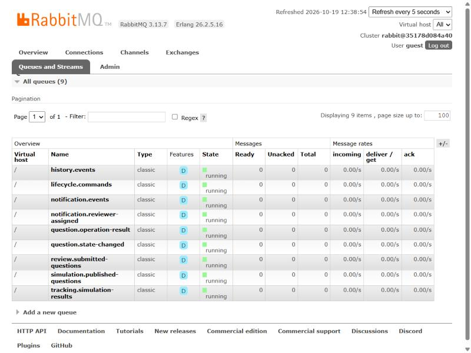

**Figura 6.6.** Colas de RabbitMQ después de ejecutar la colección: todas sin mensajes pendientes.

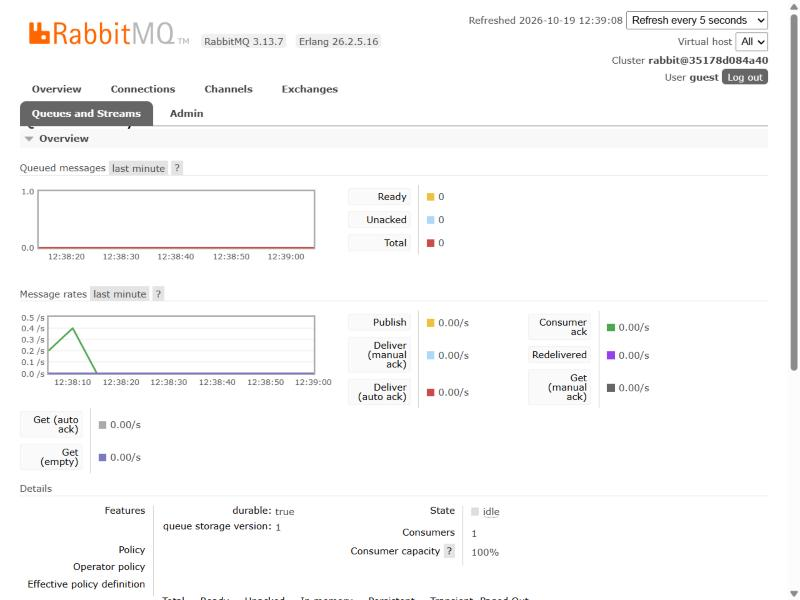

**Figura 6.7.** Detalle de la cola `lifecycle.commands`: un consumidor conectado.

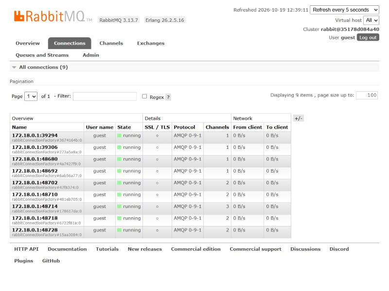

**Figura 6.8.** Conexiones de RabbitMQ: una por cada servicio que publica o consume.


**Figura 6.9.** Colas con `notification-service` detenido: 10 mensajes en `notification.events` y 4 en
`notification.reviewer-assigned`.


**Figura 6.10.** Colas tras reiniciar `notification-service`: los mensajes se consumieron y las colas quedaron en cero.

### 6.4 Cómo reproducir las pruebas

Requisitos: Java 21, Maven 3.9 o superior, Docker Desktop encendido y Node.js (para `newman`).

```
cd lisw2_taller09_microservicios_g8
mvn clean package            # compila y corre las 78 pruebas
./scripts/levantar.sh        # RabbitMQ con Docker y los nueve servicios (en PowerShell: .\scripts\levantar.ps1)
npx newman run postman/SaberPro_Microservices.postman_collection.json -e postman/SaberPro_Local.postman_environment.json
./scripts/detener.sh --rabbit
```

Los usuarios de prueba son `admin`, `autor1`, `autor2` y `revisor1` a `revisor4`, todos con la clave `clave123`. Las
bases son H2 en memoria: al reiniciar un servicio sus datos se pierden.

## 7. Cumplimiento de la rúbrica

La **Tabla 7.1** relaciona cada criterio de la rúbrica con lo que se entrega y dónde se evidencia.

**Tabla 7.1.** Cumplimiento de la rúbrica del taller.

| Criterio | Peso | Qué se entrega | Evidencia |
|---|---|---|---|
| Diseño de microservicios y delimitación de responsabilidades | 15 % | Nueve contextos con una responsabilidad cada uno; `lifecycle-service` como único dueño del estado | Secciones 3.1 y 3.2; Figura 3.1 |
| Comunicación síncrona REST | 20 % | Login, creación, validación y llamadas entre servicios con Spring Web | Secciones 4.1 y 5.1 |
| Comunicación asíncrona con RabbitMQ | 25 % | Comandos y eventos con `RabbitTemplate` y `@RabbitListener`, dos exchanges y nueve colas | Secciones 3.3 y 4.2; Figuras 6.3 a 6.8 |
| Validación de estados, errores y resiliencia | 15 % | Transiciones inválidas, operaciones `FAILED`, reversión de la asignación, RabbitMQ caído y consumidores detenidos | Capítulo 5; Figuras 5.1 a 5.3, 6.9 y 6.10 |
| Pruebas en Postman y evidencias de ejecución | 15 % | Colección por microservicio, 67 peticiones y 146 verificaciones; 78 pruebas automáticas | Capítulo 6; Figuras 6.1 y 6.2 |
| Documentación técnica y sustentación | 10 % | Este informe, el README y la carpeta `docs/` del taller | Capítulo 9 |

## 8. Conclusiones

### 8.1 Lo aprendido

- **Acoplamiento.** Las llamadas REST encadenadas hacen que la creación de una pregunta dependa de tres servicios a
  la vez; en cambio, el envío a revisión, la transición y la notificación quedaron desacoplados por la mensajería y
  cada servicio puede evolucionar sin avisar a los demás mientras respete el contrato del mensaje.
- **Interoperabilidad.** El sobre común (`eventId`, `type`, `occurredAt`, `data`) y los contratos JSON permiten que
  cada servicio tenga sus propios DTO. Agregar `history-service` no requirió tocar a los productores: bastó un binding
  a los eventos existentes.
- **Resiliencia.** Aceptar una solicitud asíncrona no significa que se cumpla. Registrar cada operación con su
  resultado (`COMPLETED` o `FAILED`) y responder 503 cuando no se puede encolar evita informar éxitos falsos. Con un
  consumidor caído, los mensajes esperan en su cola y se procesan al volver.
- **Escalabilidad.** Cada servicio escala por separado y los consumidores de una misma cola se reparten los mensajes;
  la idempotencia hace seguro tener varias réplicas o reintentos.

### 8.2 Limitaciones

- Las bases son H2 en memoria: al reiniciar un servicio se pierden sus datos. El proyecto usa PostgreSQL por servicio.
- El token es un valor simple que no se valida; la autenticación real con JWT es del tercer corte.
- No hay cola de mensajes fallidos ni patrón Outbox: un mensaje que falla tres veces se descarta, y si el servicio cae
  entre guardar y publicar se podría perder un evento.
- El correo es simulado.

### 8.3 Evolución hacia el proyecto

El proyecto del curso (`banco-preguntas-saberpro`) ya incorpora lo que el taller deja afuera: PostgreSQL por servicio,
Keycloak con JWT, Eureka, API Gateway, Outbox transaccional, cola de mensajes fallidos, correo real, Swagger
agregado y pruebas de carga con k6. El taller es la base conceptual de esa evolución.

## 9. Enlaces

**Tabla 9.1.** Enlaces del trabajo.

| Recurso | Enlace |
|---|---|
| Repositorio del laboratorio | https://github.com/DVLASZ/ingenieria-software-2 |
| Carpeta del Taller 9 | https://github.com/DVLASZ/ingenieria-software-2/tree/main/talleres/Taller-09-ComunicacionSincronaAsincrona |
| Proyecto `lisw2_taller09_microservicios_g8` | https://github.com/DVLASZ/ingenieria-software-2/tree/main/talleres/Taller-09-ComunicacionSincronaAsincrona/lisw2_taller09_microservicios_g8 |
| Colección de Postman | https://github.com/DVLASZ/ingenieria-software-2/tree/main/talleres/Taller-09-ComunicacionSincronaAsincrona/lisw2_taller09_microservicios_g8/postman |
| Documentación del taller | https://github.com/DVLASZ/ingenieria-software-2/tree/main/talleres/Taller-09-ComunicacionSincronaAsincrona/docs |
| Repositorio del proyecto de curso | https://github.com/DVLASZ/banco-preguntas-saberpro |
