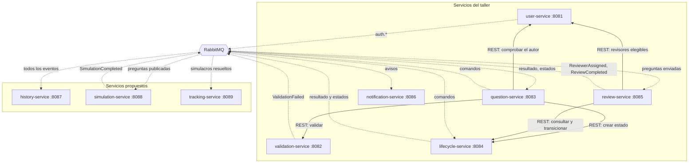
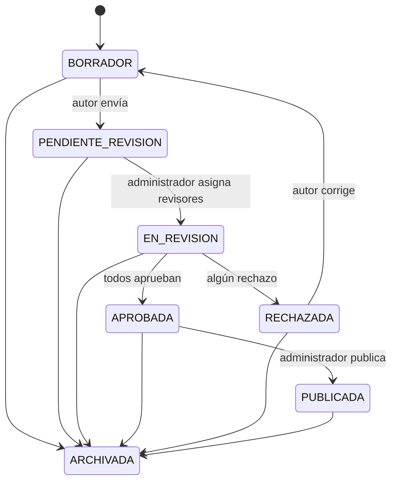
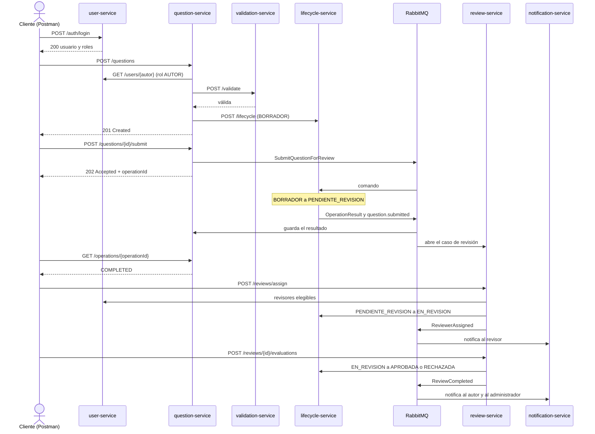

# Taller 09: diseño de los microservicios (versión lite del proyecto)

> Estado: diseño implementado por completo. Lo que cambió respecto al borrador está marcado con «(implementado)».

La profesora pidió dos cosas con énfasis:

1. **Definir y diseñar nuestros propios contextos delimitados.** Los seis servicios del taller son solo una
   sugerencia («pueden ajustarlos o proponer otros»). Por eso el grupo propone **nueve microservicios** y
   entrega una primera muestra de su definición y diseño.
2. **Usar tal cual lo que ella nombra:** Spring Web para los endpoints REST, Spring AMQP con `RabbitTemplate`
   para publicar, `@RabbitListener` para consumir, puertos distintos y variables de configuración por servicio.

El taller es la **versión lite del proyecto del banco de preguntas**: mismos estados, mismas reglas de
revisión y mismo mecanismo de rechazo, pero sin Keycloak, Eureka, API Gateway, Outbox ni cola de mensajes
fallidos, que son del proyecto (ver sección 9).

## 1. Los nueve microservicios

Los seis primeros son los del taller; los tres últimos son los que añadimos a partir de los contextos
delimitados que el docente propuso para el proyecto.

| # | Servicio | Puerto | Contexto delimitado | Origen |
|---|---|---|---|---|
| 1 | `user-service` | 8081 | Gestión de Usuarios | Taller |
| 2 | `validation-service` | 8082 | Validación de Preguntas | Taller |
| 3 | `question-service` | 8083 | Gestión de Preguntas | Taller |
| 4 | `lifecycle-service` | 8084 | Ciclo de Vida de Preguntas | Taller |
| 5 | `review-service` | 8085 | Revisión por Pares | Taller |
| 6 | `notification-service` | 8086 | Notificaciones (transversal) | Taller |
| 7 | `history-service` | 8087 | Administración y Trazabilidad | **Propuesto** |
| 8 | `simulation-service` | 8088 | Simulacros de Evaluación | **Propuesto** |
| 9 | `tracking-service` | 8089 | Seguimiento Académico | **Propuesto** |

**Por qué estos tres.** En el proyecto, Validación y Ciclo de Vida son módulos internos de `question-service`.
Aquí los separamos porque el taller lo exige y porque deja ver bien la comunicación REST (validar) y la
asíncrona (transiciones). Los contextos de Administración y Trazabilidad, Simulacros y Seguimiento Académico
son los que el docente definió para el proyecto y que el taller no incluye:

- `history-service` consume **todos** los eventos y guarda el historial de cada pregunta; es el ejemplo
  de un servicio que solo reacciona a mensajes.
- `simulation-service` mantiene su propio catálogo con las preguntas **publicadas** (se alimenta de un
  evento) y permite resolver un simulacro.
- `tracking-service` consume el resultado de los simulacros y calcula estadísticas por usuario.



Línea continua: REST (síncrono). Línea punteada: RabbitMQ (asíncrono).

## 2. Estados y reglas: los mismos del proyecto

Un único dueño del estado: `lifecycle-service`. Los demás piden transiciones o reaccionan a eventos.



| Estado del proyecto | Nombre en el enunciado |
|---|---|
| `BORRADOR` (Borrador) | DRAFT |
| `PENDIENTE_REVISION` (Pendiente de revisión) | PENDING_REVIEW |
| `EN_REVISION` (En revisión) | IN_REVIEW |
| `APROBADA` (Aprobada) | APPROVED |
| `RECHAZADA` (Rechazada) | REJECTED |
| `PUBLICADA` (Publicada) | PUBLISHED |
| `ARCHIVADA` (Archivada) | ARCHIVED |

La API de lifecycle devuelve ambos nombres (`estado` y `equivalente`) para que se vea con el vocabulario del
enunciado en Postman sin perder el del proyecto.

**Reglas de revisión (las del proyecto):**

- El administrador asigna de **1 a 3 revisores**; el autor nunca puede ser revisor y no se repite ninguno.
- La pregunta se aprueba solo si **todos** los revisores aprueban (unanimidad).
- **Rechazo:** un solo rechazo cierra la ronda y la pregunta queda `RECHAZADA` con las observaciones de los
  revisores. Rechazar exige una observación.
- El autor corrige: la pregunta vuelve a `BORRADOR`, se edita (y se valida otra vez) y se reenvía; eso abre una
  **nueva ronda** de revisión.
- Las observaciones de todos los revisores de la misma pregunta son visibles entre ellos y para el autor.
- Ninguna pregunta se borra físicamente: cualquier estado puede pasar a `ARCHIVADA`.

## 3. Cumplimiento literal de lo que pidió la profesora

Cada servicio usa exactamente estas piezas, escritas como en los ejemplos de teoría y sin envolverlas en
bibliotecas propias:

- **Spring Web:** clases `@RestController` con `@GetMapping` y `@PostMapping`.
- **Publicar:** `RabbitTemplate.convertAndSend(exchange, routingKey, mensaje)` dentro de una clase `*Publisher`.
- **Consumir:** métodos con `@RabbitListener(queues = "...")` dentro de una clase `*Listener`.
- **Puertos distintos:** `server.port: ${SERVER_PORT:808x}` en el `application.yml` de cada servicio.
- **Variables de configuración por servicio:** `RABBITMQ_HOST`, `RABBITMQ_PORT`, `RABBITMQ_USER`,
  `RABBITMQ_PASSWORD` y las direcciones de los servicios a los que llama (`VALIDATION_SERVICE_URL`,
  `LIFECYCLE_SERVICE_URL`, `USER_SERVICE_URL`), además de los nombres de exchange y colas.
- **Sin biblioteca compartida:** cada servicio tiene su propio `RabbitMQConfig` y sus propios DTO (la
  duplicación es intencional: autonomía de los servicios).

| Servicio | Spring Web | `RabbitTemplate` publica | `@RabbitListener` consume |
|---|---|---|---|
| user-service | `AuthController`, `UserController` | `AuthEventPublisher`: `auth.login-succeeded`, `auth.login-failed` | — |
| validation-service | `ValidationController` | `ValidationEventPublisher`: `ValidationFailed` | — |
| question-service | `QuestionController`, `OperationController` | `CommandPublisher`: comandos `SubmitQuestionForReview`, `PublishQuestion` y `ArchiveQuestion` | `OperationResultListener`, `StateChangedListener` |
| lifecycle-service | `LifecycleController` | `LifecycleEventPublisher`: `OperationResult`, `question.state-changed`, `question.submitted`, `question.published` | `CommandListener` |
| review-service | `ReviewController` | `ReviewEventPublisher`: `ReviewerAssigned` (uno por revisor), `EvaluationSubmitted`, `ReviewCompleted` | `QuestionSubmittedListener` |
| notification-service | `NotificationController` | — | `NotificationListener` |
| history-service | `HistoryController` | — | `HistoryListener` (todos los eventos) |
| simulation-service | `SimulationController` | `SimulationEventPublisher`: `SimulationCompleted` | `PublishedQuestionListener` |
| tracking-service | `TrackingController` | — | `SimulationResultListener` |

Cada pieza del taller (REST, publicar, consumir) aparece en varios servicios, y el flujo del escenario usa las
tres en cadena.

## 4. Estructura del proyecto

```
lisw2_taller09_microservicios_g8/
├── README.md
├── pom.xml                         compila todos los servicios
├── docker-compose.yml              RabbitMQ con consola de administración
├── .gitignore
├── scripts/                        arrancar y detener todo en local (con y sin Docker)
├── postman/
│   ├── SaberPro_Microservices.postman_collection.json
│   └── SaberPro_Local.postman_environment.json
├── docs/                           diagramas y notas para el informe
├── user-service/                   :8081
├── validation-service/             :8082
├── question-service/               :8083
├── lifecycle-service/              :8084
├── review-service/                 :8085
├── notification-service/           :8086
├── history-service/                :8087
├── simulation-service/             :8088
└── tracking-service/               :8089
```

Cada servicio es un proyecto Spring Boot autónomo con el mismo esquema de paquetes (el de la guía):

```
<servicio>/
├── pom.xml
├── README.md
└── src/
    ├── main/
    │   ├── java/co/edu/unicauca/<contexto>/
    │   │   ├── <Servicio>Application.java
    │   │   ├── config/RabbitMQConfig.java     exchange, colas, bindings y conversor JSON
    │   │   ├── controller/                    @RestController
    │   │   ├── dto/                           contratos de REST y de los mensajes
    │   │   ├── messaging/                     *Publisher (RabbitTemplate) y *Listener (@RabbitListener)
    │   │   ├── model/                         entidades y enumeraciones
    │   │   ├── repository/                    Spring Data JPA (H2 en memoria)
    │   │   └── service/                       reglas del contexto
    │   └── resources/application.yml          puerto y variables del servicio
    └── test/java/...                          pruebas unitarias y de integración
```

## 5. Detalle por servicio

### user-service (8081): Gestión de Usuarios
- **REST:** `POST /auth/login` (200 con usuario y roles, o 401), `GET /users/{id}`,
  `GET /users?role=REVISOR&excluir={autorId}` (revisores elegibles).
- **Publica:** `auth.login-succeeded` y `auth.login-failed`.
- **Datos:** usuarios precargados con roles AUTOR, REVISOR y ADMINISTRADOR (como en el proyecto, sin roles de
  estudiante o docente). Sin tokens: el login devuelve un valor simple (a confirmar con la profesora).

### validation-service (8082): Validación de Preguntas
- **REST:** `POST /validate` → `{ valid, errors[] }`.
- **Reglas del proyecto:** contexto presente, una única pregunta directa, exactamente cuatro distractores, una
  única respuesta correcta y sin «todas/ninguna de las anteriores».
- **Publica:** `ValidationFailed` cuando la validación falla.

### question-service (8083): Gestión de Preguntas
- **REST:** `POST /questions` (exige `Authorization`; comprueba por REST que el autor tiene el rol AUTOR en
  user-service, valida por REST, crea el estado en lifecycle y responde 201, o 400 con los errores), `GET /questions` y `GET /questions/{id}` (con filtros), `PUT /questions/{id}`
  (solo en `BORRADOR`; si estaba `RECHAZADA`, primero pide a lifecycle la vuelta a `BORRADOR`),
  `POST /questions/{id}/submit`, `/publish` y `/archive` (responden **202** con `operationId`),
  `GET /operations/{operationId}`.
- **Publica:** comandos `SubmitQuestionForReview`, `PublishQuestion`, `ArchiveQuestion`.
- **Consume:** `OperationResult` (guarda el resultado que consulta el cliente) y `question.state-changed`
  (mantiene una copia del estado para listar y filtrar; la autoridad sigue siendo lifecycle).

### lifecycle-service (8084): Ciclo de Vida de Preguntas
- **REST:** `POST /lifecycle` (crea el estado `BORRADOR`), `GET /lifecycle/{questionId}`,
  `POST /lifecycle/{questionId}/transition` (transición solicitada por otro servicio, síncrona) y
  `GET /lifecycle/operations/{operationId}` (resultado de un comando asíncrono) (implementado).
- **Consume:** los comandos de envío, publicación y archivo.
- **Publica:** `OperationResult` (COMPLETED o FAILED con el motivo), `question.state-changed`,
  `question.submitted` y `question.published`.
- **Regla:** solo acepta las transiciones del diagrama de la sección 2; cualquier otra falla y deja el
  resultado `FAILED` consultable.

### review-service (8085): Revisión por Pares
- **REST:** `POST /reviews/assign` (administrador; 1 a 3 revisores), `POST /reviews/{questionId}/evaluations`
  (decisión y observación), `GET /reviews/{questionId}` (rondas, asignaciones y observaciones),
  `GET /reviews/assigned?reviewerId=` (pendientes de un revisor).
- **Llama por REST** a `user-service` (revisores elegibles) y a `lifecycle-service` (consultar el estado y pedir
  `EN_REVISION`, `APROBADA` o `RECHAZADA`). La asignación se registra **solo si** la transición tuvo éxito.
- **Consume:** `question.submitted` (abre el caso de revisión y la ronda).
- **Publica:** `ReviewerAssigned`, `EvaluationSubmitted` y `ReviewCompleted`.

### notification-service (8086): Notificaciones
- **Consume:** `ReviewerAssigned` (cola `notification.reviewer-assigned`: avisa al revisor), y en `notification.events`:
  `EvaluationSubmitted` (administrador y autor), `ReviewCompleted` (autor y administrador, como `QUESTION_APPROVED` o
  `QUESTION_REJECTED`), `ValidationFailed` (autor) y `question.published`.
- **REST:** `GET /notifications?destinatario=` para comprobar en Postman que se generaron.
- **Envío:** simulado (se registra y se escribe en el log); no bloquea nunca la operación principal.

### history-service (8087): Administración y Trazabilidad
- **Consume:** todos los eventos (`#`), de forma idempotente por `eventId`.
- **REST:** `GET /history/{questionId}` (línea de tiempo) y `GET /history/audit?tipo=` (inicios de sesión y
  demás eventos del sistema).

### simulation-service (8088): Simulacros de Evaluación
- **Consume:** `question.published` (agrega la pregunta a su catálogo).
- **REST:** `GET /simulations/catalog`, `POST /simulations` (arma un simulacro con preguntas del catálogo),
  `POST /simulations/{id}/submit` (respuestas y puntaje).
- **Publica:** `SimulationCompleted`.

### tracking-service (8089): Seguimiento Académico
- **Consume:** `SimulationCompleted`.
- **REST:** `GET /tracking/users/{id}` y `GET /tracking/summary` (promedios y cantidad de simulacros).

## 6. Mensajería

- **Exchange de comandos:** `saberpro.direct.exchange` (*direct*), con el nombre de la guía.
- **Exchange de eventos:** `saberpro.topic.exchange` (*topic*), para que varios servicios reciban el mismo
  evento (por ejemplo, history recibe todos).
- Todos los mensajes viajan en JSON (`Jackson2JsonMessageConverter`) con un sobre común: `eventId`, `type`,
  `occurredAt` y `data`.

| Mensaje | Tipo | Lo publica | Routing key | Cola | Lo consume |
|---|---|---|---|---|---|
| `SubmitQuestionForReview` | comando | question | `question.submit` | `lifecycle.commands` | lifecycle |
| `PublishQuestion` | comando | question | `question.publish` | `lifecycle.commands` | lifecycle |
| `ArchiveQuestion` | comando | question | `question.archive` | `lifecycle.commands` | lifecycle |
| `OperationResult` | evento | lifecycle | `question.operation-result` | `question.operation-result` | question |
| `question.state-changed` | evento | lifecycle | `question.state-changed` | `question.state-changed`, `history.events` | question, history |
| `question.submitted` | evento | lifecycle | `question.submitted` | `review.submitted-questions`, `history.events` | review, history |
| `question.published` | evento | lifecycle | `question.published` | `simulation.published-questions`, `notification.events`, `history.events` | simulation, notification, history |
| `ValidationFailed` | evento | validation | `validation.failed` | `notification.events`, `history.events` | notification, history |
| `ReviewerAssigned` | evento (uno por revisor) | review | `reviewer.assigned` | `notification.reviewer-assigned`, `history.events` | notification, history |
| `EvaluationSubmitted` | evento | review | `review.evaluation-submitted` | `notification.events`, `history.events` | notification, history |
| `ReviewCompleted` | evento | review | `review.completed` | `notification.events`, `history.events` | notification, history |
| `auth.login-succeeded` / `auth.login-failed` | evento | user | `auth.login-*` | `history.events` | history |
| `SimulationCompleted` | evento | simulation | `simulation.completed` | `tracking.simulation-results`, `history.events` | tracking, history |

## 7. Flujo completo (el escenario del taller más el proyecto)



## 8. Matriz de pruebas de Postman (las 11 del enunciado y las del proyecto)

| Caso | Resultado | Cubre |
|---|---|---|
| Login válido / incorrecto | 200 / 401 | Enunciado |
| Crear pregunta válida / inválida | 201 en BORRADOR / 400 sin registrar | Enunciado |
| Enviar a revisión | 202 y luego `COMPLETED` con la pregunta en PENDIENTE_REVISION | Enunciado |
| Aprobar una pregunta en BORRADOR | Transición rechazada | Enunciado |
| Asignar revisor elegible | Asignación registrada y notificación generada | Enunciado |
| Asignar 0 o 4 revisores, o al autor | Se rechaza con el motivo | Proyecto |
| Rechazar en EN_REVISION | RECHAZADA con la observación | Enunciado |
| Corregir una pregunta rechazada | Vuelve a BORRADOR, se reenvía y abre otra ronda | Enunciado |
| Todos aprueban | APROBADA | Proyecto |
| Publicar y archivar | PUBLICADA y ARCHIVADA; la pregunta aparece en el catálogo de simulacros | Proyecto |
| Falla una transición asíncrona (por ejemplo, enviar a revisión una pregunta que ya no está en BORRADOR) | `FAILED` con el motivo en `GET /operations/{id}` | Enunciado |
| Resolver un simulacro | Puntaje y estadística en tracking | Propuesto |

## 9. Qué queda fuera de la versión lite

Keycloak y JWT (corte 3), Eureka y API Gateway, el patrón Outbox, la cola de mensajes fallidos con
reintentos, PostgreSQL por servicio (se usa H2 en memoria), Swagger agregado, la prueba de carga con k6 y el
correo real. Todo se documenta como evolución hacia el proyecto.

## 10. Alcance y orden de trabajo

1. **Núcleo del taller (obligatorio):** user, validation, question, lifecycle, review y notification, con el
   escenario completo y la colección de Postman.
2. **history-service:** pequeño y muestra bien un consumidor puro.
3. **simulation-service y tracking-service:** primera muestra de los contextos propuestos, con las funciones
   mínimas descritas arriba. Si falta tiempo, se entregan con el diseño completo y un esqueleto funcional (el
   listener y un endpoint).

**Funcionamiento sin Docker:** los servicios se arrancan con Maven y solo necesitan un RabbitMQ en
`localhost:5672`, con Docker o instalado en el equipo. Los scripts de `scripts/` arrancan y detienen todo.
