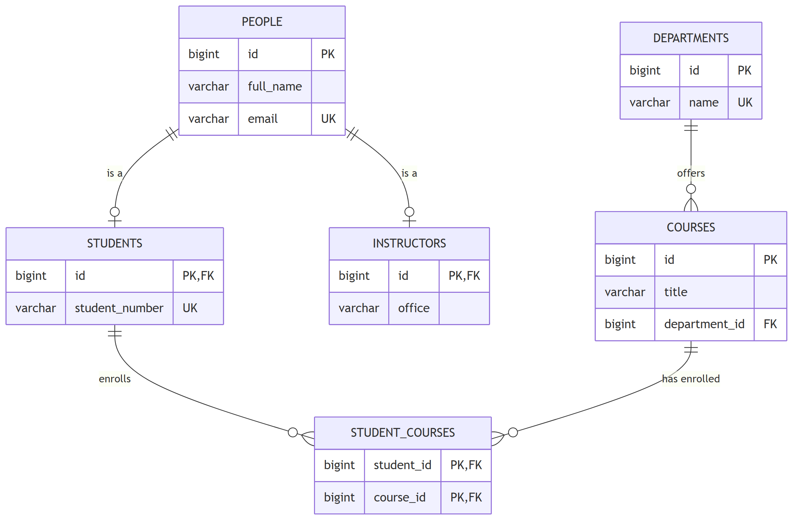
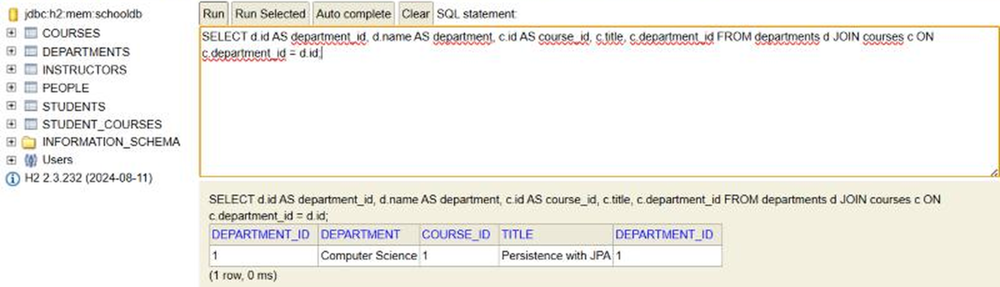
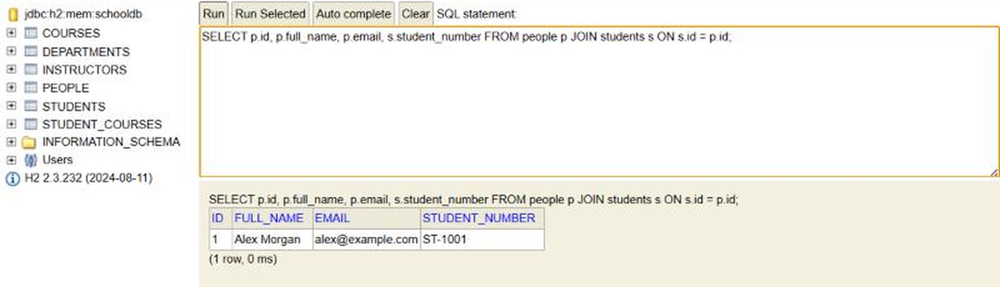
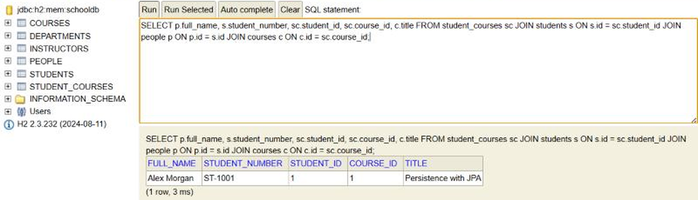
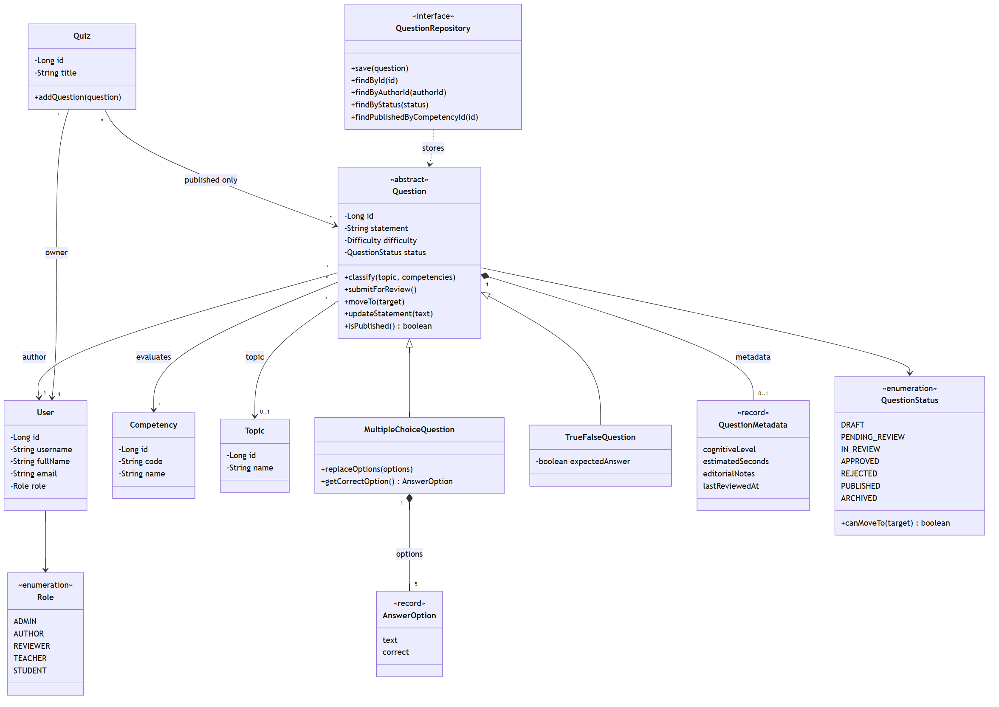
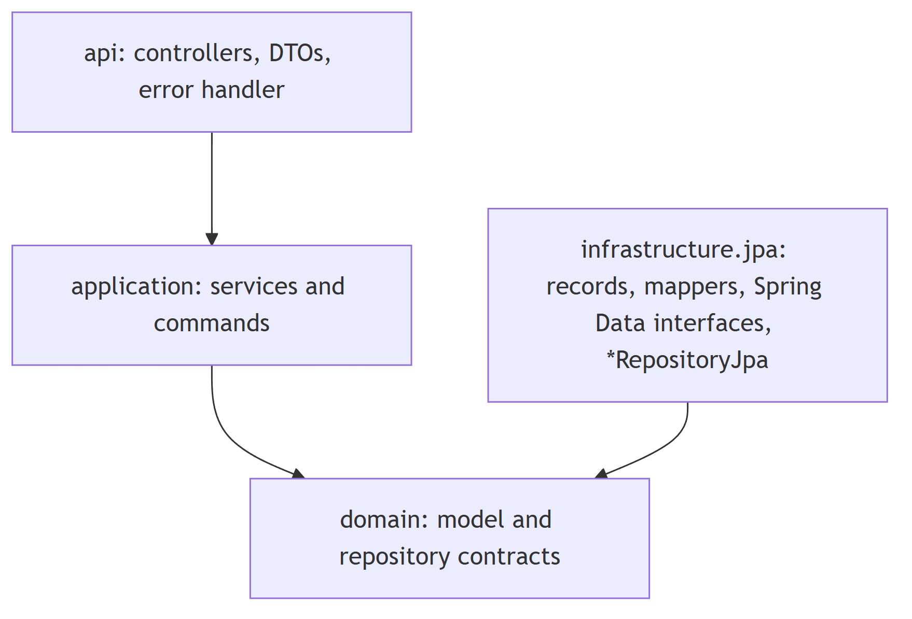
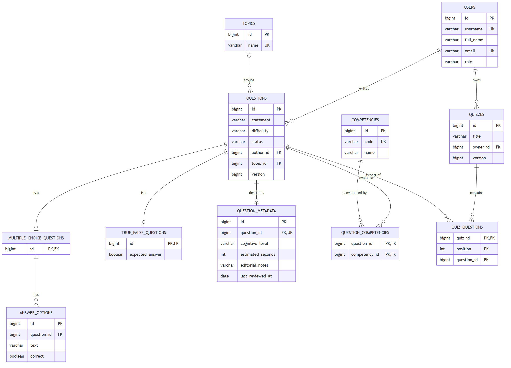

# Informe del Taller 10: persistencia con JPA

## 1. Introducción

En el proyecto de curso, el banco de preguntas Saber Pro, las clases de negocio y las tablas de la base de datos cambian por razones distintas. Si una pregunta lleva anotaciones de JPA, cada cambio en una tabla toca una clase que debería hablar solo de preguntas. Este taller muestra otra forma: el dominio es Java normal y la persistencia vive en clases aparte.

El trabajo tiene tres partes. Primero estudiamos el demo del docente (cursos, estudiantes y departamentos), lo ejecutamos y revisamos sus tablas en H2. Después diseñamos el dominio del banco de preguntas con las cuatro relaciones y una jerarquía de herencia. Por último lo implementamos en capas, con contratos de repositorio en el dominio y clases JPA que los cumplen.

El código está en Java 17 (Spring Boot 3.5, Spring Data JPA, H2 y JUnit 5) y se puede consultar en https://github.com/DVLASZ/ingenieria-software-2 (carpeta `talleres/Taller-10-JPA`). Código, nombres y README están en inglés porque lo pide el enunciado. El informe va en español.

### 1.1 Objetivo general

Persistir un modelo de dominio con JPA sin poner anotaciones tecnológicas en las clases de negocio, y aplicarlo al banco de preguntas Saber Pro.

### 1.2 Objetivos específicos

- Entender cómo el demo separa dominio, aplicación, API e infraestructura, y comprobar sus tablas en la consola de H2.
- Diseñar el dominio del banco de preguntas con un diagrama de clases y un modelo relacional.
- Mapear una relación de cada tipo (uno a uno, uno a muchos, muchos a uno y muchos a muchos) y una jerarquía con herencia JOINED.
- Definir contratos de repositorio en el dominio e implementarlos con Spring Data JPA.
- Probar la persistencia, las reglas del ciclo de vida y la separación entre capas con pruebas automáticas.

### 1.3 Contenido del informe

**Tabla 1.** Dónde está cada entregable del taller.

| Entregable | Dónde está |
|---|---|
| Análisis del demo y tabla de arquitectura | Capítulo 2 |
| Respuestas sobre el demo | Secciones 2.2 a 2.4 |
| Esquema relacional del demo | Figura 2 |
| Evidencia de la consola H2 | Sección 2.5 |
| Diagrama de clases UML del banco de preguntas | Figura 7 |
| Diagrama del modelo relacional con claves | Figura 11 |
| Arquitectura, contratos e implementaciones JPA | Capítulo 4 |
| Pruebas | Capítulo 6 |
| Preguntas de sustentación | Capítulo 7 |
| Enlaces al repositorio | Tabla 11 |

## 2. Parte I: análisis del demo

El demo es un proyecto Spring Boot con H2 que maneja departamentos, cursos y estudiantes. Lo bajamos, lo compilamos con `mvn clean test` (compila, pero el zip no trae pruebas y Maven responde que no hay ninguna) y lo corrimos con `mvn spring-boot:run`. Lo ejecutamos con JDK 21 aunque el demo declara Java 17.

### 2.1 Reconocimiento de la arquitectura

El demo tiene cuatro paquetes dentro de `com.example.persistence`, como muestra la Figura 1.

```
persistence/
  api/             SchoolController
  application/     SchoolService
  domain/          Person, Student, Instructor, Department, Course
    repository/    StudentRepository, CourseRepository,
                   DepartmentRepository
  infrastructure/jpa/
    StudentRepositoryJpa, CourseRepositoryJpa,
    DepartmentRepositoryJpa, DomainMapper
    record/        PersonRecord, StudentRecord, InstructorRecord,
                   DepartmentRecord, CourseRecord
    repository/    SpringStudentDataRepository,
                   SpringCourseDataRepository,
                   SpringDepartmentDataRepository
```

**Figura 1.** Estructura de paquetes del demo.

La Tabla 2 completa la tabla de la guía.

**Tabla 2.** Capas del demo y responsabilidad de cada clase.

| Elemento | Archivo o clase | Responsabilidad |
|---|---|---|
| Presentación | `SchoolController` | Expone los endpoints REST bajo `/api`. Recibe los cuerpos JSON, llama al servicio y devuelve objetos de dominio |
| Aplicación | `SchoolService` | Coordina los casos de uso (crear departamento, curso y estudiante, matricular, listar). Abre la transacción y solo conoce los contratos de repositorio |
| Dominio | `Student`, `Course`, `Department` | Representan al estudiante, al curso y al departamento como objetos Java sin anotaciones. El curso guarda el id de su departamento y el estudiante guarda los ids de sus cursos |
| Contrato de repositorio | `StudentRepository` | Define `save`, `findById`, `findAll` y `enrollInCourse`, sin tipos de Spring ni de JPA |
| Implementación concreta | `StudentRepositoryJpa` | Convierte el estudiante a record, lo guarda con Spring Data y lo convierte de vuelta. Para matricular, carga el estudiante y el curso, agrega el curso a la colección y guarda dentro de una transacción |
| Modelo JPA | `StudentRecord` | Es la entidad que se guarda en la tabla `students`. Lleva el número de estudiante y la relación muchos a muchos con los cursos |
| Conversión de modelos | `DomainMapper` | Traduce entre objetos de dominio y records. Es el único lugar donde se conocen los dos modelos |

### 2.2 Respuestas sobre la arquitectura

**1. ¿Qué ocurriría si se agregara @Entity a Student?**

El dominio quedaría atado a `jakarta.persistence` y a Hibernate: la clase no compilaría sin esas librerías. Además tendría que cambiar por dentro, porque `Student` guarda `courseIds` como lista de números y JPA necesita una colección de entidades (`Set<Course>`) para mapear la relación. `Person` también tendría que ser entidad o superclase mapeada. Y cualquier ajuste de tabla, por ejemplo cambiar una longitud de columna, obligaría a editar una clase de negocio.

**2. ¿Por qué SchoolService depende de StudentRepository y no de SpringStudentDataRepository?**

`SpringStudentDataRepository` extiende `JpaRepository<StudentRecord, Long>`, así que devuelve y recibe records. Si el servicio lo usara tendría que importar clases de `infrastructure.jpa` y el dominio ya no mandaría sobre la persistencia. Con `StudentRepository` el servicio solo habla en objetos de dominio y se puede probar con una implementación en memoria, que es lo que hicimos en nuestro proyecto.

**3. ¿Qué responsabilidades tiene StudentRepositoryJpa que no deberían estar en Student?**

Buscar registros en la base de datos, convertirlos con el mapper, abrir la transacción de la matrícula, mantener el lado propietario de la colección de cursos y decidir qué hacer cuando un curso o un estudiante no existe. Un `Student` solo debería guardar sus datos y sus reglas.

**4. ¿Qué ventajas y costos introduce tener Student y StudentRecord?**

La ventaja es que el dominio se prueba sin base de datos y que los cambios de tablas quedan en un solo paquete. Los costos son más clases, un mapeo escrito a mano y el riesgo de olvidar un campo. En el demo pasa algo así: según el código, `DomainMapper.toRecord(Student)` no copia las matrículas, y por eso la matrícula tiene su propio método `enrollInCourse` en el repositorio. Si alguien guardara un estudiante que ya tiene cursos con `save`, esos cursos no viajarían al record.

**5. ¿Qué tendría que cambiar si se reemplazara H2 por PostgreSQL manteniendo el contrato?**

Solo la configuración: la dependencia del driver en el `pom.xml`, la URL, el usuario y la contraseña en `application.properties`, y la consola de H2. Conviene cambiar `create-drop` por `validate` o por migraciones, porque en PostgreSQL no queremos que Hibernate cree y borre las tablas. El dominio, el servicio, el contrato, el mapper y los records quedan igual.

### 2.3 Relaciones

La Tabla 3 reúne las anotaciones que encontramos en el paquete `infrastructure.jpa.record`.

**Tabla 3.** Relaciones del demo y su mapeo.

| Relación | Clase y campo | Anotaciones | Dónde queda la clave |
|---|---|---|---|
| Uno a muchos | `DepartmentRecord.courses` | `@OneToMany(mappedBy = "department", cascade = ALL, orphanRemoval = true)` | No tiene columna propia |
| Muchos a uno | `CourseRecord.department` | `@ManyToOne(fetch = LAZY, optional = false)` y `@JoinColumn(name = "department_id", nullable = false)` | `courses.department_id` |
| Muchos a muchos | `StudentRecord.courses` | `@ManyToMany` y `@JoinTable(name = "student_courses")` | Tabla `student_courses` con `student_id` y `course_id` |

El lado propietario entre `DepartmentRecord` y `CourseRecord` es `CourseRecord`, porque la clave foránea `department_id` está en la tabla `courses` y es esa clase la que tiene `@JoinColumn`.

`mappedBy = "department"` aparece en el lado de uno a muchos para decirle a JPA que esa relación ya está mapeada por el campo `department` de `CourseRecord`. Sin eso, Hibernate trataría la colección como una relación propia y crearía una tabla de unión extra.

`@JoinColumn` en el muchos a uno pone nombre a la columna de la clave foránea (`department_id`) y la declara obligatoria. Por eso un curso no puede quedar sin departamento.

La tabla intermedia del muchos a muchos es `student_courses`, con dos columnas que forman la clave primaria y apuntan una a `students` y otra a `courses`.

La colección de cursos del departamento es el lado inverso: no escribe nada en la base, los cursos dependen del departamento (`cascade` y `orphanRemoval`) y es una `List`. La colección de cursos del estudiante es el lado propietario de una relación muchos a muchos: es un `Set`, no tiene cascada porque los cursos existen por su cuenta, y es la que escribe las filas de `student_courses`.

La Figura 2 muestra el esquema relacional que sale de estas anotaciones, con claves primarias, claves foráneas y la tabla intermedia.



**Figura 2.** Esquema relacional del demo.

### 2.4 Herencia

`PersonRecord` lleva `@Inheritance(strategy = InheritanceType.JOINED)`. Con JOINED, Hibernate crea una tabla para la clase base y una tabla por cada subclase. Cada tabla hija usa como clave primaria el mismo id de la base, que a la vez es clave foránea hacia `people`. Para leer un estudiante completo hace un `JOIN` entre `people` y `students`.

**Tabla 4.** Dónde se guarda cada atributo en la jerarquía del demo.

| Tabla | Clase | Columnas |
|---|---|---|
| `people` | `PersonRecord` | `id` (clave primaria), `full_name`, `email` (único) |
| `students` | `StudentRecord` | `id` (clave primaria y foránea a `people`), `student_number` (único) |
| `instructors` | `InstructorRecord` | `id` (clave primaria y foránea a `people`), `office` |

Las clases de dominio (`Person`, `Student`, `Instructor`) tienen los mismos atributos que los records, pero sin anotaciones. Se diferencian en la relación con los cursos: el dominio guarda una lista de ids y el record guarda un `Set<CourseRecord>`. Además los records no tienen setters públicos para el id, que lo pone la base, mientras que el dominio sí tiene `setId`.

**Tabla 5.** Qué cambiaría con otra estrategia de herencia.

| Estrategia | Cómo quedarían las tablas | Efecto |
|---|---|---|
| `JOINED` (la del demo) | `people`, `students` e `instructors` | Cada subtipo conserva sus restricciones `NOT NULL`. Las consultas sobre un subtipo hacen un `JOIN` |
| `SINGLE_TABLE` | Una sola tabla `people` con una columna discriminadora y todas las columnas de los subtipos | No hay `JOIN`, pero `student_number` y `office` tendrían que aceptar nulos, porque un estudiante no tiene oficina |
| `TABLE_PER_CLASS` | `students` e `instructors`, cada una con `full_name` y `email` repetidos, y ninguna tabla `people` | Una consulta sobre `Person` necesita un `UNION`, no sirve `IDENTITY` para el id y no se puede apuntar con una clave foránea a "una persona" |

### 2.5 Ejecución y comprobación

Con la aplicación arriba (`http://localhost:8080`) hicimos las operaciones mínimas con `curl`. La Figura 3 muestra las llamadas y las respuestas.

```
$ POST /api/departments
{"id":1,"name":"Computer Science"}
$ POST /api/courses
{"id":1,"title":"Persistence with JPA","departmentId":1}
$ POST /api/students
{"id":1,"fullName":"Alex Morgan","email":"alex@example.com","studentNumber":"ST-1001","courseIds":[]}
$ POST /api/students/1/courses/1
{"id":1,"fullName":"Alex Morgan","email":"alex@example.com","studentNumber":"ST-1001","courseIds":[1]}
$ GET /api/students
[{"id":1,"fullName":"Alex Morgan","email":"alex@example.com","studentNumber":"ST-1001","courseIds":[1]}]
$ POST /api/courses con departamento inexistente
500
$ POST /api/departments con nombre repetido
500
```

**Figura 3.** Operaciones ejecutadas contra la API del demo.

Después entramos a la consola de H2 (`http://localhost:8080/h2-console`, con `jdbc:h2:mem:schooldb`, usuario `sa` y sin contraseña) y revisamos las tablas. La Figura 4 muestra el departamento y su curso, unidos por `department_id`.



**Figura 4.** Departamento y curso en la consola de H2.

La Figura 5 muestra que el estudiante ocupa dos tablas: `people` guarda el nombre y el correo, y `students` el número de estudiante.



**Figura 5.** Estudiante guardado con herencia JOINED.

La Figura 6 muestra la matrícula, que quedó como una fila de `student_courses`.



**Figura 6.** Matrícula del estudiante en el curso.

Lo último que se ve en la Figura 3 no es un error nuestro: el demo no tiene manejo de errores. Un curso con un departamento que no existe lanza `IllegalArgumentException` y un departamento con el mismo nombre rompe la restricción `unique`. En los dos casos el cliente recibe un 500 sin explicación. En nuestro proyecto esos casos responden 404 y 409 con el motivo.

## 3. Parte II: diseño del banco de preguntas

### 3.1 Modelo de dominio

El banco de preguntas necesita usuarios con rol, preguntas de varios tipos, una clasificación por tema y competencias, y cuestionarios. No implementamos todo el catálogo sugerido por la guía. Nos quedamos con `User`, `Role`, `Competency`, `Topic`, `Question` (con `MultipleChoiceQuestion` y `TrueFalseQuestion`), `AnswerOption`, `QuestionMetadata` y `Quiz`. Las revisiones, el historial y los intentos de los estudiantes ya existen como microservicios en el proyecto de curso y no hacían falta para demostrar el taller.

La Figura 7 muestra el diagrama de clases.



**Figura 7.** Diagrama de clases del banco de preguntas.

Las reglas de negocio están en el dominio y no en la base:

- Una pregunta nace en `DRAFT`. `QuestionStatus.canMoveTo` define qué cambios de estado son válidos, y cualquier estado puede pasar a `ARCHIVED`.
- Solo se envía a revisión una pregunta con tema, al menos una competencia y contenido válido. Una de selección múltiple necesita cinco opciones con una sola correcta.
- El enunciado solo se edita mientras la pregunta es un borrador.
- Un `Quiz` solo acepta preguntas publicadas.

### 3.2 Las cuatro relaciones

**Tabla 6.** Relaciones del banco de preguntas y decisiones de diseño.

| Tipo | Clases | Lado propietario y clave | Decisiones |
|---|---|---|---|
| `@OneToOne` | `Question` y `QuestionMetadata` | `QuestionMetadataRecord` es el dueño: `question_metadata.question_id`, única y no nula | Los metadatos son opcionales. La restricción `unique` impide que una pregunta tenga dos registros. Con cascada y `orphanRemoval`, si se borra la pregunta se borran sus metadatos |
| `@OneToMany` | `MultipleChoiceQuestion` y `AnswerOption` | `AnswerOptionRecord` es el dueño: `answer_options.question_id`, no nula | Cascada y `orphanRemoval`: una opción no existe sin su pregunta. El dominio comprueba que haya cinco opciones y una sola correcta |
| `@ManyToOne` | `Question` hacia `User` (autor) y hacia `Topic` | `QuestionRecord`: `questions.author_id` (no nula) y `questions.topic_id` (opcional) | La clave foránea impide un autor inexistente. El tema es opcional porque la pregunta nace sin clasificar |
| `@ManyToMany` | `Question` y `Competency`, y `Quiz` y `Question` | Tablas `question_competencies` y `quiz_questions` | La primera no tiene atributos propios y se queda como `@ManyToMany`. La segunda usa `@OrderColumn` para guardar el orden de las preguntas |

Para la relación con las competencias dejamos `@ManyToMany` porque no guardamos ningún dato de la asociación. Si hubiera que registrar el porcentaje de contribución de cada competencia, habría que crear una entidad `QuestionCompetency` con dos relaciones muchos a uno.

### 3.3 Herencia

Elegimos `JOINED` para `Question`. Los datos comunes (enunciado, dificultad, estado, autor y tema) están en `questions`; la pregunta verdadero o falso solo agrega `expected_answer` en `true_false_questions`, y la de selección múltiple tiene su tabla `multiple_choice_questions` con las opciones aparte.

Con `SINGLE_TABLE` todas las columnas de los subtipos quedarían en la misma tabla y tendrían que aceptar nulos, así que la base no podría exigir que una pregunta de selección múltiple tenga lo que le corresponde. Con `TABLE_PER_CLASS` cada consulta de preguntas, por ejemplo "las publicadas de una competencia", necesitaría un `UNION`, y las tablas de unión como `quiz_questions` no podrían apuntar a una sola tabla de preguntas. Como el banco puede ganar más tipos de pregunta, cada uno con sus propias reglas, `JOINED` nos deja agregar una tabla por tipo con sus restricciones `NOT NULL` reales.

La jerarquía de dominio (`Question`, `MultipleChoiceQuestion`, `TrueFalseQuestion`) y la de persistencia (`QuestionRecord`, `MultipleChoiceQuestionRecord`, `TrueFalseQuestionRecord`) son independientes. Un mapper decide qué record corresponde a cada clase.

## 4. Parte III: arquitectura en capas y persistencia

### 4.1 Capas y dependencias

El proyecto sigue la estructura que propone la guía, ampliada con los paquetes que fueron haciendo falta. Son cuatro capas y las flechas de dependencia van en un solo sentido (Figura 8).



**Figura 8.** Capas y dependencias del proyecto.

**Tabla 7.** Paquetes del proyecto.

| Paquete | Qué contiene |
|---|---|
| `api` | Controladores REST, DTO con validación (`@NotNull`, `@Size`) y `GlobalExceptionHandler`, que convierte las excepciones en 404, 409 y 400 |
| `application` | `QuestionService`, `QuizService`, `UserService`, `CatalogService` y los comandos. Dependen solo de los contratos de repositorio |
| `domain.model` | `Question` y sus subclases, `Quiz`, `User`, `Competency`, `Topic`, `QuestionStatus` y el resto del modelo |
| `domain.repository` | Contratos como `QuestionRepository`, sin tipos de Spring ni de JPA |
| `infrastructure.jpa.record` | Las clases con `@Entity` y las anotaciones de relación |
| `infrastructure.jpa.repository` | Las interfaces de Spring Data (`Spring*DataRepository`) |
| `infrastructure.jpa.mapper` | Los mappers entre dominio y records |
| `infrastructure.jpa` | Las clases `*RepositoryJpa`, que cumplen los contratos del dominio |

Estas reglas no quedaron solo escritas: `LayeringTest`, hecha con ArchUnit, falla si el dominio importa `jakarta.persistence`, Spring o Hibernate, si un servicio importa Spring Data o un record, si un controlador toca la infraestructura, o si aparece un `@Entity` fuera de `infrastructure.jpa.record`.

### 4.2 Mapeo con JPA

La Figura 9 muestra el record base de la jerarquía de preguntas. Ahí están juntos la herencia, la versión para bloqueo optimista y tres de las cuatro relaciones.

```java
@Entity
@Table(name = "questions")
@Inheritance(strategy = InheritanceType.JOINED)
public abstract class QuestionRecord {
    @Id @GeneratedValue(strategy = GenerationType.IDENTITY)
    private Long id;

    @Version
    private Long version;

    @ManyToOne(fetch = FetchType.LAZY, optional = false)
    @JoinColumn(name = "author_id", nullable = false)
    private UserRecord author;

    @ManyToOne(fetch = FetchType.LAZY)
    @JoinColumn(name = "topic_id")
    private TopicRecord topic;

    @ManyToMany
    @OrderBy("code")
    @BatchSize(size = 50)
    @JoinTable(name = "question_competencies",
            joinColumns = @JoinColumn(name = "question_id"),
            inverseJoinColumns = @JoinColumn(name = "competency_id"))
    private Set<CompetencyRecord> competencies = new HashSet<>();

    @OneToOne(mappedBy = "question", cascade = CascadeType.ALL, orphanRemoval = true)
    private QuestionMetadataRecord metadata;
}
```

**Figura 9.** Mapeo de `QuestionRecord` (se omiten los campos simples y los métodos).

### 4.3 Contratos y mappers

El contrato de preguntas, en el dominio, cubre las consultas que pide la guía (Figura 10).

```java
public interface QuestionRepository {
    Question save(Question question);
    Optional<Question> findById(Long id);
    List<Question> findAllById(Collection<Long> ids);
    List<Question> findAll();
    List<Question> findByAuthorId(Long authorId);
    List<Question> findByStatus(QuestionStatus status);
    List<Question> findPublishedByCompetencyId(Long competencyId);
}
```

**Figura 10.** Contrato `QuestionRepository`.

`QuestionRepositoryJpa` lo implementa con `SpringQuestionDataRepository`. Al guardar una pregunta que ya existe, carga su record y le copia el estado nuevo, en lugar de crear un record desde cero, para no perder las asociaciones que no cambiaron. Las opciones solo se reemplazan si cambiaron.

Los mappers leen asociaciones perezosas, así que corren dentro de la transacción de los `*RepositoryJpa` (`@Transactional(readOnly = true)` en la clase). Fuera de una transacción, el record no puede leer sus competencias y Hibernate lanza `LazyInitializationException`. `LazyLoadingTest` muestra los dos casos.

### 4.4 Casos de uso

**Tabla 8.** Casos de uso implementados y regla que comprueba cada uno.

| Caso de uso | Servicio y ruta | Regla de negocio |
|---|---|---|
| Crear una pregunta | `QuestionService.createMultipleChoice` y `createTrueFalse` (`POST /api/questions/...`) | El autor debe existir y tener el rol de autor. Nace en `DRAFT` |
| Consultar preguntas | `QuestionService.findById` y `list` (`GET /api/questions`) | Se filtra por autor, por estado o por ambos. Las publicadas de una competencia tienen su propia consulta |
| Clasificar una pregunta | `QuestionService.classify` (`PUT /api/questions/{id}/classification`) | El tema y las competencias deben existir. Solo se clasifica mientras la pregunta es un borrador |
| Enviar a revisión | `QuestionService.submitForReview` (`POST /api/questions/{id}/submit`) | Necesita tema, competencia y contenido válido. Si falla, el estado no cambia |
| Cambiar de estado | `QuestionService.changeStatus` (`POST /api/questions/{id}/status`) | Solo pasan las transiciones que acepta `canMoveTo` |
| Crear un cuestionario | `QuizService.create` (`POST /api/quizzes`) | Todas las preguntas deben estar publicadas. Si una no lo está, no se crea el cuestionario |

Los servicios son transaccionales, de modo que si una regla falla a la mitad no queda nada guardado.

## 5. Modelo relacional

La Figura 11 muestra las tablas que genera Hibernate a partir de los records, con claves primarias (PK), foráneas (FK) y únicas (UK).



**Figura 11.** Modelo relacional del banco de preguntas.

**Tabla 9.** Restricciones que protegen los datos en la base.

| Restricción | Dónde | Qué impide |
|---|---|---|
| Clave foránea no nula | `questions.author_id` | Una pregunta sin autor o con un autor que no existe |
| Clave foránea no nula | `answer_options.question_id` | Una opción suelta, sin pregunta |
| Única | `question_metadata.question_id` | Dos registros de metadatos para la misma pregunta |
| Únicas | `users.username`, `users.email`, `competencies.code`, `topics.name` | Duplicados en el catálogo |
| Clave compuesta | `question_competencies` (`question_id`, `competency_id`) | Asociar dos veces la misma competencia a una pregunta |
| Clave compuesta | `quiz_questions` (`quiz_id`, `position`) | Dos preguntas en la misma posición de un cuestionario |
| Versión | `questions.version` y `quizzes.version` | Que dos cambios simultáneos se pisen sin aviso |

## 6. Pruebas

`mvn test` corre 159 pruebas con H2 en memoria, sin Docker y sin base externa. Cada grupo prueba una cosa distinta.

**Tabla 10.** Pruebas por capa.

| Capa | Pruebas | Qué comprueban |
|---|---|---|
| Dominio | 66 | Ciclo de vida, transiciones de estado, reglas de las opciones y del cuestionario, con JUnit sin Spring |
| Aplicación | 28 | Los casos de uso con repositorios en memoria que implementan los contratos, sin JPA |
| Infraestructura JPA | 40 | Guardar y leer los dos tipos de pregunta, las cuatro relaciones, las consultas, las claves foráneas y restricciones únicas, la carga perezosa y el bloqueo optimista |
| API | 16 | La aplicación completa por HTTP con `MockMvc`, con casos de éxito y de error. Sin transacción alrededor del test, así cada petición se confirma y lee de la base |
| Arquitectura | 9 | Las reglas de dependencia entre capas con ArchUnit |

La Figura 12 muestra el resultado de la última corrida.

```
 16 ok  Question bank API, end to end
 15 ok  Question use cases (in-memory repositories)
  9 ok  Quiz use cases (in-memory repositories)
  4 ok  User and catalog use cases
 10 ok  Multiple choice question
 15 ok  Question lifecycle rules
 29 ok  Question status transitions
  6 ok  Quiz rules
  6 ok  Users, competencies and topics
  2 ok  Lazy associations outside a transaction
  1 ok  Optimistic locking
  9 ok  Foreign keys and constraints
 18 ok  Question repository with JPA and H2
  6 ok  Quiz repository with JPA and H2
  4 ok  User, competency and topic repositories
  9 ok  LayeringTest
--- Tests run: 159, Failures: 0, Errors: 0, Skipped: 0
--- BUILD SUCCESS
```

**Figura 12.** Resultado de `mvn test` (pruebas que pasan por grupo).

También generamos el JavaDoc con `mvn javadoc:javadoc -Ddoclint=all` y sale sin avisos.

## 7. Preguntas de sustentación

**1. ¿Qué ventajas y desventajas tiene mantener un modelo de dominio y otro de persistencia?**

La ventaja que más sentimos fue probar. Las 28 pruebas de aplicación y las 66 de dominio corren sin base de datos ni Spring. La desventaja es el trabajo extra: cada atributo nuevo se escribe en el dominio, en el record y en el mapper, y si se olvida uno el error aparece tarde. Para un modelo pequeño casi no vale la pena. Para uno con reglas como las del ciclo de vida, sí.

**2. ¿Qué cambios serían necesarios si el sistema dejara de usar JPA?**

Habría que escribir otra implementación de cada contrato (por ejemplo con JDBC o con una base documental) y cambiar su configuración. El dominio, los servicios, la API y las pruebas de dominio y aplicación no cambian, porque solo conocen los contratos. Se reemplazaría el paquete `infrastructure.jpa` completo, y las pruebas de ese paquete.

**3. ¿Cuándo conviene una relación muchos a muchos directa y cuándo una entidad asociativa?**

Directa cuando la asociación no tiene datos propios, como pregunta y competencia en nuestro caso. Una entidad asociativa cuando la asociación guarda algo, por ejemplo el porcentaje con que una competencia contribuye a una pregunta, o cuando hay que consultarla por sí sola. En `quiz_questions` guardamos el orden, pero lo resolvimos con `@OrderColumn`, que es parte del mapeo de la lista y no un dato de negocio.

**4. ¿Qué problemas aparecen al recuperar asociaciones perezosas fuera de una transacción?**

Hibernate lanza `LazyInitializationException` porque la sesión ya se cerró. Nos pasó con los mappers: leen las competencias de la pregunta, así que tuvimos que dejarlos dentro de la transacción de `*RepositoryJpa`. También encontramos el problema contrario: el lado inverso de un `@OneToOne` no puede ser perezoso sin instrumentar el código, y listar preguntas hacía un `select` extra por cada una para traer sus metadatos. Dejamos `@BatchSize` en las colecciones para reducir ese costo y aceptamos el del `@OneToOne`.

**5. ¿Qué estrategia de herencia elegirían si el sistema incorpora muchos tipos de pregunta con atributos y reglas diferentes?**

Seguiríamos con `JOINED`. Con muchos tipos, `SINGLE_TABLE` acumula columnas que casi siempre son nulas y no deja poner `NOT NULL` por tipo. `TABLE_PER_CLASS` obliga a `UNION` en cada consulta general. El costo de `JOINED` es el `JOIN` al leer, que en este sistema pesa poco frente a lo que se gana en integridad.

**6. ¿Por qué la persistencia de una pregunta y la validación de su ciclo de vida son responsabilidades distintas?**

Guardar es una decisión técnica (qué tabla, qué consulta) y validar es una regla del negocio (qué cambios de estado son legales). Si se mezclan, la regla queda escondida en el repositorio y no se puede probar sin base de datos. En el proyecto, `QuestionStatus.canMoveTo` y `Question.submitForReview` viven en el dominio, y el servicio solo llama a la regla y a la transacción. El repositorio guarda lo que el dominio ya aceptó.

## 8. Dificultades

La primera versión de la regla de ArchUnit que prohíbe a los servicios importar Spring Data estaba mal escrita: filtraba por la interfaz equivocada y no detectaba nada. La corregimos y comprobamos que falla cuando metemos un import prohibido.

Al revisar el código con un revisor de Java y uno de bases de datos vimos tres cosas que no teníamos: dos personas podían editar la misma pregunta y la segunda sobrescribía a la primera, algunas listas no tenían un orden fijo y el `@OneToOne` hacía consultas de más. Agregamos `@Version` a preguntas y cuestionarios (la API responde 409 si hay conflicto), ordenamos las consultas por id y pusimos `@BatchSize`. Las pruebas de `OptimisticLockingTest` y de los límites de tamaño salieron de ahí.

La guía pide "cuatro distractores y una respuesta correcta", que son cinco opciones, y en el proyecto de curso las preguntas tienen cuatro opciones en total. Aquí seguimos la guía y dejamos los números como constantes en `MultipleChoiceQuestion`, para cambiarlos en un solo lugar.

## 9. Enlaces

**Tabla 11.** Enlaces del trabajo.

| Recurso | Dirección |
|---|---|
| Repo | https://github.com/DVLASZ/ingenieria-software-2 |
| Carpeta | https://github.com/DVLASZ/ingenieria-software-2/tree/main/talleres/Taller-10-JPA |
| Proyecto | https://github.com/DVLASZ/ingenieria-software-2/tree/main/talleres/Taller-10-JPA/lisw2_taller10_jpa_g2 |
