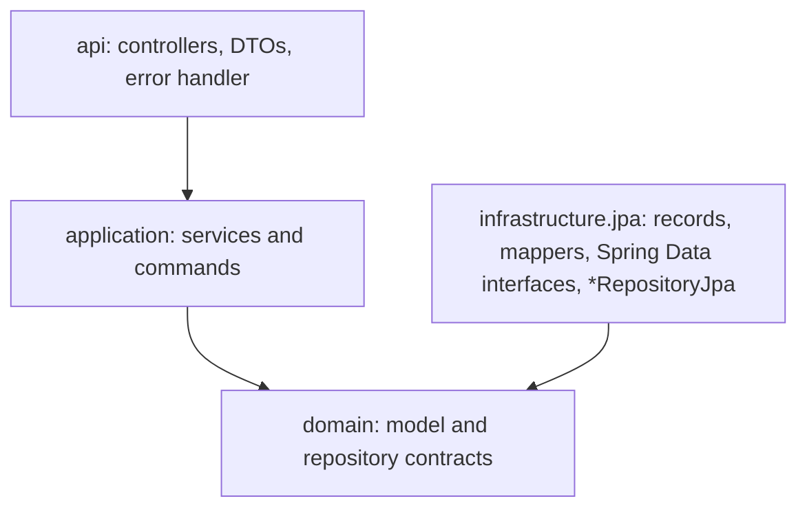
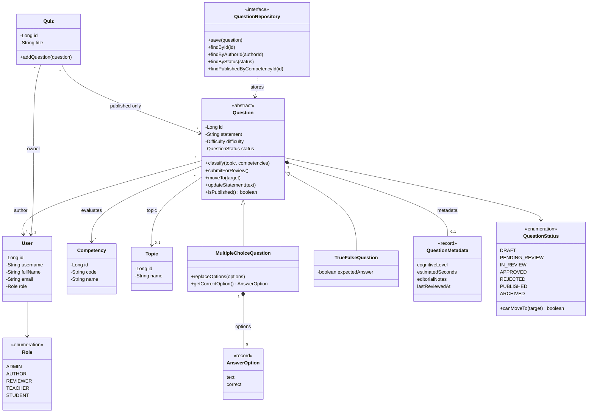
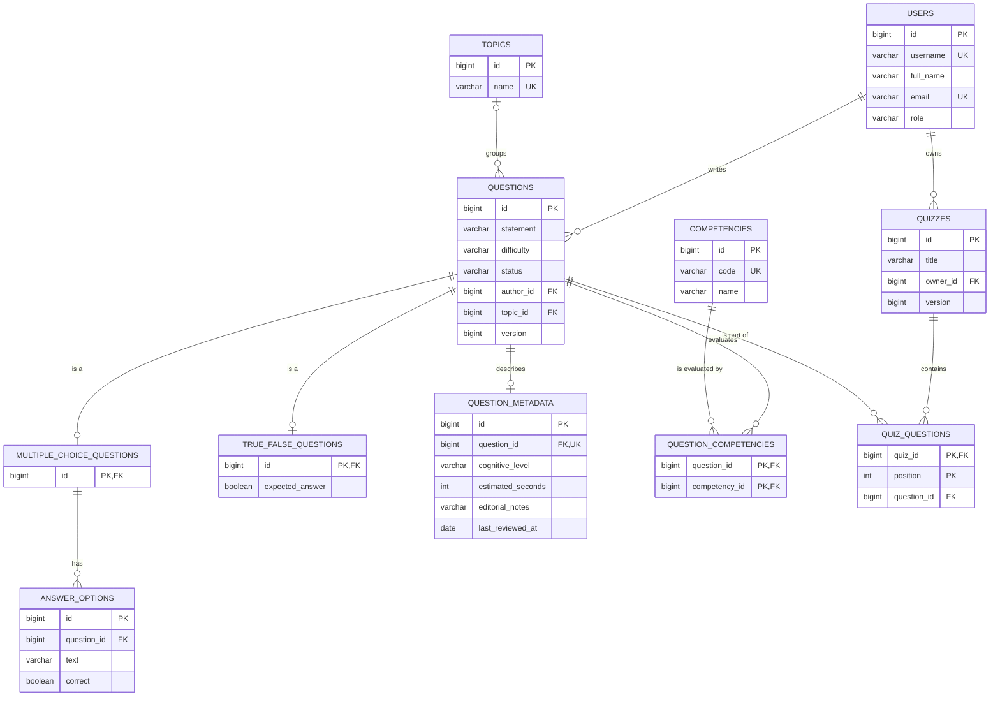

# Question Bank JPA

Workshop 10 of Software Engineering II Lab (Universidad del Cauca, group 2). It persists the Saber Pro question bank
with JPA and H2 while keeping the business classes free of persistence annotations.

The domain classes are plain Java. The JPA mapping lives in separate classes (the records), and mappers translate
between the two. The application is layered: `api`, `application`, `domain` and `infrastructure.jpa`.

## What it does

- Creates users, competencies and topics.
- Creates multiple choice questions (one correct option and four distractors) and true/false questions.
- Classifies a question with a topic and one or more competencies.
- Sends a draft to review, only if it has a topic, a competency and valid content.
- Moves a question through the life cycle: `DRAFT`, `PENDING_REVIEW`, `IN_REVIEW`, `APPROVED`, `PUBLISHED`,
  `ARCHIVED`. A rejected question goes back to `DRAFT`, and any status can go to `ARCHIVED`.
- Creates a quiz that only accepts published questions.

## Architecture



| Package | What lives there |
|---|---|
| `api` | `@RestController` classes, request and response DTOs with validation, `GlobalExceptionHandler` |
| `application` | `QuestionService`, `QuizService`, `UserService`, `CatalogService` and the command records. Each service depends on repository contracts only |
| `domain.model` | Business classes and rules: `Question`, `MultipleChoiceQuestion`, `TrueFalseQuestion`, `Quiz`, `QuestionStatus` and the rest |
| `domain.repository` | Technology-independent contracts such as `QuestionRepository` |
| `infrastructure.jpa.record` | Classes with `@Entity` and the relationship annotations |
| `infrastructure.jpa.repository` | Spring Data interfaces (`Spring*DataRepository`) |
| `infrastructure.jpa.mapper` | Static mappers between domain objects and records |
| `infrastructure.jpa` | `*RepositoryJpa`, the classes that implement the domain contracts |

Rules that the build checks (`LayeringTest`, with ArchUnit): the domain does not import `jakarta.persistence`, Spring
or Hibernate; services do not import Spring Data or the records; controllers do not touch the infrastructure; and
`@Entity` classes only exist in `infrastructure.jpa.record`.

## Domain model



The four relationship types the workshop asks for:

| Type | Where | Owner and foreign key |
|---|---|---|
| `@OneToOne` | `Question` and `QuestionMetadata` | The metadata owns it: `question_metadata.question_id`, unique and not null |
| `@OneToMany` | `MultipleChoiceQuestion` and `AnswerOption` | The option owns it: `answer_options.question_id`, not null, with cascade and orphan removal |
| `@ManyToOne` | `Question` to `User` (author) and to `Topic` | The question owns them: `questions.author_id` (not null) and `questions.topic_id` |
| `@ManyToMany` | `Question` and `Competency`, and `Quiz` and `Question` | Join tables `question_competencies` and `quiz_questions` (this one keeps the order) |

## Relational model



## Design decisions

Inheritance uses `JOINED`. The common columns live in `questions`, the options live apart for multiple choice, and a
true/false question only adds `expected_answer` in its own table. `SINGLE_TABLE` would put every subtype column in one
table, all of them nullable, and `TABLE_PER_CLASS` would need a `UNION` for each polymorphic query. With more question
types and different rules for each one, `JOINED` keeps each type in its own table with real `NOT NULL` constraints.

The many to many relation between a question and its competencies stays as `@ManyToMany` because the association has
no attributes. If it needed a weight per competency, it should become an association entity `QuestionCompetency` with
two many to one relations.

The domain says "four distractors and one correct option", as the workshop guide does. That is five options in total.
The numbers are constants in `MultipleChoiceQuestion` (`DISTRACTORS` and `CORRECT_OPTIONS`).

Saving an existing question loads its record and copies the new state into it, so associations that did not change are
not lost. The options are only replaced when they differ from the stored ones.

Questions and quizzes have a `@Version` column. If two people change the same question at the same time, the second
save fails with an optimistic locking error and the API answers `409` instead of overwriting the first change
(`OptimisticLockingTest`).

The `@OneToOne` side that does not own the foreign key (`Question.metadata`) is loaded eagerly: Hibernate cannot make that
side lazy without bytecode enhancement, so listing questions runs one extra select per question for its metadata. The
collections use `@BatchSize` to avoid the same problem. Lists come back ordered by id.

The mappers read lazy associations, so they run inside the transaction of the `*RepositoryJpa` classes (class-level
`@Transactional(readOnly = true)`). Outside a transaction a record cannot read its competencies and Hibernate throws
`LazyInitializationException`. `LazyLoadingTest` shows both cases.

## Run it

Requirements: JDK 17 or newer and Maven 3.9 or newer.

```bash
mvn test
mvn spring-boot:run
```

The API starts at `http://localhost:8080`. The H2 console is at `http://localhost:8080/h2-console` with these values:

- JDBC URL: `jdbc:h2:mem:questionbank`
- User name: `sa`
- Password: empty

The database lives in memory and is created again on every start (`create-drop`).

## Example

```bash
curl -X POST localhost:8080/api/users -H "Content-Type: application/json" \
  -d '{"username":"ada","fullName":"Ada Lovelace","email":"ada@example.com","role":"AUTHOR"}'
curl -X POST localhost:8080/api/users -H "Content-Type: application/json" \
  -d '{"username":"grace","fullName":"Grace Hopper","email":"grace@example.com","role":"TEACHER"}'
curl -X POST localhost:8080/api/topics -H "Content-Type: application/json" -d '{"name":"Argumentative texts"}'
curl -X POST localhost:8080/api/competencies -H "Content-Type: application/json" \
  -d '{"code":"CRIT","name":"Critical reading"}'

curl -X POST localhost:8080/api/questions/multiple-choice -H "Content-Type: application/json" -d '{
  "statement":"What is the main idea of the text?","difficulty":"MEDIUM","authorId":1,
  "options":[{"text":"The author defends a thesis","correct":true},{"text":"The author tells a story","correct":false},
             {"text":"The author lists data","correct":false},{"text":"The author asks a question","correct":false},
             {"text":"The author gives instructions","correct":false}],
  "metadata":{"cognitiveLevel":"Analysis","estimatedSeconds":90}}'

curl -X PUT localhost:8080/api/questions/1/classification -H "Content-Type: application/json" \
  -d '{"topicId":1,"competencyIds":[1]}'
curl -X POST localhost:8080/api/questions/1/submit
for s in IN_REVIEW APPROVED PUBLISHED; do
  curl -X POST localhost:8080/api/questions/1/status -H "Content-Type: application/json" -d "{\"target\":\"$s\"}"
done
curl -X POST localhost:8080/api/quizzes -H "Content-Type: application/json" \
  -d '{"title":"Midterm","ownerId":2,"questionIds":[1]}'
```

Sending the question to review before classifying it, or creating the quiz before the question is published, answers
`409` with the reason. A missing author, question or topic answers `404`, and an invalid body answers `400`.

| Method and path | Use case |
|---|---|
| `POST /api/users`, `GET /api/users`, `GET /api/users/{id}` | Users |
| `POST /api/topics`, `GET /api/topics`, `POST /api/competencies`, `GET /api/competencies` | Classification data |
| `POST /api/questions/multiple-choice`, `POST /api/questions/true-false` | Create a question |
| `GET /api/questions/{id}`, `GET /api/questions?authorId=&status=` | Query questions |
| `GET /api/questions/published?competencyId=` | Published questions of a competency |
| `PUT /api/questions/{id}/classification` | Classify a question |
| `POST /api/questions/{id}/submit` | Send to review |
| `POST /api/questions/{id}/status` | Move to another status |
| `POST /api/quizzes`, `GET /api/quizzes`, `GET /api/quizzes/{id}` | Quizzes |

## Tests

`mvn test` runs 159 tests and uses no Docker and no external database.

| Folder | What it checks |
|---|---|
| `domain` | Life cycle rules, option rules and quiz rules, with plain JUnit and no Spring |
| `application` | Use cases with in-memory repositories that implement the domain contracts, so JPA is not involved |
| `infrastructure.jpa` | Save and read both question types, the four relations, queries, updates, foreign keys, unique constraints, lazy loading and optimistic locking, on H2 |
| `api` | The whole application over HTTP with `MockMvc`, with success and error cases. No transaction wraps the test, so every request commits and reads from the database |
| `architecture` | The dependency rules between layers |

`mvn javadoc:javadoc -Ddoclint=all` builds the documentation without warnings.
