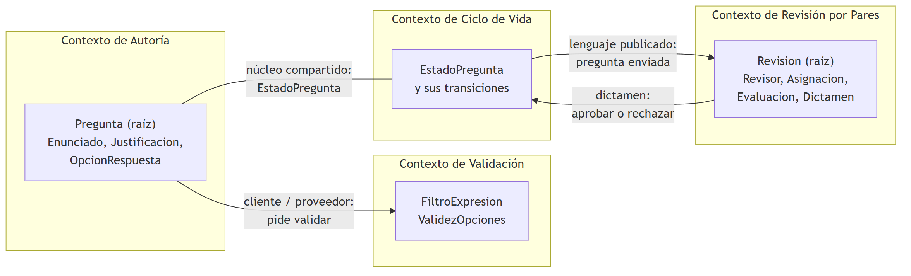
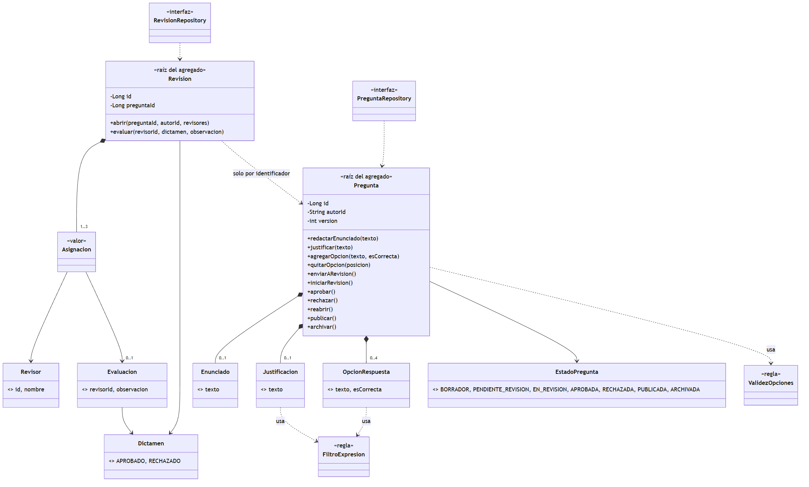
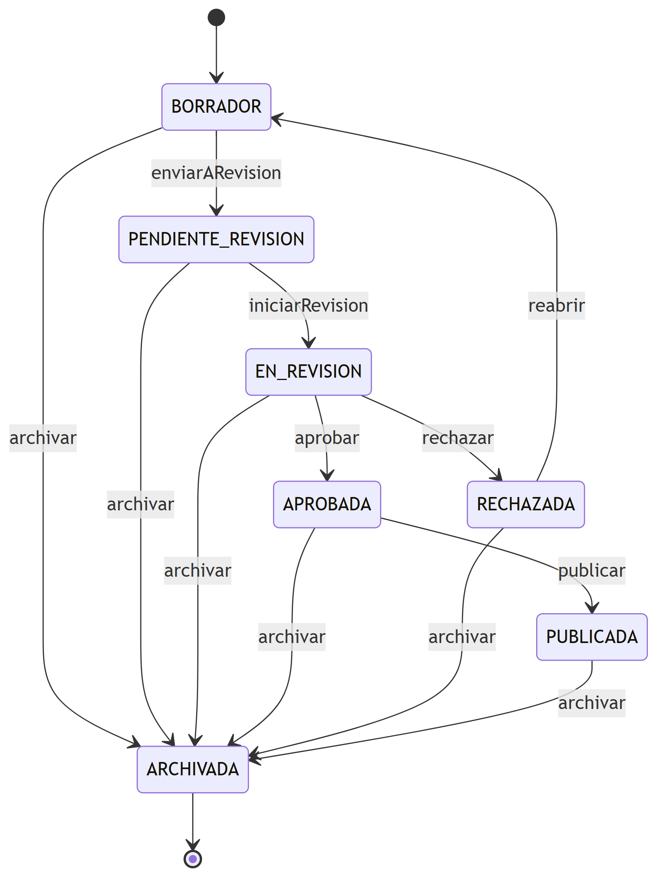

# Informe del Taller 11: Domain-Driven Design

## 1. Introducción

En el proyecto de curso, el banco de preguntas Saber Pro, las reglas del negocio estaban repartidas: la validación en un servicio, los
estados en otro y la decisión de los revisores en un tercero. Cada una se podía entender sola, pero nadie veía el modelo completo. Este
taller lo ordena con DDD. Primero decidimos qué contextos tiene el negocio y cómo se hablan, y después escribimos el corazón del dominio en
Java puro, con las reglas dentro de los objetos y no en los servicios.

El trabajo tiene dos partes. En la estratégica identificamos los cuatro contextos delimitados que pide la guía, su lenguaje ubicuo y las
relaciones entre ellos. En la táctica implementamos los agregados `Pregunta` y `Revision`, sus objetos de valor, sus entidades y sus
invariantes, y los probamos con JUnit 5. El dominio no importa nada que no sea del JDK: ni Spring, ni JPA, ni ninguna anotación.

El código está en https://github.com/DVLASZ/ingenieria-software-2 (carpeta `talleres/Taller-11-DDD`). Los nombres de clases y de paquetes
están en español porque así lo pide la guía.

### 1.1 Objetivo general

Aplicar los patrones estratégicos y tácticos de DDD al banco de preguntas Saber Pro, con un dominio en Java puro que garantice sus
propias reglas.

### 1.2 Objetivos específicos

- Identificar los contextos delimitados del banco de preguntas y escribir su lenguaje ubicuo.
- Modelar objetos de valor inmutables, entidades y dos agregados con sus raíces.
- Hacer que las invariantes del negocio se cumplan dentro del agregado y no dependan de quien lo use.
- Probar cada invariante con un caso que la rompa y comprobar que se lanza `ReglaNegocioException`.
- Verificar con una prueba que el dominio no depende de ningún framework.

### 1.3 Contenido del informe

**Tabla 1.** Dónde está cada entregable del taller.

| Entregable | Dónde está |
|---|---|
| Contextos delimitados y lenguaje ubicuo | Capítulo 2 |
| Mapa de contextos y diagramas de dominio | Figuras 1 a 3 |
| Objetos de valor, entidades, agregado e invariantes | Capítulo 3 |
| Código del dominio sin Spring ni JPA | Capítulo 4 y repositorio |
| Pruebas con JUnit 5 | Capítulo 5 |
| Enlace al repositorio | Capítulo 7 |

## 2. Parte I: modelado estratégico

### 2.1 Contextos delimitados

Un contexto delimitado es un límite dentro del cual cada palabra tiene un solo significado. "Estado", por ejemplo, es una cosa en el contexto
de ciclo de vida (en qué punto está una pregunta) y no significa nada en el de autoría. Partimos de los cuatro contextos de la guía y
precisamos qué responsabilidad tiene cada uno y qué clases del dominio le corresponden.

**Tabla 2.** Contextos delimitados del banco de preguntas.

| Contexto | Responsabilidad | Clases del dominio | Lenguaje ubicuo |
|---|---|---|---|
| Autoría | Escribir los reactivos del banco: enunciado, opciones y justificación. Es el dueño de `Pregunta` | `Pregunta`, `Enunciado`, `Justificacion`, `OpcionRespuesta` | Pregunta, Enunciado, Clave, Justificación, Autor |
| Validación | Comprobar las reglas de calidad estructural y pedagógica del contenido | `FiltroExpresion`, `ValidezOpciones` | ReglaEstructural, FiltroExpresion, ValidezOpciones |
| Ciclo de Vida | Controlar los estados de la pregunta y las transiciones que se permiten | `EstadoPregunta` | EstadoPregunta, Transición, Borrador, EnRevisión |
| Revisión por Pares | Asignar revisores, recoger sus evaluaciones y decidir | `Revision`, `Revisor`, `Asignacion`, `Evaluacion`, `Dictamen` | Revisor, Asignación, Evaluación, Dictamen |

### 2.2 Lenguaje ubicuo

El lenguaje ubicuo es el vocabulario que usan por igual los docentes, el código y las pruebas. Casi cada término de la tabla es el nombre de
una clase, de un método o de una constante, así que quien lea el código lee el negocio.

**Tabla 3.** Glosario del lenguaje ubicuo.

| Término | Qué significa | Contexto | En el código |
|---|---|---|---|
| Pregunta | Un reactivo de selección múltiple con única respuesta | Autoría | `Pregunta` |
| Enunciado | El texto de la pregunta; no puede ser nulo ni vacío | Autoría | `Enunciado` |
| Opción de respuesta | Una de las cuatro respuestas posibles, con su texto | Autoría | `OpcionRespuesta` |
| Clave | La única opción correcta | Autoría | `OpcionRespuesta.esCorrecta()` y `Pregunta.clave()` |
| Justificación | Por qué la clave es correcta; mínimo 15 caracteres y sin expresiones prohibidas | Autoría | `Justificacion` |
| Expresión prohibida | "Todas las anteriores" o "ninguna de las anteriores" | Validación | `FiltroExpresion` |
| Opciones válidas | Exactamente cuatro, distintas entre sí, y una sola clave | Validación | `ValidezOpciones` |
| Borrador | Estado en el que la pregunta se puede editar | Ciclo de Vida | `EstadoPregunta.BORRADOR` |
| Enviar a revisión | Pasar de borrador a pendiente de revisión | Ciclo de Vida | `Pregunta.enviarARevision()` |
| Reabrir | Volver al borrador una pregunta rechazada, como versión nueva | Ciclo de Vida | `Pregunta.reabrir()` |
| Revisor | Docente que evalúa preguntas; se identifica por su id de docente | Revisión por Pares | `Revisor` |
| Asignación | Una pregunta puesta en manos de un revisor, pendiente o ya evaluada | Revisión por Pares | `Asignacion` |
| Evaluación | Lo que un revisor decidió y su observación | Revisión por Pares | `Evaluacion` |
| Dictamen | El veredicto: aprobado o rechazado | Revisión por Pares | `Dictamen` |
| Unanimidad | Se aprueba solo si todos aprueban; un rechazo basta para rechazar | Revisión por Pares | `Revision.evaluar` |

### 2.3 Mapa de contextos

Los contextos no viven aislados: se hablan, y la forma de hablarse define cuánto cambia uno cuando cambia el otro.



**Figura 1.** Mapa de contextos del banco de preguntas.

**Tabla 4.** Relaciones entre contextos.

| Relación | Patrón | Por qué |
|---|---|---|
| Autoría y Validación | Cliente y proveedor | Autoría pide a Validación que revise el contenido. Si las reglas de calidad cambian, Autoría no cambia |
| Autoría y Ciclo de Vida | Núcleo compartido | Los dos usan `EstadoPregunta`. En el taller viven en el mismo módulo; en el proyecto cada uno está en su servicio y se hablan por eventos |
| Ciclo de Vida y Revisión | Lenguaje publicado | Revisión se entera de que una pregunta se envió, y cuando decide devuelve el dictamen. La revisión conoce la pregunta solo por su identificador |

### 2.4 Cómo se corresponde con el proyecto

Los contextos de la guía ya existen, partidos en servicios, en la arquitectura del segundo corte. El dominio de este taller es el modelo
que cada uno de esos servicios necesita por dentro.

**Tabla 5.** Contextos del taller y servicios del proyecto.

| Contexto | Servicios del proyecto |
|---|---|
| Autoría | `question-service` |
| Validación | `validation-service` |
| Ciclo de Vida | `lifecycle-service` |
| Revisión por Pares | `assignment-service` y `evaluation-service` |

## 3. Parte II: modelado táctico

### 3.1 Bloques de construcción

**Tabla 6.** Elementos del dominio y el tipo de bloque DDD de cada uno.

| Clase | Bloque DDD | Por qué |
|---|---|---|
| `Pregunta` | Raíz del agregado | Tiene identidad, cambia en el tiempo y protege las invariantes de sus opciones, su enunciado y su justificación |
| `Enunciado` | Objeto de valor | No tiene identidad: dos enunciados con el mismo texto son lo mismo |
| `Justificacion` | Objeto de valor | Igual, y se valida al crearse |
| `OpcionRespuesta` | Objeto de valor | Se define por su texto y por si es la clave |
| `EstadoPregunta` | Enumeración | Un conjunto cerrado de estados, con la regla de sus transiciones |
| `Revision` | Raíz del agregado | Tiene identidad y decide por unanimidad |
| `Revisor` | Entidad | Se identifica por el id del docente, no por su nombre |
| `Asignacion` y `Evaluacion` | Objetos de valor | Inmutables: evaluar devuelve una asignación nueva |
| `Dictamen` | Enumeración | Aprobado o rechazado |
| `FiltroExpresion` y `ValidezOpciones` | Reglas del dominio | Lógica del contexto de validación que no pertenece a una sola entidad |
| `PreguntaRepository` y `RevisionRepository` | Contratos de repositorio | Dicen qué se guarda y qué se consulta, no cómo |



**Figura 2.** Diagrama de clases del dominio, con sus dos agregados.

### 3.2 Invariantes

Una invariante es una regla que siempre tiene que ser cierta. El agregado las hace cumplir: no importa quién llame ni en qué orden, no hay
manera de dejar el objeto en un estado inválido.

**Tabla 7.** Invariantes del negocio, quién las hace cumplir y qué prueba las cubre.

| Invariante | La hace cumplir | Prueba |
|---|---|---|
| El enunciado no es nulo ni vacío | `Enunciado` | `elEnunciadoNoPuedeSerNulo`, `elEnunciadoNoPuedeEstarVacio` |
| La justificación tiene al menos 15 caracteres | `Justificacion` | `laJustificacionNecesitaQuinceCaracteres` |
| La justificación no usa expresiones prohibidas | `Justificacion` y `FiltroExpresion` | `laJustificacionNoPuedeUsarExpresionesProhibidas` |
| Una opción no está vacía ni dice "todas las anteriores" | `OpcionRespuesta` | `unaOpcionNoPuedeEstarVacia`, `unaOpcionNoPuedeDecirTodasLasAnteriores` |
| No hay más de 4 opciones | `Pregunta` y `ValidezOpciones` | `noSeAgreganMasDeCuatroOpciones` |
| No hay dos opciones con el mismo texto | `ValidezOpciones` | `noSeAgregaUnaOpcionRepetida` |
| Para enviar a revisión hay exactamente 4 opciones | `Pregunta.enviarARevision` | `noDebePermitirEnviarARevisionSinCuatroOpciones` |
| Para enviar a revisión hay exactamente 1 clave | `Pregunta.enviarARevision` | `noSePuedeEnviarConMasDeUnaClave`, `noSePuedeEnviarSinClave` |
| Para enviar hay autor, enunciado y justificación | `Pregunta.enviarARevision` | `noSePuedeEnviarSinAutor`, `noSePuedeEnviarSinEnunciado`, `noSePuedeEnviarSinJustificacion` |
| Solo se edita en estado Borrador | `Pregunta` | `despuesDeEnviarNoSePuedeModificarNada` |
| Solo se pasa de un estado a otro por una transición válida | `EstadoPregunta` y `Pregunta` | `soloSePermitenLasTransicionesDelCicloDeVida`, `noSePuedeSaltarUnEstado` |
| Una pregunta rechazada se reabre como versión nueva | `Pregunta.reabrir` | `unaRechazadaSeReabreComoVersionNueva` |
| Se asignan de 1 a 3 revisores, sin repetir | `Revision.abrir` | `noSeAsignanCeroNiMasDeTresRevisores`, `unRevisorNoSeRepite` |
| El autor no revisa su propia pregunta | `Revision.abrir` | `elAutorNoPuedeRevisarSuPropiaPregunta` |
| Rechazar exige una observación | `Evaluacion` | `rechazarExigeUnaObservacion` |
| Un revisor evalúa una sola vez y solo si está asignado | `Revision` | `unRevisorNoEvaluaDosVeces`, `soloEvaluanLosRevisoresAsignados` |
| Aprobar exige que todos aprueben; un rechazo basta para rechazar | `Revision.evaluar` | `conTodasLasAprobacionesSeApruebaPorUnanimidad`, `unSoloRechazoCierraLaRevisionSinEsperarALosDemas` |

### 3.3 Ciclo de vida

La guía dice que una pregunta rechazada vuelve al borrador para corregirse, y que solo las aprobadas se publican. Lo modelamos con siete
estados y una regla de transiciones en `EstadoPregunta.puedePasarA`, que `Pregunta` consulta antes de cada cambio.



**Figura 3.** Estados de la pregunta y transiciones válidas. Cualquier estado, menos Archivada, puede pasar a Archivada: una pregunta nunca se borra.

### 3.4 Dos agregados que no se conocen por dentro

`Pregunta` y `Revision` son dos agregados distintos, cada uno con su raíz. `Revision` guarda solo el identificador de la pregunta y no una
referencia al objeto. La razón es que cada agregado se guarda y se cambia en una sola transacción, y dos cosas que cambian por motivos
distintos (editar el contenido y decidir una revisión) no deberían bloquearse entre sí. Quien coordina los dos es la capa de aplicación,
que en este taller no existe: abre la revisión y llama a `pregunta.iniciarRevision()`, y cuando la revisión se cierra llama a
`pregunta.aprobar()` o a `pregunta.rechazar()` según el dictamen. La prueba `elFlujoDeRevisionSeCoordinaConLosDosContratos` recorre ese
camino completo.

## 4. Parte III: implementación

### 4.1 Estructura

```text
co.edu.unicauca.saberpro.domain/
├── model/        Pregunta, Revision, Revisor, Enunciado, Justificacion, OpcionRespuesta,
│                 Asignacion, Evaluacion, Dictamen, EstadoPregunta, FiltroExpresion, ValidezOpciones
├── exception/    DomainException, ReglaNegocioException
└── repository/   PreguntaRepository, RevisionRepository
```

**Figura 4.** Paquetes del dominio.

### 4.2 Código del objeto de valor Justificacion

```java
public record Justificacion(String texto) {

    public static final int MINIMO_CARACTERES = 15;

    public Justificacion {
        if (texto == null || texto.trim().length() < MINIMO_CARACTERES) {
            throw new ReglaNegocioException(
                    "La justificación debe contener al menos " + MINIMO_CARACTERES + " caracteres.");
        }
        if (FiltroExpresion.contieneExpresionProhibida(texto)) {
            throw new ReglaNegocioException("La justificación usa una expresión prohibida.");
        }
        texto = texto.trim();
    }
}
```

**Figura 5.** `Justificacion`: se valida en el constructor, así que no existe una justificación inválida.

### 4.3 Código de las invariantes de Pregunta

```java
public void enviarARevision() {
    validarInvariantesParaEnvio();
    pasarA(EstadoPregunta.PENDIENTE_REVISION);
}

private void validarInvariantesParaEnvio() {
    if (autorId == null) {
        throw new ReglaNegocioException("La pregunta debe tener un autor.");
    }
    if (enunciado == null) {
        throw new ReglaNegocioException("La pregunta debe tener un enunciado.");
    }
    if (justificacion == null) {
        throw new ReglaNegocioException("La pregunta debe tener una justificación.");
    }
    ValidezOpciones.verificarParaEnvio(opciones);
}
```

**Figura 6.** Invariantes de `Pregunta` antes de enviarla a revisión.

### 4.4 Correcciones al código de la guía

El código que sugiere la guía sirve de punto de partida, pero no compila tal cual ni cubre todo lo que el enunciado describe. Estas son las
diferencias.

**Tabla 8.** Qué cambiamos del código de ejemplo y por qué.

| De la guía | Problema | Qué hicimos |
|---|---|---|
| `Pregunta` sin forma de poner enunciado y justificación | Los campos nunca se llenaban, así que no se podía validar nada | `redactarEnunciado` y `justificar`, que se exigen al enviar. Se conserva el constructor sin argumentos para que la prueba de la guía funcione tal cual |
| `Justificacion` no revisaba palabras prohibidas | El texto del taller lo pide | `FiltroExpresion`, compartido con `OpcionRespuesta` |
| `ReglaNegocioException` sin padre | La guía también pide `DomainException` | Una extiende a la otra, y las dos son `RuntimeException` |
| `OpcionRespuesta::isEsCorrecta` | El nombre del acceso es feo y con `record` ya no existe | `esCorrecta()` |
| Se podía repetir una opción | Dos opciones iguales no tienen sentido en una pregunta | Se rechaza si solo cambian mayúsculas, tildes o espacios |
| Solo existía `enviarARevision` | El resto del ciclo de vida no estaba | Todas las transiciones, con `EstadoPregunta.puedePasarA` |
| Sin versión | Una pregunta rechazada se corrige y se reenvía | `reabrir` sube la versión |

### 4.5 Decisiones de diseño

- Records para los objetos de valor. Son inmutables y se comparan por sus atributos sin escribir `equals` ni `hashCode`. La validación va
  en el constructor compacto, así que un valor inválido no llega a existir.
- Identidad que se asigna una sola vez. `Pregunta` y `Revision` empiezan sin id y quien las guarda se lo pone con `asignarIdentidad`.
  Así el dominio no depende de cómo se generan los identificadores.
- Optional en lo que puede faltar. Una pregunta recién creada no tiene enunciado; `enunciado()` devuelve un `Optional` en vez de `null`.
- Colecciones que no se pueden modificar por fuera. `opciones()` devuelve una vista de solo lectura: la única forma de cambiar las
  opciones es pasar por la raíz, que es donde están las reglas.
- Reglas del contexto de validación aparte. `FiltroExpresion` y `ValidezOpciones` son clases con métodos estáticos y sin estado, porque
  no pertenecen a una sola entidad y las usan varias.
- Sin infraestructura. Los repositorios son interfaces. La prueba usa implementaciones en memoria para demostrar que alcanzan para el
  flujo de revisión; una base de datos real se haría en otra capa.

## 5. Pruebas

El módulo tiene 77 pruebas con JUnit 5. Cada invariante tiene al menos un caso que la rompe y comprueba que se lanza `ReglaNegocioException`.

**Tabla 9.** Pruebas por clase.

| Clase de prueba | Pruebas | Qué comprueba |
|---|---|---|
| `ExcepcionesTest` | 1 | `ReglaNegocioException` es una `DomainException` |
| `EstadoPreguntaTest` | 6 | Todas las combinaciones de estados contra la tabla de transiciones, y archivar |
| `ObjetosDeValorTextoTest` | 9 | `Enunciado`, `Justificacion` y el filtro de expresiones |
| `OpcionesTest` | 10 | `OpcionRespuesta` y `ValidezOpciones` |
| `PreguntaTest` | 23 | Las invariantes del agregado, el ciclo de vida, la versión y la identidad. Incluye la prueba de la guía |
| `EvaluacionesTest` | 6 | `Revisor`, `Evaluacion` y `Asignacion` |
| `RevisionTest` | 15 | Asignación de revisores, evaluaciones y decisión por unanimidad |
| `RepositoriosTest` | 3 | El flujo de revisión con los dos contratos, con implementaciones en memoria |
| `DominioPuroTest` | 4 | Ningún import fuera del JDK y del dominio, sin anotaciones de frameworks y solo los tres paquetes de la guía |

```text
Tests run: 4, Failures: 0, Errors: 0, Skipped: 0 -- DominioPuroTest
Tests run: 1, Failures: 0, Errors: 0, Skipped: 0 -- exception.ExcepcionesTest
Tests run: 6, Failures: 0, Errors: 0, Skipped: 0 -- model.EstadoPreguntaTest
Tests run: 9, Failures: 0, Errors: 0, Skipped: 0 -- model.ObjetosDeValorTextoTest
Tests run: 10, Failures: 0, Errors: 0, Skipped: 0 -- model.OpcionesTest
Tests run: 6, Failures: 0, Errors: 0, Skipped: 0 -- model.EvaluacionesTest
Tests run: 23, Failures: 0, Errors: 0, Skipped: 0 -- model.PreguntaTest
Tests run: 15, Failures: 0, Errors: 0, Skipped: 0 -- model.RevisionTest
Tests run: 3, Failures: 0, Errors: 0, Skipped: 0 -- repository.RepositoriosTest
Tests run: 77, Failures: 0, Errors: 0, Skipped: 0
```

**Figura 7.** Resultado de `mvn test`.

## 6. Preguntas de reflexión

**1. ¿Por qué Pregunta es la raíz del agregado y no OpcionRespuesta?**

Porque las reglas de las opciones (cuatro, una clave, ninguna repetida) hablan del conjunto, y solo la pregunta ve el conjunto. Una opción
sola no sabe cuántas hermanas tiene. Por eso nadie cambia las opciones sin pasar por `Pregunta`, que es la que puede decir que no.

**2. ¿Qué diferencia hay entre un objeto de valor y una entidad en este modelo?**

`Enunciado`, `Justificacion` y `OpcionRespuesta` se definen por lo que contienen: dos opciones con el mismo texto y la misma clave son la
misma. `Revisor` y `Pregunta` tienen identidad: un docente sigue siendo el mismo aunque cambie su nombre, y una pregunta sigue siendo la
misma aunque cambie su enunciado.

**3. ¿Por qué Revision no es parte del agregado Pregunta?**

Porque cambian por motivos distintos y en momentos distintos. Un autor edita su borrador mientras nadie revisa nada, y varios revisores
evalúan a la vez sin tocar el contenido. Si fueran un solo agregado, cada evaluación bloquearía a la pregunta entera. Se refieren por
identificador y los coordina la capa de aplicación.

**4. ¿Qué cambiaría si mañana las preguntas se guardan con JPA?**

El dominio no cambia. Se escriben entidades JPA aparte, un mapeador entre ellas y el dominio, y una clase que implemente
`PreguntaRepository`. Es lo que hicimos en el Taller 10 con otro modelo. Las reglas siguen en `Pregunta`.

**5. ¿Cómo se relaciona este dominio con los microservicios del proyecto?**

Cada contexto delimitado es un servicio o un par de servicios (Tabla 5). Entre contextos no se comparte el objeto sino su identificador y
los eventos: `question.submitted` lleva el identificador de la pregunta, no la pregunta. Así `Revision` puede vivir en el servicio de
revisión sin conocer la clase `Pregunta`.

## 7. Enlaces

**Tabla 10.** Enlaces del trabajo.

| Recurso | Dirección |
|---|---|
| Repositorio | https://github.com/DVLASZ/ingenieria-software-2 |
| Carpeta del taller | https://github.com/DVLASZ/ingenieria-software-2/tree/main/talleres/Taller-11-DDD |
| Módulo de dominio | https://github.com/DVLASZ/ingenieria-software-2/tree/main/talleres/Taller-11-DDD/lisw2_taller11_ddd_g2 |
