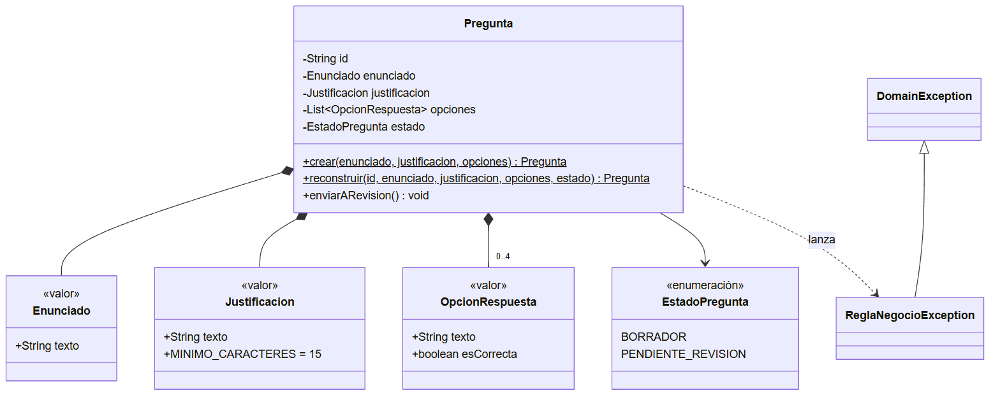
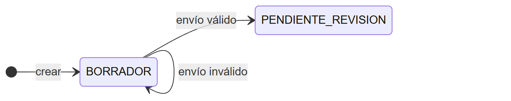
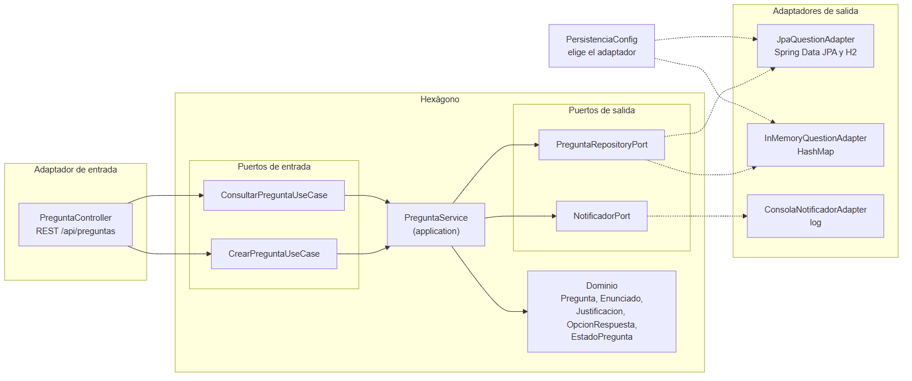
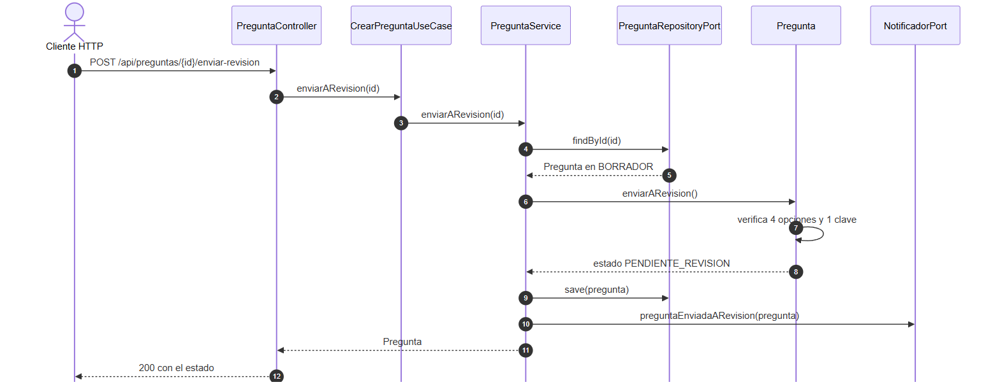
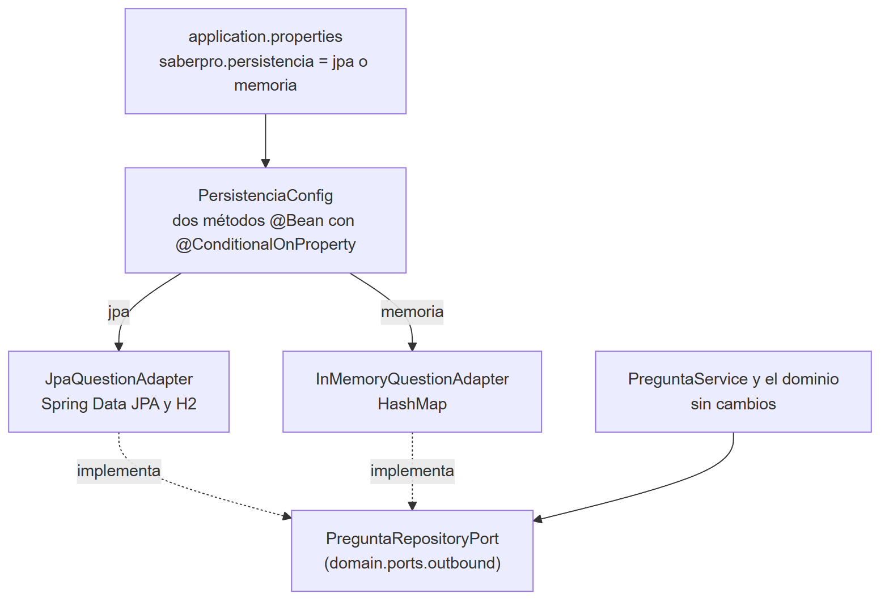

# Informe del Taller 12: Arquitectura hexagonal y DDD

## 1. Introducción

En el Taller 11 modelamos el dominio del banco de preguntas Saber Pro en Java puro. En este lo metemos dentro de un hexágono. El dominio queda en
el centro y solo conoce el JDK. Los puertos dicen qué se le pide al banco y qué necesita el banco de afuera. Los adaptadores (la API REST, JPA con H2,
una implementación en memoria y una notificación por consola) se enchufan a esos puertos desde fuera. Para comprobar que el aislamiento es de verdad,
cambiamos el repositorio JPA por uno en memoria sin modificar una línea del dominio.

Usamos el proyecto demo GymClass como guía de cómo se ve una arquitectura hexagonal en Java con Spring Boot, pero no lo copiamos. Los nombres de
los paquetes y de los adaptadores son los que pide el enunciado (domain.ports.inbound, domain.ports.outbound, JpaQuestionAdapter,
InMemoryQuestionAdapter) y el dominio es el de las preguntas, no el de las clases de gimnasio. En la sección 3.5 está lo que tomamos del demo y lo que
cambiamos.

El código está en https://github.com/DVLASZ/ingenieria-software-2 (carpeta talleres/Taller-12-DDD-Hexagonal). Los nombres de clases y de paquetes
están en español, como en el Taller 11, salvo los que fija el enunciado.

### 1.1 Objetivo general

Construir el núcleo del banco de preguntas con DDD y arquitectura hexagonal, de modo que el dominio no dependa de ninguna tecnología y su
persistencia se pueda cambiar sin tocarlo.

### 1.2 Objetivos específicos

- Modelar el agregado Pregunta con sus objetos de valor inmutables y sus invariantes en Java puro.
- Mantener fuera del dominio a Spring, JPA y HTTP, y comprobarlo con una prueba.
- Definir los puertos de entrada (casos de uso) y de salida (persistencia y notificación).
- Implementar dos adaptadores del mismo puerto de persistencia, JPA con H2 y memoria, y cambiar de uno a otro sin modificar el dominio.

### 1.3 Contenido del informe

**Tabla 1.** Dónde está cada entregable del taller.

| Entregable | Dónde está |
|---|---|
| Objetos de valor, agregado e invariantes | Capítulo 2 |
| Puertos y adaptadores, separación en paquetes | Capítulo 3 |
| Prueba de intercambiabilidad con evidencias | Capítulo 4 |
| Pruebas con JUnit 5 | Capítulo 5 |
| Cómo correr el proyecto | Capítulo 6 |
| Enlace al repositorio | Capítulo 7 |

## 2. Modelo de dominio

### 2.1 Reglas que pide el taller

El dominio es la parte del sistema que sabe qué es una pregunta válida. Todas las reglas del enunciado viven ahí y cada una lanza
ReglaNegocioException cuando se incumple.

**Tabla 2.** Reglas de negocio y el lugar donde se hacen cumplir.

| Regla | Dónde se cumple | Prueba |
|---|---|---|
| El enunciado no es nulo ni vacío | Enunciado | ObjetosDeValorTest |
| La justificación tiene al menos 15 caracteres | Justificacion | ObjetosDeValorTest |
| Cada opción tiene texto y dice si es la clave | OpcionRespuesta | ObjetosDeValorTest |
| La pregunta nunca tiene más de 4 opciones | Pregunta, al crearla | PreguntaTest |
| Para pasar a PENDIENTE_REVISION hay exactamente 4 opciones | Pregunta, al enviarla | PreguntaTest |
| Para pasar a PENDIENTE_REVISION hay una sola clave | Pregunta, al enviarla | PreguntaTest |
| La pregunta nace en BORRADOR | Pregunta, al crearla | PreguntaTest |
| Solo una pregunta en BORRADOR se envía a revisión | Pregunta, al enviarla | PreguntaTest |

### 2.2 Objetos de valor

Los tres objetos de valor son registros de Java (record). No tienen identidad, no cambian después de creados y se comparan por lo que contienen:
dos enunciados con el mismo texto son el mismo enunciado. Validan en el constructor, así que un valor inválido no llega a existir.

**Tabla 3.** Objetos de valor del dominio.

| Clase | Qué contiene | Qué rechaza |
|---|---|---|
| Enunciado | El texto de la pregunta, sin espacios en los extremos | Nulo o vacío |
| Justificacion | La sustentación técnica de la clave | Menos de 15 caracteres, sin contar los espacios de los extremos |
| OpcionRespuesta | El texto de la opción y si es la clave | Texto nulo o vacío |

La regla del texto vacío en OpcionRespuesta no está en el enunciado del taller. La agregamos porque una opción sin texto no sirve para nada y
cuatro opciones vacías habrían pasado la regla de las cuatro opciones.

### 2.3 El agregado Pregunta

Pregunta es la raíz del agregado. Guarda el enunciado, la justificación, la lista de opciones y el estado. Nadie cambia las opciones desde afuera:
la lista que devuelve es de solo lectura y la que recibe al crearse se copia, de modo que cambiarla después no altera la pregunta.

La identidad es un UUID que se genera en el dominio con una sola línea del JDK. Así la pregunta ya tiene su identificador antes de guardarse y los
dos adaptadores se comportan igual, sin depender de una secuencia de la base de datos.



**Figura 1.** Diagrama de clases del dominio.

Una pregunta puede nacer con menos de 4 opciones, porque en BORRADOR todavía se está redactando. Lo que no puede es tener más de 4, ni salir de
BORRADOR sin cumplir la regla. Esa comprobación está en enviarARevision y es la que usa el enunciado como invariante. Hay un segundo método
de creación, reconstruir, que usan los adaptadores para armar de nuevo una pregunta que ya existía. Aplica las mismas reglas: una pregunta en
PENDIENTE_REVISION con tres opciones no se puede reconstruir, así que una base de datos dañada no mete preguntas inválidas al dominio.

### 2.4 Ciclo de vida

El enunciado pide solo dos estados. La pregunta empieza en BORRADOR y pasa a PENDIENTE_REVISION cuando cumple las invariantes. Si no las
cumple, enviarARevision lanza la excepción y el estado no cambia.



**Figura 2.** Estados de la pregunta y la transición que pide el taller.

## 3. Arquitectura hexagonal

### 3.1 Regla de dependencias y paquetes

Las dependencias del código apuntan hacia el centro. El dominio no importa nada que no sea del JDK. La aplicación importa solo el dominio.
La infraestructura importa a los dos y a Spring. Los tres paquetes que exige el enunciado se ven así en el árbol del proyecto:

```text
co.edu.unicauca.saberpro
  domain
    model            Pregunta, Enunciado, Justificacion, OpcionRespuesta, EstadoPregunta
    exception        DomainException, ReglaNegocioException, PreguntaNoEncontradaException
    ports.inbound    CrearPreguntaUseCase, ConsultarPreguntaUseCase
    ports.outbound   PreguntaRepositoryPort, NotificadorPort
  application        PreguntaService
  infrastructure
    adapter.in.web                       PreguntaController, ApiExceptionHandler, dto
    adapter.out.persistence.jpa          JpaQuestionAdapter, PreguntaJpaEntity,
                                         SpringDataPreguntaRepository
    adapter.out.persistence.memory       InMemoryQuestionAdapter
    adapter.out.notification             ConsolaNotificadorAdapter
    config                               PersistenciaConfig, AplicacionConfig
```

### 3.2 Puertos y adaptadores

**Tabla 4.** Componentes hexagonales del taller.

| Componente | Tipo | Responsabilidad |
|---|---|---|
| CrearPreguntaUseCase | Puerto de entrada | Crear una pregunta y enviarla a revisión |
| ConsultarPreguntaUseCase | Puerto de entrada | Consultar una pregunta por su id |
| PreguntaRepositoryPort | Puerto de salida | Guardar y buscar preguntas con save y findById |
| NotificadorPort | Puerto de salida | Avisar que una pregunta quedó lista para revisar |
| PreguntaService | Servicio de aplicación | Implementa los puertos de entrada y coordina el dominio con los de salida |
| PreguntaController | Adaptador de entrada | API REST en /api/preguntas |
| JpaQuestionAdapter | Adaptador de salida | Guarda con Spring Data JPA en H2 |
| InMemoryQuestionAdapter | Adaptador de salida | Guarda en un HashMap |
| ConsolaNotificadorAdapter | Adaptador de salida | Escribe el aviso en el log |



**Figura 3.** Puertos y adaptadores del banco de preguntas.

El puerto de persistencia solo tiene las dos operaciones que pide el taller. No expone nada de JPA: recibe y devuelve objetos del dominio. El
adaptador JPA tiene sus propias clases, PreguntaJpaEntity y OpcionEmbeddable, y traduce en los dos sentidos. Pregunta no tiene una sola
anotación.

### 3.3 Qué pasa al enviar una pregunta a revisión

Este es el recorrido completo de un caso de uso. El controlador no conoce a PreguntaService, solo a la interfaz del puerto. El servicio no conoce
a JPA ni al HashMap, solo al puerto de salida. Quien decide la regla es la pregunta.



**Figura 4.** Secuencia de enviar una pregunta a revisión.

### 3.4 Cómo se arma la aplicación

Lo único que sabe qué adaptador se usa es la clase PersistenciaConfig, en el paquete infrastructure.config. Tiene un método @Bean por adaptador y
cada uno se activa con una propiedad:

```java
@Bean
@ConditionalOnProperty(name = "saberpro.persistencia", havingValue = "jpa", matchIfMissing = true)
PreguntaRepositoryPort jpaQuestionAdapter(SpringDataPreguntaRepository repositorio) {
    return new JpaQuestionAdapter(repositorio);
}

@Bean
@ConditionalOnProperty(name = "saberpro.persistencia", havingValue = "memoria")
PreguntaRepositoryPort inMemoryQuestionAdapter() {
    return new InMemoryQuestionAdapter();
}
```

PreguntaService no lleva anotaciones de Spring. Lo crea AplicacionConfig, también en infraestructura, y le entrega el puerto que esté activo.

### 3.5 Lo que tomamos del demo GymClass y lo que cambiamos

**Tabla 5.** Diferencias entre el demo y este taller.

| Tema | GymClass | Este taller |
|---|---|---|
| Puertos | application/port/in y application/port/out | domain.ports.inbound y domain.ports.outbound, como pide el enunciado |
| Configuración | HexagonalConfiguration crea el servicio y la política de dominio | AplicacionConfig crea el servicio y PersistenciaConfig elige el adaptador de persistencia |
| Persistencia | Un adaptador JPA por agregado, sin alternativa | Dos adaptadores del mismo puerto y una propiedad que elige |
| Identificador | Objetos UUID propios por agregado | Un UUID como texto, generado en el dominio |
| Agregados | Member y ClassSession con una entidad interna | Pregunta con sus objetos de valor, sin entidades internas |
| Notificación | No tiene | Un segundo puerto de salida con un adaptador de consola |

De GymClass tomamos tres ideas: las entidades JPA separadas del dominio, el mapeo en el adaptador y un servicio de aplicación sin anotaciones que se
arma en una clase de configuración, fuera del núcleo.

### 3.6 Decisiones de diseño

- La copia en el adaptador en memoria. InMemoryQuestionAdapter guarda y devuelve copias de la pregunta, no la misma instancia. Con JPA cada lectura
  produce un objeto nuevo, y si la versión en memoria devolviera siempre el mismo objeto, cambiarlo cambiaría lo guardado sin llamar a save. Con la
  copia los dos adaptadores se comportan igual y el contrato es el mismo.
- Excepciones del dominio. ReglaNegocioException se traduce a 400 y PreguntaNoEncontradaException a 404 en un manejador del adaptador web. El
  dominio no conoce HTTP.
- La notificación como puerto. Avisar que una pregunta quedó lista para revisar es algo que el negocio necesita, pero cómo se avisa (log, correo, cola)
  no es asunto del dominio. Por eso es un puerto con un adaptador de consola.
- Envío repetido. Enviar a revisión una pregunta que ya está en PENDIENTE_REVISION es una regla de negocio incumplida y responde 400.

## 4. Prueba de intercambiabilidad

El experimento sigue los tres pasos del taller. El dominio no se toca en ninguno. Para tener una prueba que no dependa de lo que recordemos,
calculamos la huella SHA-256 de los 12 archivos del paquete domain antes y después de las dos corridas.



**Figura 5.** El adaptador se elige en la configuración, el servicio y el dominio no cambian.

### 4.1 Paso 1: con JpaQuestionAdapter

Con saberpro.persistencia=jpa levantamos la aplicación y repetimos las mismas llamadas con curl. Estas son las respuestas, con las opciones
recortadas para que quepan:

```text
# modo: jpa
crear pregunta valida
{"id":"e9aec3b6-3c61-4e83-8769-e3fd24b8e9c0","enunciado":"¿Qué separa el dominio de la infraestructura?",
 "justificacion":"El puerto es el contrato que define el dominio","estado":"BORRADOR","opciones":[...]}
HTTP 201
crear con justificacion corta
{"mensaje":"La justificación debe tener al menos 15 caracteres."}
HTTP 400
enviar a revision una pregunta con 3 opciones
{"mensaje":"La pregunta debe tener exactamente 4 opciones y tiene 3."}
HTTP 400
enviar a revision la pregunta completa
{"id":"e9aec3b6-...","estado":"PENDIENTE_REVISION","opciones":[...]}
HTTP 200
consultar una que no existe
{"mensaje":"No existe una pregunta con id no-existe."}
HTTP 404
```

En el log de la aplicación quedó el aviso del adaptador de consola:

```text
ConsolaNotificadorAdapter : Pregunta e9aec3b6-3c61-4e83-8769-e3fd24b8e9c0 lista para revisión
```

### 4.2 Paso 2: cambiar al adaptador en memoria

El enunciado propone cambiar la anotación @Bean. Como PersistenciaConfig ya tiene un método por adaptador, el cambio es una sola línea de
application.properties, o el argumento --saberpro.persistencia=memoria al arrancar. Nada de esto está en el dominio ni en la aplicación.

```text
saberpro.persistencia=memoria
```

### 4.3 Paso 3: la misma prueba con el otro adaptador

Repetimos exactamente las mismas llamadas. Las respuestas son iguales, salvo el identificador, que es un UUID nuevo en cada corrida:

```text
# modo: memoria
crear pregunta valida                               HTTP 201   estado BORRADOR
crear con justificacion corta                       HTTP 400   La justificación debe tener al menos 15 caracteres.
enviar a revision una pregunta con 3 opciones       HTTP 400   La pregunta debe tener exactamente 4 opciones y tiene 3.
enviar a revision la pregunta completa              HTTP 200   estado PENDIENTE_REVISION
consultar una que no existe                         HTTP 404   No existe una pregunta con id no-existe.
ConsolaNotificadorAdapter : Pregunta fecf4b32-4968-461d-984c-bfba9785030b lista para revisión
```

Las mismas pruebas de integración también se ejecutan contra los dos adaptadores. Hay una clase base con el recorrido por la API y
dos clases que solo cambian la propiedad: FlujoRestConJpaTest y FlujoRestEnMemoriaTest. Cada una comprueba también qué adaptador quedó activo.

**Tabla 6.** Resultado del experimento.

| Comprobación | Con JpaQuestionAdapter | Con InMemoryQuestionAdapter |
|---|---|---|
| Crear una pregunta válida | 201 en BORRADOR | 201 en BORRADOR |
| Justificación de menos de 15 caracteres | 400 | 400 |
| Enviar con 3 opciones | 400 | 400 |
| Enviar una pregunta completa | 200 en PENDIENTE_REVISION | 200 en PENDIENTE_REVISION |
| Consultar una pregunta que no existe | 404 | 404 |
| Pruebas de integración de la API | 8 de 8 | 8 de 8 |
| Pruebas del contrato del puerto | 5 de 5 | 5 de 5 |
| Huella SHA-256 de los 12 archivos de domain | 0af1fca9e8c5cf29... | 0af1fca9e8c5cf29... |

Una aclaración sobre el modo memoria: la aplicación sigue levantando la base H2, porque la dependencia de JPA está en el proyecto y Spring Boot la
configura sola. El puerto de persistencia ya no la usa. Para que no se levante habría que quitar la dependencia o excluir su configuración
automática, y no lo hicimos porque eso sí sería tocar la configuración de fondo del proyecto.

## 5. Pruebas

El proyecto tiene 67 pruebas con JUnit 5. Las del dominio se ejecutan en milisegundos y no levantan Spring. Las de contrato son una sola clase
abstracta con las pruebas del puerto de persistencia, y cada adaptador la hereda: lo que se le exige a uno se le exige al otro.

**Tabla 7.** Pruebas por clase.

| Clase de prueba | Pruebas | Qué comprueba |
|---|---|---|
| ObjetosDeValorTest | 15 | Enunciado, Justificacion y OpcionRespuesta, incluyendo los 14 y los 15 caracteres |
| PreguntaTest | 15 | Estado inicial, las invariantes de 4 opciones y 1 clave, el envío repetido, la lista inmutable y la reconstrucción |
| PreguntaServiceTest | 7 | Los casos de uso con el adaptador en memoria y un notificador de prueba |
| JpaQuestionAdapterTest | 5 | El contrato del puerto contra H2, con el adaptador JPA |
| InMemoryQuestionAdapterTest | 5 | El mismo contrato con el adaptador en memoria |
| FlujoRestConJpaTest | 8 | El recorrido completo por la API con JPA |
| FlujoRestEnMemoriaTest | 8 | El mismo recorrido con el adaptador en memoria |
| HexagonoPuroTest | 4 | Ni el dominio ni la aplicación importan Spring, JPA, Hibernate, Jackson ni infraestructura |

Las 5 pruebas del contrato (guardar, buscar, actualizar el estado, conservar el orden de las opciones y no compartir objetos con quien llama) están
escritas una sola vez en PreguntaRepositoryPortContractTest y las ejecutan las dos clases de adaptador.

```text
Tests run: 7, Failures: 0, Errors: 0, Skipped: 0 -- application.PreguntaServiceTest
Tests run: 15, Failures: 0, Errors: 0, Skipped: 0 -- domain.model.ObjetosDeValorTest
Tests run: 15, Failures: 0, Errors: 0, Skipped: 0 -- domain.model.PreguntaTest
Tests run: 4, Failures: 0, Errors: 0, Skipped: 0 -- infrastructure.arquitectura.HexagonoPuroTest
Tests run: 5, Failures: 0, Errors: 0, Skipped: 0 -- infrastructure.persistence.InMemoryQuestionAdapterTest
Tests run: 5, Failures: 0, Errors: 0, Skipped: 0 -- infrastructure.persistence.JpaQuestionAdapterTest
Tests run: 8, Failures: 0, Errors: 0, Skipped: 0 -- infrastructure.web.FlujoRestConJpaTest
Tests run: 8, Failures: 0, Errors: 0, Skipped: 0 -- infrastructure.web.FlujoRestEnMemoriaTest
Tests run: 67, Failures: 0, Errors: 0, Skipped: 0
BUILD SUCCESS
```

**Figura 6.** Resultado de mvn test.

En la primera corrida fallaron 4 pruebas del adaptador en memoria. El error era de la prueba, no del adaptador: el método que entrega el puerto
creaba un adaptador nuevo en cada llamada y el HashMap quedaba vacío entre el guardado y la lectura. Lo corregimos con una sola instancia por
prueba. La que usa JPA no tenía el problema porque la base es compartida.

## 6. Cómo correr el proyecto

Hace falta Java 17 o superior y Maven. No se necesita Docker ni una base de datos externa: H2 vive en memoria y se vacía al reiniciar.

```text
cd talleres/Taller-12-DDD-Hexagonal/lisw2_taller12_hexagonal_g2
mvn test
mvn spring-boot:run
mvn spring-boot:run -Dspring-boot.run.arguments=--saberpro.persistencia=memoria
```

Los endpoints son tres: POST /api/preguntas para crear, POST /api/preguntas/{id}/enviar-revision para enviarla y GET /api/preguntas/{id} para
consultarla. La consola de H2 queda en /h2-console con la URL jdbc:h2:mem:saberprodb y el usuario sa.

## 7. Enlaces

**Tabla 8.** Enlaces del trabajo.

| Recurso | Dirección |
|---|---|
| Repositorio | https://github.com/DVLASZ/ingenieria-software-2 |
| Carpeta del taller | https://github.com/DVLASZ/ingenieria-software-2/tree/main/talleres/Taller-12-DDD-Hexagonal |
| Proyecto | https://github.com/DVLASZ/ingenieria-software-2/tree/main/talleres/Taller-12-DDD-Hexagonal/lisw2_taller12_hexagonal_g2 |
