# Informe del Taller 13: entrega final con DDD, arquitectura hexagonal y Docker

## 1. Introducción

Este es el último trabajo del laboratorio y junta lo de los tres talleres anteriores. Del Taller 11 viene el dominio en Java puro, del Taller 12 la
arquitectura hexagonal con adaptadores intercambiables, y del Parcial 2 los tres servicios que se hablan por REST y por RabbitMQ. Aquí los
unimos en un solo repositorio y los metemos en contenedores: tres microservicios Spring Boot y un RabbitMQ que se levantan con un único
comando, docker compose up -d --build, en una red propia llamada saberpro-net.

El servicio que lleva el dominio es question-service. Tiene la clase Pregunta con sus reglas, los puertos de entrada y salida, y dos adaptadores de
persistencia que se pueden cambiar sin tocar el dominio. validation-service dice si una justificación sirve, y lifecycle-service cambia el estado de
la pregunta cuando le llega la petición de revisión por RabbitMQ.

El código está en https://github.com/DVLASZ/ingenieria-software-2 (carpeta talleres/Taller-13-DDD-Hexagonal-Docker/saberpro-banco-preguntas).
Cada servicio es un proyecto Maven con su Dockerfile, y el docker-compose.yml está en la raíz de esa carpeta.

### 1.1 Objetivo general

Entregar el banco de preguntas como un sistema de microservicios contenerizado, con un dominio que no depende de ninguna tecnología y una
persistencia que se puede cambiar sin modificarlo.

### 1.2 Objetivos específicos

- Mantener el agregado Pregunta y sus objetos de valor en Java puro, con las invariantes dentro del dominio.
- Estructurar los puertos de entrada y de salida de question-service y comprobar que el repositorio JPA se puede cambiar por uno en memoria.
- Escribir un Dockerfile por servicio y un docker-compose.yml que levante todo en la red saberpro-net.
- Comprobar de punta a punta, sobre contenedores, la petición síncrona (201 y 400) y el procesamiento asíncrono por RabbitMQ (202).
- Dejar la trazabilidad del proyecto del semestre y los diagramas C4 del nivel 1 al 4.

### 1.3 Contenido del informe

**Tabla 1.** Dónde está cada entregable del taller.

| Entregable | Dónde está |
|---|---|
| Trazabilidad de los tres cortes | Capítulo 2 |
| Dominio puro y sus reglas | Capítulo 3 |
| Puertos y adaptadores | Capítulo 4 |
| Dockerfile y docker-compose.yml | Capítulo 5 |
| Flujo de punta a punta sobre contenedores | Capítulo 6 |
| Prueba de intercambiabilidad JPA y memoria | Capítulo 7 |
| Diagramas C4 del nivel 1 al 4 | Capítulo 8 |
| Pruebas | Capítulo 9 |
| Cómo correr el proyecto y enlaces | Capítulos 10 y 11 |

## 2. Trazabilidad semestral

La tabla resume cómo creció el proyecto en las tres iteraciones. Los talleres de cada corte son los que están en la carpeta talleres del
repositorio del laboratorio.

**Tabla 2.** Evolución del proyecto en los tres cortes.

| Corte | Enfoque | Qué se hizo | Peso |
|---|---|---|---|
| I | Monolito limpio y refactorización SOLID | Polimorfismo, principios SOLID, modelo C4, capas con MVC, y generación de preguntas con Microkernel y Tuberías y Filtros (talleres 1 a 5) | 25 % |
| II | Microservicios y patrones GoF | Builder y State, comunicación síncrona por REST y asíncrona por RabbitMQ, y persistencia con JPA (talleres 8, 9 y 10 y el Parcial 2) | 35 % |
| III | DDD, hexagonal y Docker | Dominio en Java puro (Taller 11), puertos y adaptadores intercambiables (Taller 12), y contenedores con Docker Compose (este taller) | 40 % |

El Parcial 2 es el antecedente directo de este taller: ya tenía los tres servicios, los puertos 8082, 8083 y 8084 y el envío a revisión por
RabbitMQ. Lo que cambió es que ahora el dominio vive dentro de question-service en lugar de un módulo compartido, el servicio está organizado como
hexágono y todo corre en Docker.

## 3. Dominio puro

El dominio es el paquete domain de question-service. No importa nada que no sea del JDK: ni Spring, ni JPA, ni Jackson, ni el logger. Una prueba lo
comprueba leyendo los imports de cada archivo (capítulo 9).

### 3.1 Reglas de negocio

**Tabla 3.** Reglas del dominio y el lugar donde se hacen cumplir.

| Regla | Dónde se cumple |
|---|---|
| El enunciado no es nulo ni vacío | Enunciado, al crearse |
| La justificación tiene al menos 15 caracteres | Justificacion, al crearse |
| Cada opción tiene texto y dice si es la clave | OpcionRespuesta, al crearse |
| La pregunta nunca tiene más de 4 opciones | Pregunta, al crearse |
| Para enviarla a revisión hay exactamente 4 opciones | Pregunta, en verificarEnvioARevision |
| Para enviarla a revisión hay una sola clave | Pregunta, en verificarEnvioARevision |
| Solo una pregunta en BORRADOR se envía a revisión | Pregunta, en verificarEnvioARevision |
| La pregunta nace en BORRADOR y pasa a PENDIENTE_REVISION cuando el ciclo de vida lo confirma | Pregunta, en pasarAPendienteRevision |

Todas lanzan ReglaNegocioException. Enunciado, Justificacion y OpcionRespuesta son registros de Java (record): inmutables, se comparan por su
contenido y se validan en el constructor. Pregunta es la raíz del agregado y su identidad es un UUID que se genera en el dominio. La lista de opciones
que devuelve es de solo lectura, y la que recibe al crearse se copia.

A diferencia del Taller 12, el cambio de estado se partió en dos pasos, porque aquí el envío a revisión es asíncrono. verificarEnvioARevision comprueba
las reglas sin tocar el estado, y pasarAPendienteRevision lo cambia cuando lifecycle-service confirma. Las dos usan la misma comprobación.

## 4. Arquitectura hexagonal en question-service

### 4.1 Paquetes

La estructura sigue el árbol que pide la guía. Los nombres del dominio están en español, como en los talleres 11 y 12, y los de los adaptadores
JPA son los del árbol de la guía.

```text
question-service/src/main/java/co/edu/unicauca/saberpro/question/
  domain/
    model/            Pregunta, Enunciado, Justificacion, OpcionRespuesta,
                      EstadoPregunta
    exception/        DomainException, ReglaNegocioException,
                      PreguntaNoEncontradaException,
                      ServicioNoDisponibleException
    ports/inbound/    CrearPreguntaUseCase, EvaluarPreguntaUseCase,
                      ConsultarPreguntaUseCase
    ports/outbound/   PreguntaRepositoryPort, NotificacionPort,
                      ValidacionJustificacionPort
  application/        QuestionApplicationService
  infrastructure/
    jpa/              QuestionRecord, AnswerOptionRecord,
                      QuestionDomainMapper, JpaQuestionAdapter
    memory/           InMemoryQuestionAdapter
    messaging/        RabbitMQPublisher, QuestionStatusListener, RabbitConfig
    rest/             ValidationRestClient, RestClientConfig
    config/           PersistenciaConfig, AplicacionConfig
  api/                QuestionRestController, ApiExceptionHandler, dto
```

### 4.2 Puertos y adaptadores

**Tabla 4.** Componentes hexagonales de question-service.

| Componente | Tipo | Responsabilidad |
|---|---|---|
| CrearPreguntaUseCase | Puerto de entrada | Crear una pregunta |
| EvaluarPreguntaUseCase | Puerto de entrada | Pedir la revisión de una pregunta y confirmar el cambio de estado que avisa lifecycle-service |
| ConsultarPreguntaUseCase | Puerto de entrada | Consultar una pregunta o listarlas |
| PreguntaRepositoryPort | Puerto de salida | Guardar y buscar preguntas con save, findById y findAll |
| NotificacionPort | Puerto de salida | Avisar a otros servicios que una pregunta pide revisión |
| ValidacionJustificacionPort | Puerto de salida | Preguntar a validation-service si una justificación sirve |
| QuestionApplicationService | Servicio de aplicación | Implementa los tres puertos de entrada y coordina el dominio con los de salida |
| QuestionRestController | Adaptador de entrada | API REST en /api/preguntas |
| QuestionStatusListener | Adaptador de entrada | Recibe de RabbitMQ el cambio de estado y llama al puerto |
| JpaQuestionAdapter | Adaptador de salida | Guarda con Spring Data JPA en H2 usando QuestionRecord y el mapeador |
| InMemoryQuestionAdapter | Adaptador de salida | Guarda en un HashMap |
| RabbitMQPublisher | Adaptador de salida | Publica en RabbitMQ la petición de revisión |
| ValidationRestClient | Adaptador de salida | Llama por REST a POST /validate |

QuestionApplicationService no lleva anotaciones de Spring. Lo crea AplicacionConfig, en infraestructura, con los adaptadores que haya activos. El
controlador solo conoce las interfaces de los puertos de entrada, y una prueba lo comprueba.

### 4.3 Dónde se elige el adaptador de persistencia

PersistenciaConfig es el único lugar que conoce los dos adaptadores. Tiene un método @Bean por cada uno y se activa con una propiedad:

```java
@Bean
@ConditionalOnProperty(name = "saberpro.persistencia", havingValue = "jpa", matchIfMissing = true)
PreguntaRepositoryPort jpaQuestionAdapter(SpringQuestionDataRepository repositorio) {
    return new JpaQuestionAdapter(repositorio, new QuestionDomainMapper());
}

@Bean
@ConditionalOnProperty(name = "saberpro.persistencia", havingValue = "memoria")
PreguntaRepositoryPort inMemoryQuestionAdapter() {
    return new InMemoryQuestionAdapter();
}
```

## 5. Contenerización con Docker

### 5.1 Dockerfile

Los tres servicios tienen el mismo Dockerfile y solo cambia el puerto que se expone. Es de dos etapas: la primera compila el jar con Maven y la
segunda es la imagen que se ejecuta.

```text
# etapa 1: compila el jar
FROM maven:3.9-eclipse-temurin-17 AS build
WORKDIR /build
COPY pom.xml .
COPY src ./src
RUN --mount=type=cache,target=/root/.m2 mvn -B -q -DskipTests clean package

# etapa 2: imagen liviana que solo ejecuta el jar
FROM eclipse-temurin:17-jre
WORKDIR /app
COPY --from=build /build/target/*.jar app.jar
EXPOSE 8083
ENTRYPOINT ["java", "-jar", "app.jar"]
```

### 5.2 Lo que se cambió de la guía y por qué

Al seguir la guía paso a paso aparecieron cosas que no funcionaban tal cual. Esta tabla dice cuáles fueron y qué hicimos en cada una.

**Tabla 5.** Diferencias entre la guía y lo que se entregó.

| Tema | La guía dice | Lo que hicimos |
|---|---|---|
| Imagen base | openjdk:17-jdk-slim | Docker Hub responde que esa imagen no existe. Usamos eclipse-temurin:17-jre para ejecutar y maven:3.9-eclipse-temurin-17 para compilar |
| Jar | Copiar target/*.jar, compilado antes con mvnw | Dockerfile de dos etapas. El jar se compila dentro de la imagen y basta el comando docker compose up -d --build, sin Java ni Maven en la máquina |
| Dirección de validation-service | No se define | question-service lee VALIDATION_SERVICE_URL, que apunta a http://validation-service:8082. Dentro de un contenedor, localhost es el mismo contenedor |
| Espera de RabbitMQ | depends_on sin condición | Un healthcheck que espera a que el puerto 5672 esté abierto, y depends_on con service_healthy |
| version: '3.8' | Se incluye | Se omite, porque Docker Compose actual lo considera obsoleto |
| Nombres de clases | Question y AnswerOption en el árbol, Pregunta y OpcionRespuesta en el texto | Dominio en español, como en el Taller 12, y adaptadores JPA con los nombres del árbol |
| Puertos de entrada | Solo CrearPreguntaUseCase en la guía paso a paso, y también EvaluarPreguntaUseCase en el árbol | Los dos, más ConsultarPreguntaUseCase para los GET |
| Base de datos | PostgreSQL o H2 | H2 en memoria |
| Reintentos | No se menciona | restart: on-failure en los tres servicios |

La espera de RabbitMQ la vimos en la práctica con el healthcheck. La primera versión usaba rabbitmq-diagnostics ping, que da "healthy" cuando el nodo
arranca, pero antes de que el puerto 5672 acepte conexiones. question-service intentó publicar en ese hueco y respondió 503 con "Connection
refused". Cambiamos el healthcheck a check_port_listener sobre el 5672 y repetimos el recorrido desde cero: ya no hubo ningún rechazo de conexión.

### 5.3 docker-compose.yml

El archivo define la red saberpro-net como bridge y cuatro servicios. Estos son los dos que tienen más configuración:

```text
networks:
  saberpro-net:
    driver: bridge

services:
  rabbitmq:
    image: rabbitmq:3-management
    container_name: saberpro-rabbitmq
    ports:
      - "5672:5672"
      - "15672:15672"
    healthcheck:
      test: ["CMD", "rabbitmq-diagnostics", "-q", "check_port_listener", "5672"]
      interval: 10s
      timeout: 10s
      retries: 12
      start_period: 20s
    networks:
      - saberpro-net

  question-service:
    build: ./question-service
    container_name: saberpro-question-service
    ports:
      - "8083:8083"
    environment:
      - SPRING_RABBITMQ_HOST=rabbitmq
      - VALIDATION_SERVICE_URL=http://validation-service:8082
      - SABERPRO_PERSISTENCIA=${SABERPRO_PERSISTENCIA:-jpa}
    depends_on:
      rabbitmq:
        condition: service_healthy
      validation-service:
        condition: service_started
    restart: on-failure
    networks:
      - saberpro-net
```

### 5.4 Puertos

**Tabla 6.** Puertos publicados en la máquina.

| Contenedor | Puerto | Para qué sirve |
|---|---|---|
| saberpro-validation-service | 8082 | POST /validate |
| saberpro-question-service | 8083 | API de preguntas en /api/preguntas |
| saberpro-lifecycle-service | 8084 | Salud del servicio en /actuator/health |
| saberpro-rabbitmq | 5672 | AMQP |
| saberpro-rabbitmq | 15672 | Panel de administración, con guest y guest |

Entre los contenedores no se usan estos puertos desde afuera: se hablan por nombre dentro de la red, por ejemplo http://validation-service:8082 y
rabbitmq:5672.

## 6. Flujo de punta a punta sobre contenedores

### 6.1 Cómo viaja una pregunta

Crear una pregunta es síncrono: question-service llama por REST a validation-service y responde con 201 o 400 en la misma petición. Enviarla a
revisión es asíncrono. question-service comprueba las reglas, publica la petición en RabbitMQ y responde 202 sin esperar. lifecycle-service la
recibe, hace el cambio de estado y publica el aviso en otra cola. question-service lo recibe y guarda el nuevo estado.

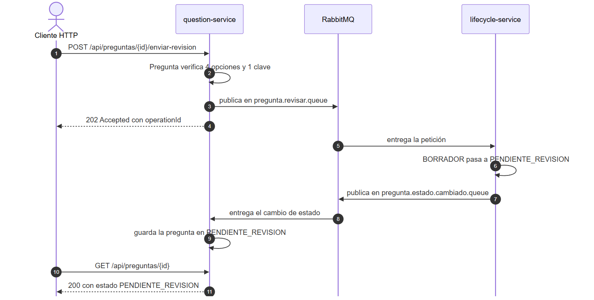

**Figura 1.** Secuencia del envío a revisión, de la petición HTTP al estado guardado.

### 6.2 Evidencias

Todo lo que sigue se hizo sobre los contenedores, sin ningún servicio corriendo fuera de Docker. Se arrancó desde cero con docker compose down -v
y después docker compose up -d --build.

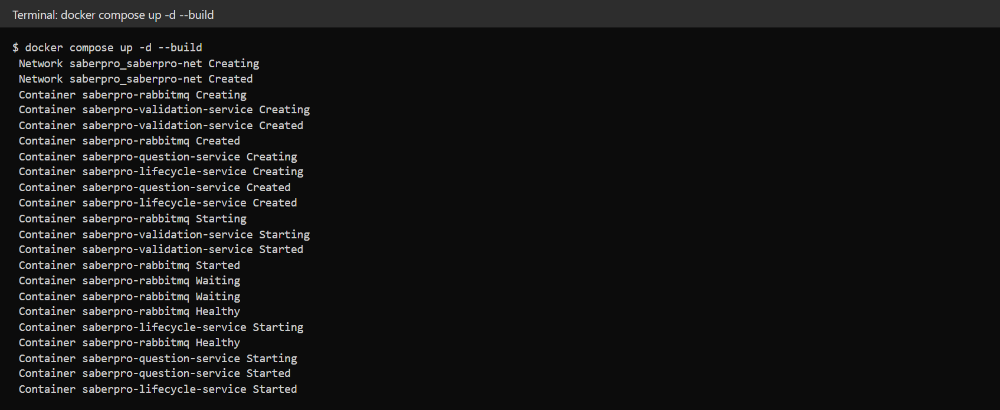

**Figura 2.** Salida de docker compose up -d --build: la red, los cuatro contenedores y RabbitMQ en estado Healthy antes de arrancar los servicios
que dependen de él.

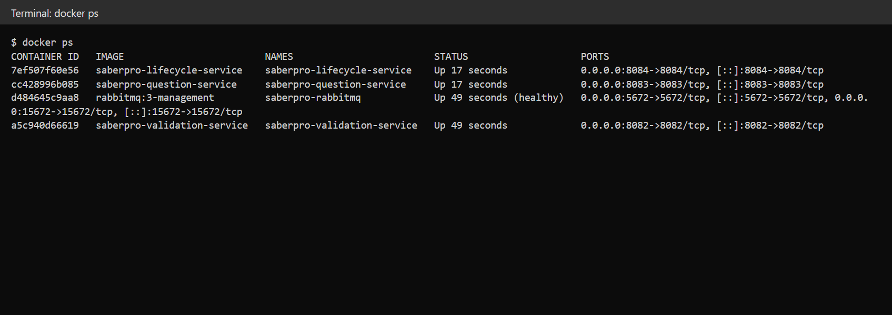

**Figura 3.** Los cuatro contenedores en ejecución, con sus puertos publicados.

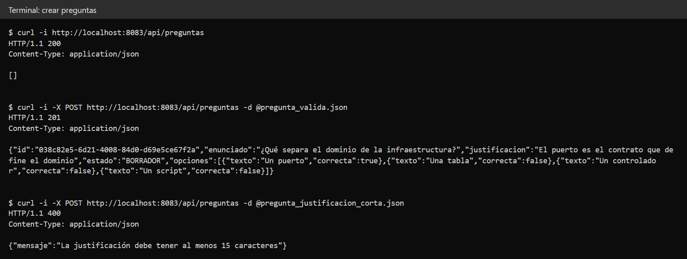

**Figura 4.** GET de la lista vacía (200), creación de una pregunta válida (201, en BORRADOR) y creación con una justificación corta (400). La
respuesta de la pregunta válida se recortó en la consola por el ancho, trae sus cuatro opciones.

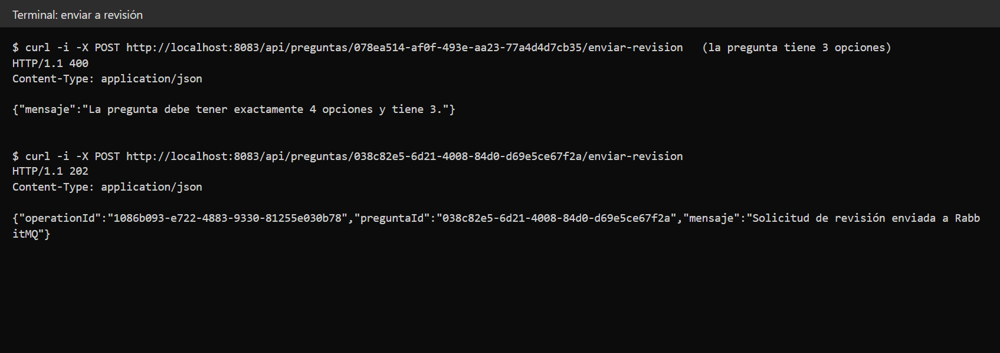

**Figura 5.** Enviar a revisión una pregunta que tiene 3 opciones devuelve 400, y una completa devuelve 202 con un operationId.

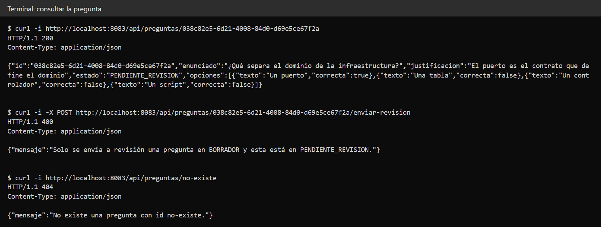

**Figura 6.** Pocos segundos después de enviar, la pregunta ya está en PENDIENTE_REVISION. Enviarla otra vez devuelve 400 y una pregunta que no existe
devuelve 404.

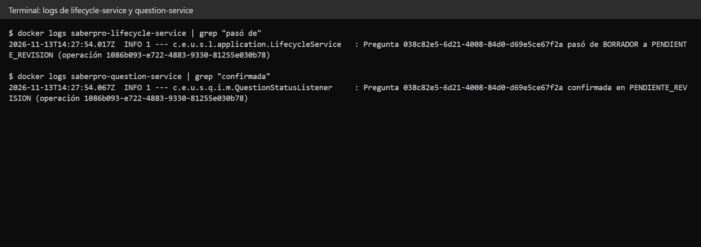

**Figura 7.** Los logs de lifecycle-service y de question-service muestran el mismo operationId que devolvió la API: el cambio de estado se hizo en
uno y se confirmó en el otro.

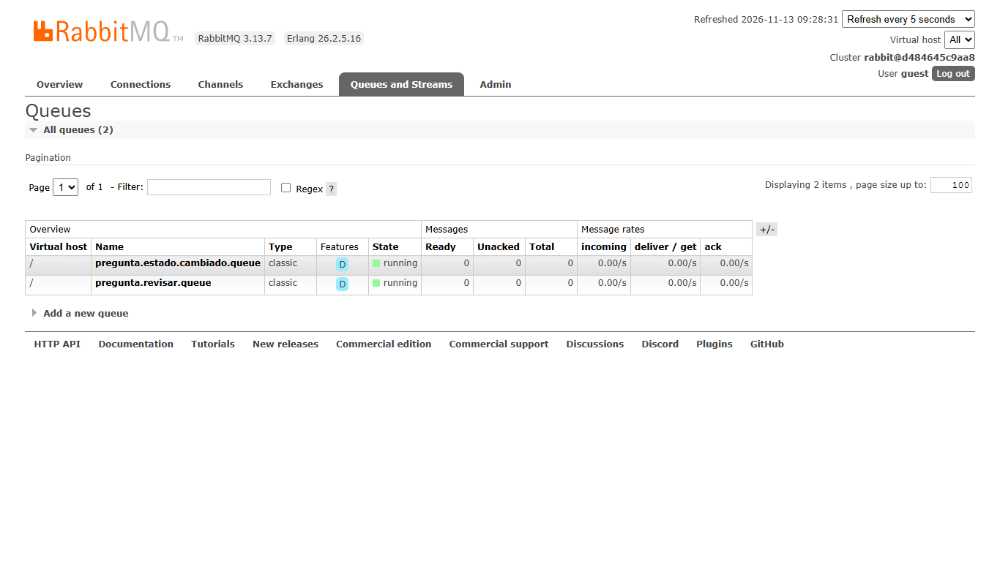

**Figura 8.** Las dos colas durables en el panel de RabbitMQ, sin mensajes pendientes porque se consumieron al instante.

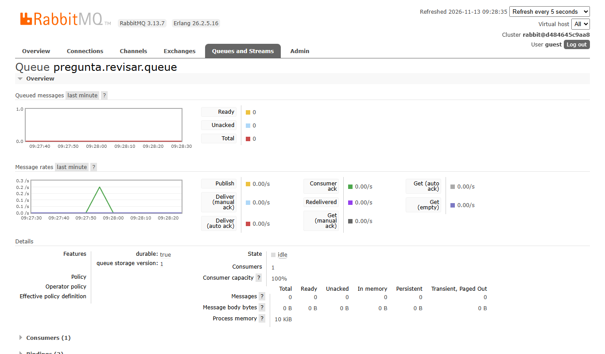

**Figura 9.** La cola pregunta.revisar.queue tiene un consumidor, que es lifecycle-service. En la gráfica de tasas se ve el mensaje que se publicó
y se confirmó.

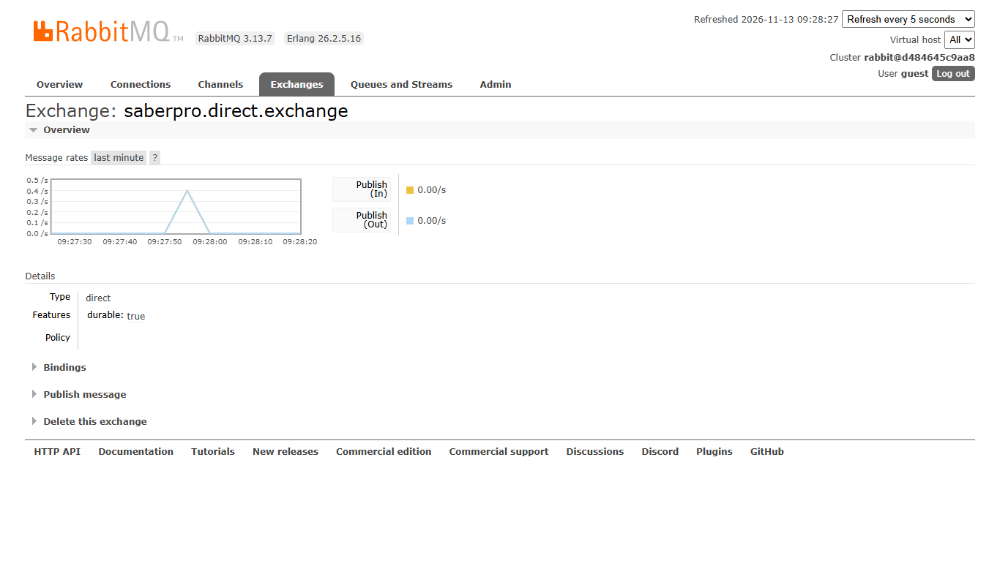

**Figura 10.** El exchange saberpro.direct.exchange es de tipo direct y durable.

**Tabla 7.** Respuestas del recorrido sobre contenedores.

| Petición | Respuesta | Qué pasa |
|---|---|---|
| GET /api/preguntas | 200 | Lista vacía al arrancar |
| POST /api/preguntas con una pregunta válida | 201 | Valida por REST, guarda en BORRADOR |
| POST /api/preguntas con justificación corta | 400 | validation-service la rechaza y no se guarda nada |
| POST .../enviar-revision de una pregunta con 3 opciones | 400 | Pregunta no cumple la regla de 4 opciones y no se publica nada |
| POST .../enviar-revision de una pregunta completa | 202 | Se publica en RabbitMQ y se responde con un operationId |
| GET /api/preguntas/{id} unos segundos después | 200 | Estado PENDIENTE_REVISION, confirmado por lifecycle-service |
| POST .../enviar-revision otra vez | 400 | Ya no está en BORRADOR |
| GET /api/preguntas/no-existe | 404 | La pregunta no existe |

Si validation-service o RabbitMQ no responden, question-service devuelve 503. Eso lo cubren las pruebas y lo vimos una vez con el healthcheck
anterior, como se contó en la sección 5.2.

## 7. Prueba de intercambiabilidad

El experimento es el mismo del Taller 12, ahora dentro de Docker. El docker-compose.yml pasa la variable SABERPRO_PERSISTENCIA a question-service y
por defecto vale jpa. Para activar el adaptador en memoria se recrea solo ese contenedor:

```text
SABERPRO_PERSISTENCIA=memoria docker compose up -d question-service
```

Las figuras 4, 5 y 6 son con JpaQuestionAdapter. La figura 11 es el mismo recorrido con InMemoryQuestionAdapter: se ve la variable dentro del
contenedor, la lista vacía porque el almacén en memoria empieza sin nada, y después los mismos 201, 400, 202 y el estado PENDIENTE_REVISION. El
mensaje de cada respuesta es idéntico.

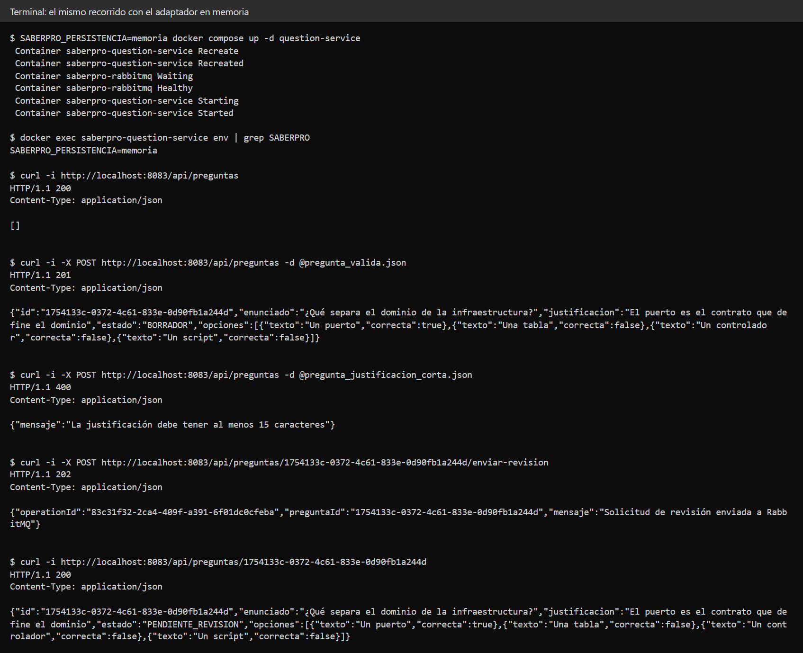

**Figura 11.** El mismo recorrido con el adaptador en memoria, dentro del contenedor de question-service.

Calculamos la huella SHA-256 de los 15 archivos del paquete domain de question-service después de las dos corridas y es 54bbb089151e7c56...,
la misma. No se modificó ningún archivo del dominio ni de la aplicación para cambiar de adaptador.

**Tabla 8.** Resultado de la prueba de intercambiabilidad.

| Comprobación | Con JpaQuestionAdapter | Con InMemoryQuestionAdapter |
|---|---|---|
| Crear una pregunta válida | 201 en BORRADOR | 201 en BORRADOR |
| Justificación de menos de 15 caracteres | 400 | 400 |
| Enviar una pregunta completa | 202 | 202 |
| Estado después de la confirmación | PENDIENTE_REVISION | PENDIENTE_REVISION |
| Pruebas de la API en la compilación | 9 de 9 | 9 de 9 |
| Pruebas del contrato del puerto | 6 de 6 | 6 de 6 |

## 8. Diagramas C4

Probamos primero con la sintaxis C4 de Mermaid y las etiquetas de las flechas se encimaban, así que dibujamos los diagramas con la notación C4
(persona, sistema, contenedor, componente, base de datos, cola y límite del sistema), en SVG y con una disposición propia, para que se lean sin
cruces. El nivel 4 es el diagrama de clases del dominio y de los puertos.

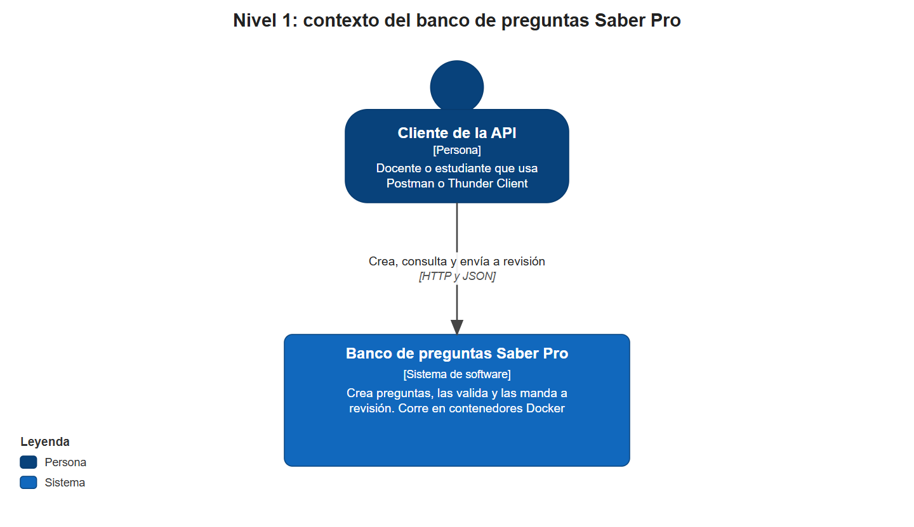

**Figura 12.** Nivel 1: el sistema y quien lo usa.

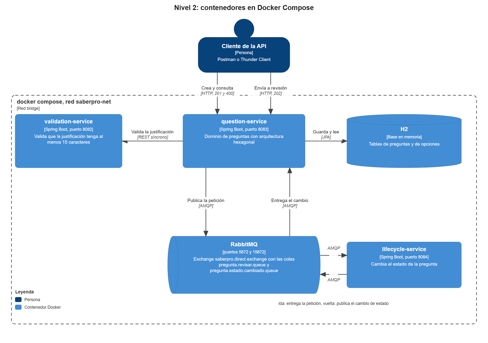

**Figura 13.** Nivel 2: los contenedores de Docker Compose y cómo se hablan.

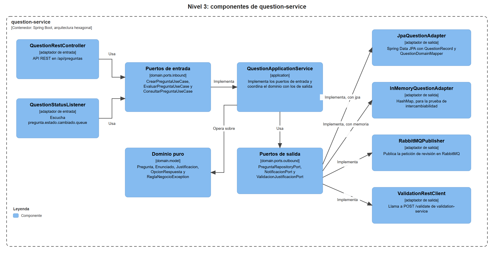

**Figura 14.** Nivel 3: los componentes de question-service, ordenados como hexágono. A la izquierda los adaptadores de entrada, en el medio los
puertos, la aplicación y el dominio, y a la derecha los adaptadores de salida.

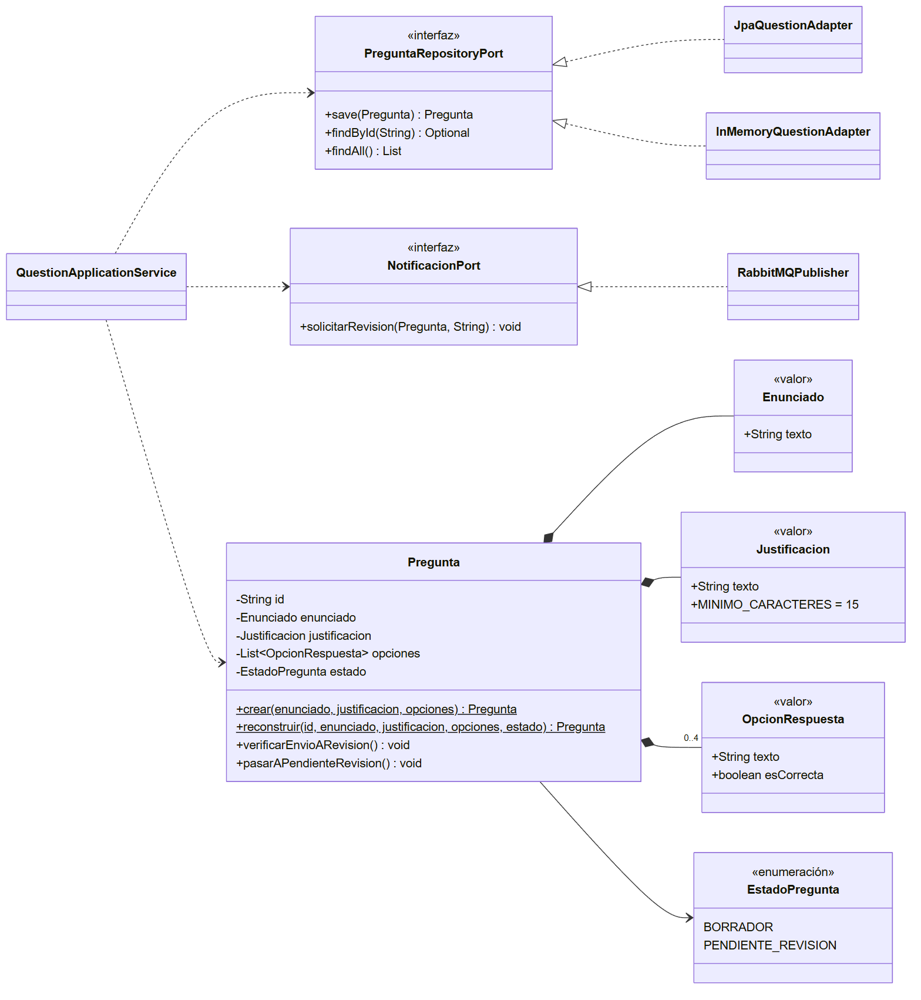

**Figura 15.** Nivel 4: las clases del dominio, los puertos de salida y los adaptadores que los implementan.

## 9. Pruebas

Son 100 pruebas con JUnit 5 repartidas en los tres servicios. Todas se ejecutan con mvn test dentro de la carpeta de cada servicio y no necesitan
Docker ni RabbitMQ: la mensajería y la validación se prueban con dobles o con simuladores.

**Tabla 9.** Pruebas por servicio.

| Servicio y clase de prueba | Pruebas | Qué comprueba |
|---|---|---|
| validation-service, JustificationRuleTest | 4 | La regla de los 15 caracteres, con 14 y 15 |
| validation-service, ValidationRestControllerTest | 2 | POST /validate con una justificación válida y una corta |
| lifecycle-service, LifecycleServiceTest | 4 | La transición, el evento publicado, el estado repetido y el desconocido |
| lifecycle-service, QuestionReviewListenerTest | 3 | Delega en el servicio y rechaza sin devolver a la cola lo que no se puede aplicar |
| question-service, ObjetosDeValorTest | 15 | Enunciado, Justificacion y OpcionRespuesta |
| question-service, PreguntaTest | 16 | Las invariantes, los dos pasos del cambio de estado, la lista inmutable y la reconstrucción |
| question-service, QuestionApplicationServiceTest | 11 | Los casos de uso con el adaptador en memoria y dobles de los otros puertos |
| question-service, JpaQuestionAdapterTest | 6 | El contrato del puerto contra H2 |
| question-service, InMemoryQuestionAdapterTest | 6 | El mismo contrato con el adaptador en memoria |
| question-service, QuestionDomainMapperTest | 1 | El mapeo de ida y vuelta entre Pregunta y QuestionRecord |
| question-service, RabbitMQPublisherTest | 3 | Qué publica, en qué exchange y con qué llave, y el 503 si RabbitMQ falla |
| question-service, QuestionStatusListenerTest | 3 | Confirma el estado y rechaza lo que no se puede aplicar |
| question-service, ValidationRestClientTest | 3 | La llamada a /validate, la respuesta negativa y el fallo del servicio |
| question-service, FlujoRestConJpaTest | 9 | El recorrido completo por la API con JPA |
| question-service, FlujoRestEnMemoriaTest | 9 | El mismo recorrido con el adaptador en memoria |
| question-service, HexagonoPuroTest | 5 | El dominio solo importa el JDK, la aplicación solo el dominio y el controlador solo los puertos |

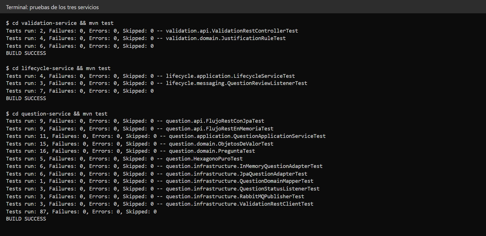

**Figura 16.** Resultado de mvn test en cada servicio.

La primera vez que corrimos las pruebas de question-service falló una: confirmarEstado con BORRADOR sobre una pregunta que ya estaba en BORRADOR
no lanzaba la excepción que la prueba esperaba. El error era de la prueba. Ese caso es el idempotente, que no hace nada. Lo imposible es volver a
BORRADOR desde PENDIENTE_REVISION, y esa es la prueba que quedó.

## 10. Cómo correr el proyecto

Hace falta Docker con Compose. No hace falta Java ni Maven, porque el jar se compila dentro de la imagen. Desde la carpeta
saberpro-banco-preguntas:

```text
docker compose up -d --build
docker ps
docker logs -f saberpro-question-service
docker compose down
```

El repositorio trae una colección de Postman con las 11 peticiones del recorrido, en postman/saberpro-taller13.postman_collection.json. El panel
de RabbitMQ está en http://localhost:15672 con el usuario guest y la clave guest.

## 11. Enlaces

**Tabla 10.** Enlaces del trabajo.

| Recurso | Dirección |
|---|---|
| Repositorio | https://github.com/DVLASZ/ingenieria-software-2 |
| Carpeta del taller | https://github.com/DVLASZ/ingenieria-software-2/tree/main/talleres/Taller-13-DDD-Hexagonal-Docker |
| Proyecto | https://github.com/DVLASZ/ingenieria-software-2/tree/main/talleres/Taller-13-DDD-Hexagonal-Docker/saberpro-banco-preguntas |
